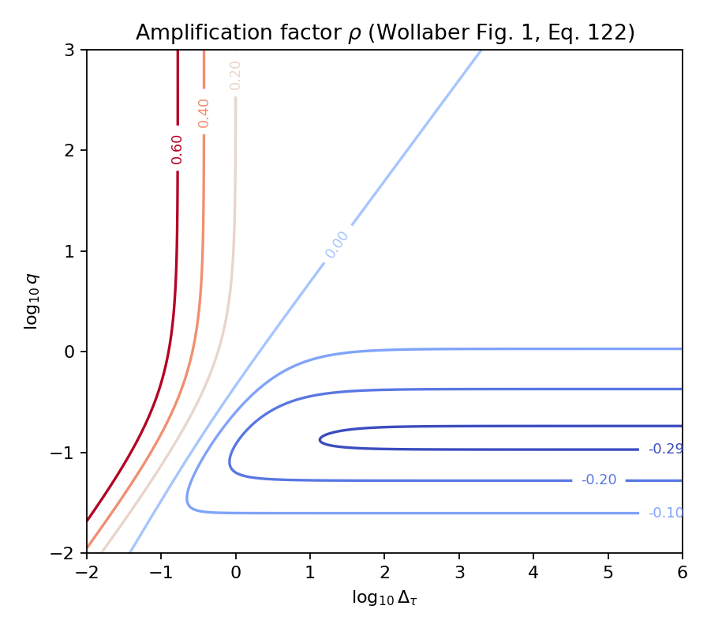
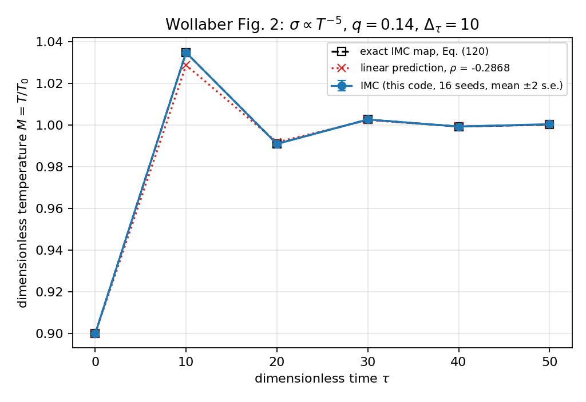
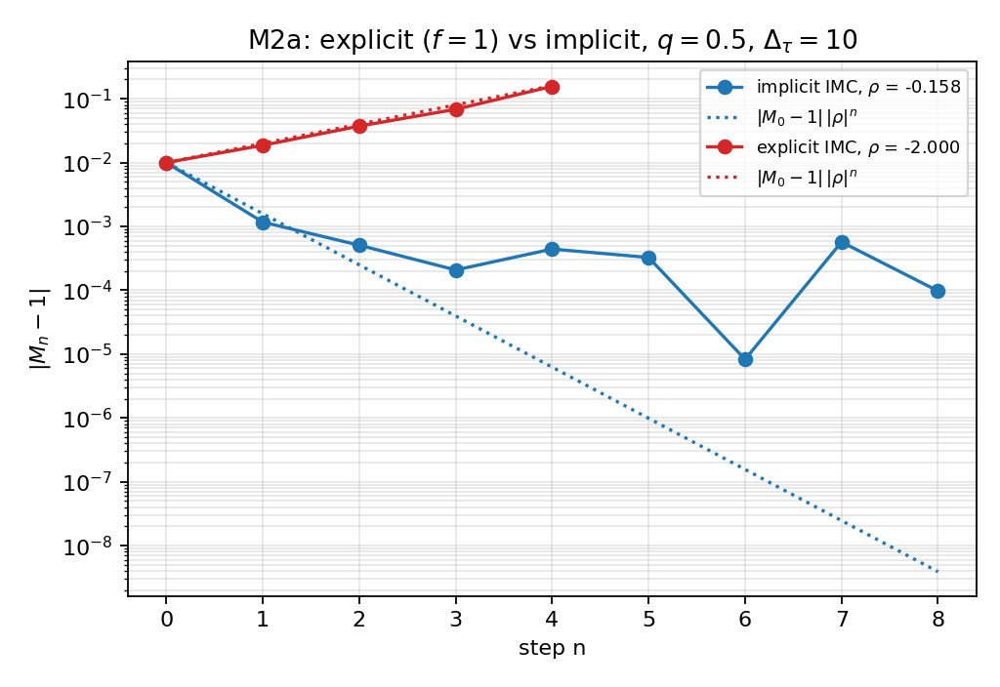

# `src/imc/problems/zero_d.py`: the 0-D IMC problem and Wollaber's Figs. 1–2

This driver runs the IMC solver (`src/imc/core/`) on the simplest nonlinear problem there is, an infinite homogeneous medium, and compares it with Wollaber's closed-form results (A. B. Wollaber, "Four Decades of Implicit Monte Carlo", *J. Comput. Theor. Transport* 45 (2016), §4.2.1). It covers plan milestones M2 (accuracy and stability of the time discretization) and M2a (the explicit scheme). Tests: `tests/imc/test_zero_d.py`.

```bash
uv run python -m imc.problems.zero_d                                   # numbers only
uv run python -m imc.problems.zero_d --figures md/imc_code/figures  # + the three figures
```

## 1. The physics

### 1.1 The problem

With no space dependence, gray transport plus the material reduce to two ODEs. Matter and radiation exchange energy by absorption and emission and nothing else, so their sum is conserved:

$$
\frac{dE_r}{dt} = c\sigma\,(aT^4 - E_r),\qquad \frac{du_m}{dt} = -c\sigma\,(aT^4 - E_r),\qquad u_m = c_v T,\qquad \sigma = \sigma_0 (T/T_0)^{-p}.
$$

Wollaber scales everything to an equilibrium temperature T₀:

| Scaled quantity | Definition | Meaning |
|---|---|---|
| q | aT₀³/c_v | radiation-to-material heat-capacity ratio (q = β/4 at T₀) |
| τ | q σ₀ c t | time in units of the material's absorption–emission relaxation time |
| M | T/T₀ | scaled temperature |
| φ | E_r/(aT₀⁴) | scaled radiation energy |

Energy conservation becomes **qφ + M = q + 1**, with equilibrium at φ = M = 1.

### 1.2 What one IMC step does here

IMC freezes σ and the Fleck factor at Mₙ and treats the fraction 1−f of absorptions as instantaneous re-emission (effective scattering). In 0-D, effective scattering changes nothing, because direction is irrelevant, so integrating the IMC transport equation over angle gives

$$
\frac{dE_r}{dt} = f c\sigma_n\,(u_{r,n} - E_r)\quad\Rightarrow\quad E_r(t) = u_{r,n} + (E_{r,n} - u_{r,n})\,e^{-f c\sigma_n (t-t_n)} .
$$

The material gains exactly what the radiation loses:

$$
u_m^{n+1} = u_m^n + (E_{r,n} - u_{r,n})\,(1 - e^{-x}),\qquad x = f c\sigma_n\Delta t .
$$

In scaled form: u_m = M/q, u_r,n = Mₙ⁴, cσΔt = Δτ/(q Mₙᵖ), the Fleck factor is

$$
f_n = \frac{1}{1 + 4\Delta_\tau M_n^{3-p}},
$$

and qφₙ = q + 1 − Mₙ. Substituting gives **Wollaber's Eq. (120)**:

$$
M_{n+1} = q + 1 - qM_n^4 + \left(M_n - q - 1 + qM_n^4\right)\exp\!\left(-\frac{f_n\Delta_\tau}{q M_n^p}\right).
$$

This is the *exact* solution of one IMC step, in the sense of the expected value of the random walk (Theorem 2 of `md/theory/imc_mc_derivation.md`). Any difference between the Monte Carlo M_{n+1} and Eq. (120) evaluated at the Monte Carlo Mₙ must therefore be pure noise. That is a sharp test of the whole solver.

### 1.3 Stability: Eq. (122)

Set Mₙ = 1 + εPₙ and linearize Eq. (120). Then P_{n+1} = ρPₙ with

$$
\rho = (1 + 4q)\,e^{-f_0\Delta_\tau/q} - 4q,\qquad f_0 = \frac{1}{1 + 4\Delta_\tau}.
$$

p drops out, as Wollaber shows. Three facts follow:

- **IMC is unconditionally stable:** |ρ| < 1 for every Δτ and q.
- **It oscillates when ρ < 0,** i.e. for large Δτ. As Δτ → ∞, f₀Δτ → 1/4, so ρ → (1+4q)e^{−1/(4q)} − 4q. Minimizing over q gives **ρ = −0.2984 at q ≈ 0.139**. Wollaber's Fig. 2 parameters (q = 0.14, Δτ = 10) were chosen near this worst case.
- **The explicit scheme** (f = 1: emission frozen at Tⁿ, all absorptions deposited) has ρ = (1+4q)e^{−Δτ/q} − 4q → −4q. It is **unstable for q > 1/4**, i.e. when the radiation's heat capacity is comparable to the material's (β = 4q > 1). This is md §1.10 in Wollaber's variables.

## 2. How the code sets this up

The core solver is unit-agnostic. `zero_d.py` uses units in which T₀ = 1, a = c = 1 and σ₀ = 1, so τ = q t and Δt = Δτ/q.

| Physics | Code |
|---|---|
| u_m = c_v T with c_v = 1/q | `PowerLawMaterial(f=1/q, beta=1, mu=1, ...)`. μ = 1 makes ρ^(1−μ) = 1 |
| σ = T^(−p) | `g=1, alpha=p, lam=0` with ρ = 1 |
| infinite medium | one cell, 1000 wide (`MESH`), reflecting walls on both sides, no bath |
| initial φ₀ | `uniform_radiation_particles(edges, φ₀, n, 0)` with φ₀ = (q+1−M₀)/q, which puts the run on qφ + M = q + 1 |

The cell is made wide so that histories rarely reach the walls. The walls reflect anyway, so nothing would change if they did; they only cost events. A unit test checks that the solver's Fleck factor equals Wollaber's fₙ (at M = 1, Δτ = 10: f = 1/41).

## 3. The functions

| Function | What it does |
|---|---|
| `material(p, q)` | the `PowerLawMaterial` of §2 |
| `fleck_factor(M, p, dtau, mode)` | Wollaber's fₙ = 1/(1+4ΔτM^(3−p)), or 1 for `"explicit"` |
| `exact_step(M, p, q, dtau, mode)` | Eq. (120): the expected IMC step from M. Works on arrays |
| `amplification(p, q, dtau, mode)` | Eq. (122): ρ. Works on arrays (used for Fig. 1) |
| `run(p, q, dtau, M0, n_steps, seed, mode, n_emission, n_initial, max_census)` | the actual Monte Carlo (details below). Returns the IMC trajectory M₀…Mₙ, the Eq. (120) prediction made from each Mₖ, and the global energy error per step |
| `exact_trajectory(p, q, dtau, M0, n)` | Eq. (120) iterated: the noise-free IMC trajectory |
| `figure_1(path)` | Wollaber Fig. 1 (below) |
| `figure_2(path, replicas)` | Wollaber Fig. 2 (below) |
| `figure_explicit(path, replicas, explicit_replicas)` | the M2a figure (below) |
| `main()` | prints the Fig. 2 case step by step, then the explicit and implicit runs at q = 0.5 |

`run(...)`, step by step:

1. Seed both random generators.
2. Create the initial census (φ₀, `n_initial` packets) and the state at M₀.
3. Per step:
   - record `exact_step(M_k)`;
   - call `stepper.imc_step` with Δt = Δτ/q. This computes σ and f at M_k, emits `n_emission` packets carrying f k_a c u_r Δx Δt, random-walks census plus emission to the step's end, updates u_m with deposition − emission, and inverts the EOS;
   - store the new M and the energy error.
4. If the census exceeds `max_census`, comb it.

## 4. Reproducing Wollaber's figures

### Fig. 1: contours of ρ(Δτ, q)

`figure_1` evaluates Eq. (122) on a grid of log₁₀Δτ ∈ [−2, 6] by log₁₀q ∈ [−2, 3] and draws the contours ρ ∈ {0.6, 0.4, 0.2, 0, −0.1, −0.2, −0.29}, as in his figure. It is a plot of a formula, so the check is visual. The test `test_amplification_factor` verifies the formula three ways:
- it matches his quoted value −0.2868;
- it equals the finite-difference derivative of Eq. (120) at equilibrium, for p = 3 and p = 5;
- |ρ| < 1 over Δτ ∈ [10⁻³, 10⁶] for several q.



### Fig. 2: damped oscillation, p = 5, q = 0.14, Δτ = 10, M₀ = 0.9

`figure_2` overlays three curves:
- **IMC:** `run(...)` for 16 seeds, plotted as mean ± 2 s.e.;
- **exact IMC map:** Eq. (120) iterated from M₀;
- **linear prediction:** 1 + (M₀ − 1)ρⁿ with ρ = −0.2868.

The IMC and the exact map coincide: 0.900 → 1.035 → 0.991 → 1.003 → 0.999 → 1.000. The linear prediction is slightly low on the first overshoot (1.029). That is Wollaber's remark that linear analysis "underpredicts the observed damped oscillations by a factor that is O(ε²)" for ε = 0.1. His figure shows the same 1.03 overshoot.



### M2a: explicit vs. implicit at q = 0.5, Δτ = 10

`figure_explicit` plots |Mₙ − 1| on a log scale, starting from M₀ = 0.99.
- **Explicit:** ρ = −2.000, and the deviation doubles every step, following |M₀−1|·2ⁿ.
- **Implicit:** ρ = −0.158. The deviation drops by about ρ in the first step, then flattens at the Monte Carlo noise floor (~10⁻⁴) instead of continuing down the dotted line.

Explicit steps are **about 11× noisier**: a per-step spread of 0.0095 vs. 0.00085 at 20 000 packets. Each explicit step emits and reabsorbs cσΔt = Δτ/q = 20 times the material energy, which is the advisor's "explicit is very noisy". The figure therefore uses 64 explicit replicas. With 96 replicas the explicit step is unbiased: the mean of M₁ is 1.0206 vs. Eq. (120)'s 1.0197, z = +0.57. Run longer, the explicit scheme ends with the emission exceeding the material energy, and the stepper raises `RuntimeError` (non-positive u_m). That is where Proposition 1's positivity guarantee, which needs f < 1, fails.



## 5. What the tests check (`tests/imc/test_zero_d.py`)

| Test | Check |
|---|---|
| `test_each_step_matches_wollaber_eq_120` | For (p, q, Δτ) = (5, 0.14, 10), (3, 0.14, 10), (5, 0.5, 1) and explicit (5, 0.5, 10): over 12 seeds, the mean of M_{n+1} − Eq.(120)(Mₙ) is within 3.5 s.e. at every step. Energy error < 10⁻¹², or < 10⁻¹⁰ for explicit, whose round-off scales with the 20× energy it cycles |
| `test_fig2_damped_oscillation` | first overshoot in (1.03, 1.04), alternating signs, shrinking amplitude |
| `test_amplification_factor` | the three checks listed under Fig. 1, and ρ_explicit → −2 at q = 0.5 |
| `test_explicit_diverges_where_implicit_is_stable` | after 4 explicit steps the deviation has grown > 6×; after 5 implicit steps it has shrunk < 0.5× |
| `test_explicit_ends_with_negative_material_energy` | explicit q = 0.5 raises the non-positive-energy error within 30 steps |
| `test_implicit_never_loses_positivity` | implicit stays above 0.9 for 30 steps at the same parameters |

## 6. What is not reproduced

Wollaber's Figs. 3–5 are spatial: maximum-principle violations in a Marshak wave, the onset curve, and the teleportation illustration. They need the 1-D slab with a bath, and they belong to milestones M4 and M8, so they are not reproduced here.
