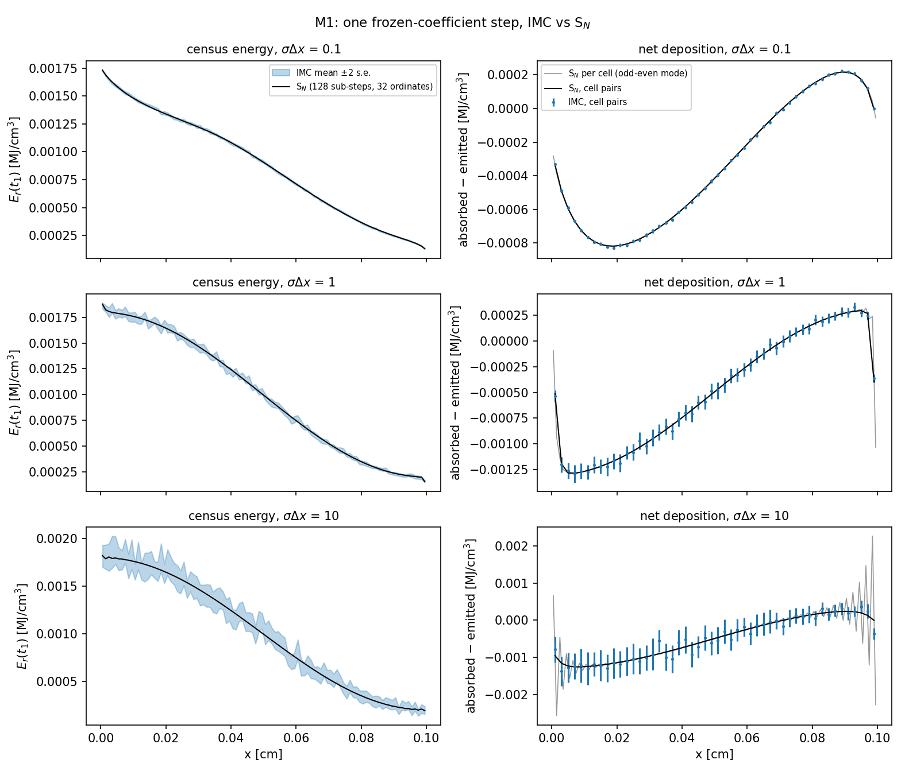

# `src/imc/problems/linear_step.py`: one linear IMC step against S_N

This driver checks the central claim of `md/imc_mc_derivation.md`: over one time step with frozen coefficients, the *mean* of the IMC random walk is the exact solution of the linear Fleck–Cummings equation (Theorem 2). The comparison is a deterministic solution of the same equation by the S_N twin, `src/sn/sn.py`. This is plan milestone M1. Test: `tests/imc/test_linear_vs_sn.py`.

```bash
uv run python -m imc.problems.linear_step                                                     # table
uv run python -m imc.problems.linear_step --figure md/figures/imc_problems/m1_linear_step_vs_sn.png
```

## 1. The physics

Freeze the opacity σ, the Fleck factor f and the emission source B = aT⁴ in each cell. One step then solves the **linear** transport equation, (T) in the derivation:

$$
\frac{1}{c}\frac{\partial\psi}{\partial t} + \mu\frac{\partial\psi}{\partial x} + \sigma\psi = (1-f)\,\sigma\,\phi + f\sigma\,cB,\qquad \phi = \tfrac12\int_{-1}^{1}\psi\,d\mu = cE_r,
$$

The terms, read left to right:
- streaming at speed c;
- loss by collisions;
- effective scattering, the fraction 1−f of absorptions treated as instantaneous re-emission;
- effective emission f σ c B.

The step starts from a census, carries an isotropic blackbody bath on the left, has vacuum on the right, and runs to t₁. Nothing is updated in the material: the point is to test the transport solve alone.

**The test problem** (`make_problem(sigma_dx)`), on the S_N module's fixed grid of 100 cells, L = 0.1 cm (cm, ns, MJ):

| Quantity | Value | Why |
|---|---|---|
| σ | uniform, σΔx ∈ {0.1, 1, 10} | thin, intermediate and thick cells |
| f | 0.3 → 0.9 linearly in x | so that effective scattering varies |
| B | 10⁻³·(1 + 0.8 cos πx/L) | an emission source that varies |
| initial E_r | 5×10⁻⁴, isotropic | tests census in as well as census out |
| bath | F_inc = c·(2×10⁻³)/4, i.e. a blackbody with aT⁴ = 2×10⁻³ | the incident flux |
| Δt | 10⁻³ ns, so cΔt = 0.03 cm = 0.3 L | packets cross a third of the slab |

**Why the two methods should agree, and how they differ.**
- **IMC** solves the equation exactly in space, angle and time. Its only error is statistical.
- **S_N** (`sn.transport_step`) uses backward Euler in time, discrete ordinates in angle, and diamond difference in space with a set-to-zero fixup, converged by source iteration. Its errors are deterministic. To make the time and angle errors small it is sub-stepped: 128 backward-Euler sub-steps of Δt/128 with the *same* frozen f (f was computed for the full Δt and is part of the equation, not of the time discretization), and 32 double-Gauss ordinates. Comparing against 64 sub-steps with 16 ordinates estimates those errors. The S_N spatial grid is a module constant, so its spatial error cannot be estimated this way.

## 2. The functions

| Function | What it does |
|---|---|
| `LinearProblem` | frozen data: `sigma`, `fleck`, `B` per cell; `E0`, `F_inc`, `dt` |
| `make_problem(sigma_dx, dt)` | builds the problem in the table above |
| `sn_solution(prob, n_sub, n_mu)` | starts from ψ = cE₀ on every ordinate and applies `sn.transport_step` n_sub times with h = Δt/n_sub. Accumulates the net deposition (absorbed − emitted, per volume) and the leakage (outgoing current × h). Returns `E` = φ/c at t₁, `net_dep`, `leak_l`, `leak_r` |
| `imc_solution(prob, seed, n_census, n_emission, n_bath)` | one IMC step built by hand, because the coefficients are frozen rather than computed from a temperature (details below) |
| `compare(sigma_dx, replicas, n_sub, n_mu)` | runs S_N at (2·n_sub, 2·n_mu) as the reference and at (n_sub, n_mu) for the error estimate, plus `replicas` independent IMC seeds. For each quantity returns the IMC mean, its standard error, the S_N value, the S_N error estimate, and z = (IMC − S_N)/(s.e. + S_N error) |
| `main()` | prints, for each σΔx, the largest difference, the typical s.e. and S_N error, and the fraction of cells with |z| ≤ 3 |
| `figure(path, replicas)` | the 3×2 figure below |

`imc_solution(...)`, step by step:

1. **Census:** 200 isotropic packets per cell carrying E₀Δx (`uniform_radiation_particles`).
2. **Emission:** E_j = f_j σ_j c B_j Δx Δt, spread over 200 000 packets (`allocate_emission`, `emission_particles`).
3. **Bath:** F_inc·Δt in 100 000 packets at x = 0, with μ density 2μ and uniform birth times (the bath is constant).
4. **Transport:** one call of `transport.transport_step` with k_a = σ, k_s = 0 and the frozen f.
5. **Outputs:**
   - census energy per cell divided by Δx (= E_r at t₁);
   - (deposited − emitted)/Δx (net deposition, comparable to S_N's);
   - leakage at both faces.

## 3. Results

Measured with 32 IMC seeds:

| σΔx | Census energy E_r(t₁) | Net deposition | Leakage |
|---|---|---|---|
| 0.1 | agrees cell by cell | agrees cell by cell | agrees |
| 1 | agrees cell by cell | S_N oscillates odd–even; cell-pair sums agree (max \|z\| = 1.8) | agrees |
| 10 | agrees cell by cell | pair sums agree in the interior; the two boundary pairs differ | agrees |



How to read the figure:
- **Left column:** census energy, with the IMC band (±2 s.e.) and the S_N line. They overlap at all three thicknesses. The band widens at σΔx = 10 because each packet travels only ~1 mean free path before it is absorbed or scattered.
- **Right column, gray:** S_N's per-cell net deposition zig-zags from cell to cell at σΔx ≥ 1. Diamond difference couples the two half-cells only through the cell average, so in thick cells it supports an odd–even ("checkerboard") mode that a smooth source excites at the boundaries. This is an S_N spatial artifact, not physics.
- **Right column, black and blue:** summing adjacent cells cancels that mode. The S_N pair sums (black) then follow the IMC pair sums (blue).
- **σΔx = 10, both ends:** the last pair differs: S_N gives about −1.4×10⁻⁵ against IMC's −7×10⁻⁴. The bath and vacuum boundary layers are 1/σ = 0.1 cell thick. Diamond difference with the set-to-zero fixup cannot represent a layer that thin, while IMC resolves it naturally because it has no spatial grid for the radiation. Mid-slab disagreements seen with one seed set (z ≈ 4.7) disappeared with fresh seeds, so they were fluctuations.

## 4. What the test checks (`tests/imc/test_linear_vs_sn.py`)

For each σΔx ∈ {0.1, 1, 10}, with 32 seeds:
- census energy: at least 97% of cells have |z| ≤ 3;
- net deposition on **cell pairs**: at least 95% of pairs have |z| ≤ 3;
- each face's leakage: |z| ≤ 3.

At σΔx = 10 the cell and pair checks cover only the interior (cells 5–89, pairs 3–44), because S_N's own boundary-layer error there is real and not estimated. The criteria come from the exploration above, and the reasons are in the test's docstring.

## 5. Why this matters for later milestones

It is the numerical form of Theorem 2: the random walk, with its sources, collision rule, face handling and census, solves the frozen-coefficient equation without bias. It also shows something for Phase B. In thick cells a deterministic solver's spatial scheme makes artifacts (odd–even modes, unresolved boundary layers) that IMC doesn't have. Expect the same kind of disagreement between IMC and the diffusion code near the bath and at the Marshak front.
