# C–D. The start-up: an early drive error, frozen into the entropy (Test 3 and every cold start)

Elaborates causes C and D of the [README](README.md). Test 3 = gold, ω = +0.5, T_s = 1 HeV, paper bath, to 2 ns. "Entropy" = p/ρ^γ, γ = 1.25. **1T** = `force_black="conduction"` (one temperature, the solver's own equation); **2T** = gray diffusion with separate T_m, T_rad. Run names and settings: [06_runs.md](06_runs.md).

---

## 1. The symptom, and why it is a record

From the cold start the shocked region below ~30 mg/cm² has the solver's pressure, velocity and temperature, but the wrong density (2T, old mesh, 300 K: ρ/ρ_solver = 0.40 at 2 mg/cm², 0.94 beyond 30). IMC misses by a different amount (0.59).

**The entropy memory.**
1. The shocked region is adiabatic. It is cold (~0.1 eV) and opaque (τ > 10³), and no radiation moves energy inside it ([05_shocked_region.md § 2](05_shocked_region.md): rad-hydro and hydro-only agree to 4×10⁻⁹). Each element's entropy changes by < 7×10⁻⁵ between 0.5 and 2 ns.
2. So each element keeps the entropy its shock gave it at t_s(m). For a strong shock that entropy is set by the shock pressure, which follows p_f over the preceding few t_s.
3. The region is nearly isobaric at p_f(t), so ρ = (p/s)^(1/γ). With the pressure right but s wrong, the density stays off by (s/s_solver)^(−1/γ) for the rest of the run, and so do x(m) and T.
4. Self-similarity makes early times weigh: m_s ∝ t^0.517. At 2 ns the matter shocked before 1 ps, 10 ps and 0.1 ns is 2%, 6.4% and 21% of the shocked mass. The ablation front always sits in the oldest matter, shocked at ≈ 3.6×10⁻⁵ t. On a log-mass axis this matter fills half the panel.

So **mass is a clock**:

| m [mg/cm²] | 1.5 | 3 | 5 | 12 | 20 | 50 | 100 | 200 |
|---|---|---|---|---|---|---|---|---|
| shocked at [ps] | 0.08 | 0.29 | 0.78 | 4.2 | 11 | 67 | 255 | 974 |
| ablated layer then, in old-mesh surface cells | 0.36 | 0.71 | 1.2 | 2.8 | 4.7 | 12 | 23 | |

Nothing in the shocked region can remove an error once written, and the late drive, however exact, only fixes the pressure. The shock itself recovers (shock mass 0.989 at 2 ns), because it is fed by the current drive. Test 3 shows this most because m_s/m_f ≈ 200 (≈ 13 in Tests 1–2).

## 2. Cause D: the surface is unresolved for the first picosecond

Until ~0.6 ps the ablated layer is thinner than one old surface cell (0.0216 mg/cm²). The first cell is heated as a block, and the early shock is overdriven: the front pressure is 1.69× the solver's at 0.03 ps in diffusion, 1.16× in IMC. Entropy over the solver's, frozen by 10 ps (old mesh, 300 K):

| m [mg/cm²] | 0.5 | 1 | 1.5 | 2 | 3 | 5 | 8 | 12 | 20 |
|---|---|---|---|---|---|---|---|---|---|
| diffusion, arithmetic face mean of D (the code's) | 8.08 | 4.98 | 3.78 | 3.14 | 2.46 | 1.93 | 1.55 | 1.33 | 1.14 |
| diffusion, harmonic face mean | | | 3.63 | | 2.11 | 1.43 | 0.95 | 0.66 | |
| IMC | | | 2.27 | | 1.57 | 1.32 | 1.16 | 1.05 | |
| graded mesh, first cell 4×10⁻⁴ mg/cm², 5% growth (30 K) | 1.56 | 1.29 | | 1.09 | 1.00 | 0.91 | 0.86 | 0.83 | 0.83 |
| graded mesh, first cell 1×10⁻⁴, 3% growth (30 K) | 1.51 | 1.24 | | 1.06 | 0.98 | 0.90 | 0.85 | 0.83 | 0.83 |

- **The IMC–diffusion difference is the face rule.** Changing only the face average of D (`radiation_step.HARMONIC_MEAN`) turns diffusion's overdrive into an underdrive, and the two rules bracket IMC. Transport cannot push more than the physical flux into a cold cell. It is not preheat of the shocked matter: nothing heats that matter after 10 ps. To set the flag, use `importlib.import_module("rad_hydro_sim.simulation.radiation_step")`, because the package `__init__` re-exports a function under the same name.
- **A graded mesh removes the excess** (`mesh="log_mass"`). The two graded meshes agree within 2–4%, so the old mesh's excess was a mesh error. What they share, the deficit of ~0.83, is cause C.

## 3. Cause C: matter and radiation out of equilibrium for ~0.1 ns

On the graded mesh, 2T, 30 K, the layer is resolved, but its matter lags the radiation.

**2T diffusion on the graded mesh, 30 K, χ = 1**: the two temperatures alone, density up to +16%.

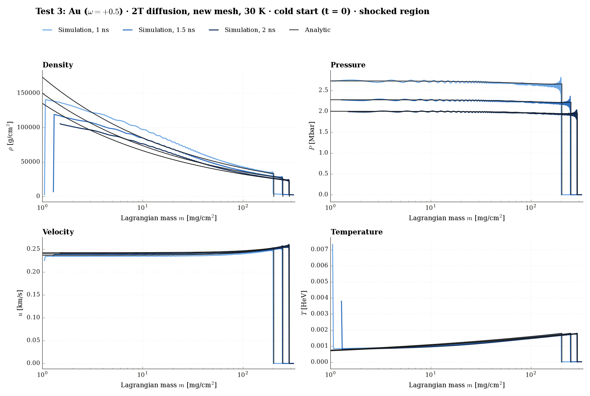

 This is the [01_surface_equilibrium.md § 2](01_surface_equilibrium.md) mechanism, at early times in gold. Over the solver's (2T, χ = 1):

| t | 0.01 ps | 0.1 ps | 1 ps | 3 ps | 10 ps | 30 ps | 0.1 ns | 0.3 ns | 1 ns | 2 ns |
|---|---|---|---|---|---|---|---|---|---|---|
| T_bath (paper) [HeV] | 2.12 | 1.71 | 1.41 | 1.30 | 1.21 | 1.15 | 1.10 | 1.06 | 1.04 | 1.03 |
| T_rad, first cell [HeV] | 1.75 | 1.41 | 1.17 | 1.09 | 1.04 | 1.01 | 1.00 | 1.00 | 1.00 | 1.00 |
| T_m, first cell [HeV]: 2T / IMC / χ = 100 | 0.38 / 0.38 / 0.82 | 0.45 / 0.46 / 0.93 | 0.55 / 0.56 / 0.98 | 0.62 / 0.63 / 0.99 | 0.70 / 0.71 / 0.99 | 0.78 / 0.79 / 1.00 | 0.87 / 0.88 / 1.00 | 0.93 / 0.94 | 0.97 | 0.98 |
| heat front mass | 3.47 | 2.23 | 1.49 | 1.27 | 1.11 | 1.03 | 0.996 | 0.986 | 0.985 | 0.986 |
| front pressure (dense side): 2T / IMC / χ = 100 | 1.26 / 1.15 / 1.12 | 0.93 / 0.92 / 0.99 | 0.85 / 0.82 / 1.02 | 0.86 / 0.82 / 1.03 | 0.89 / 0.87 / 1.03 | 0.95 / 0.93 / 1.01 | 0.99 / 0.97 / 1.01 | 1.01 / 1.00 | 1.01 | 1.00 |

- The bath is right for the *radiation* (on T_s from ~30 ps). The *matter* is at 0.4–0.7 HeV for 10 ps and still 13% low at 0.1 ns. IMC is the same within 0.01 HeV, so the lag belongs to the model (gold's coupling), not to the diffusion approximation.
- The sequence: cold, dense matter in the layer (T ×0.6–0.9, ρ ×1.1–1.5) → heat front ahead in mass (radiation streams through the thin layer) → front pressure first overdriven by the diverging bath, then 14–18% low at 0.3–5 ps, recovered by ~0.1 ns.
- **Why opaque gold does not equilibrate.** The layer has expanded to 0.04–6 g/cm³ at 5 ps, and there ℓ = 1/(κρ) ≈ 1.4×10⁻⁴ cm T_HeV^1.5 ρ^−1.2. One absorption takes ℓ/c ≈ 5 fs at 1 g/cm³, and the matter holds ~10³× the radiation's energy (3×10¹³ against 10¹⁰ erg/cm³), so equilibration takes ~5 ps, scaling as ρ^−0.34. A self-similar wave changes on its own age, so it lags for t ≲ 10× that, i.e. t/t_eq ≲ 1 ([01_surface_equilibrium.md § 2](01_surface_equilibrium.md)).

**The entropy remembers the pressure.** At 2 ns, 2T χ = 1:

| m [mg/cm²] | 3 | 12 | 20 | 50 | 100 | 200 |
|---|---|---|---|---|---|---|
| shocked at t_s [ps] | 0.29 | 4.2 | 11 | 67 | 255 | 974 |
| front pressure / solver's at t_s | 0.89 | 0.84 | 0.89 | 0.99 | 0.99 | 1.00 |
| entropy / solver's | 0.996 | 0.832 | 0.831 | 0.897 | 0.946 | 0.974 |

The entropy minimum follows the pressure minimum with a lag of a few t_s, the time sound needs to cross the shocked layer. A 15% pressure deficit gives about a 15% entropy deficit (γ = 1.25). Entropy 0.83 means density 1.16× the solver's. The four curves at 0.5–2 ns lie on each other. 

**The first picoseconds**: front pressure, heat front mass and shock mass over the solver's against time, and the surface temperature, for every cold start.

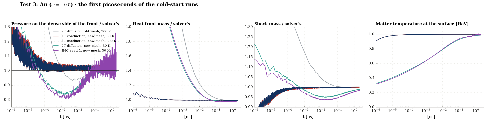

**The surface temperature against the bath** (2T, IMC, χ = 100):

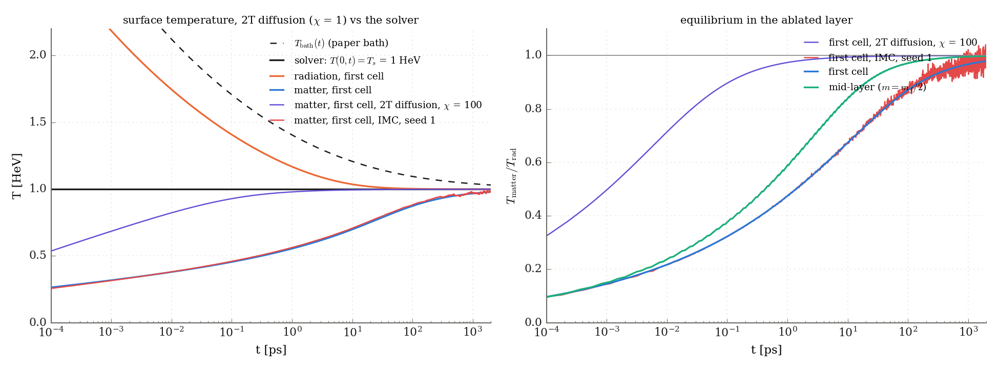

**The front against time** (heat front, front pressure, mid-layer ρ and T over the solver's):

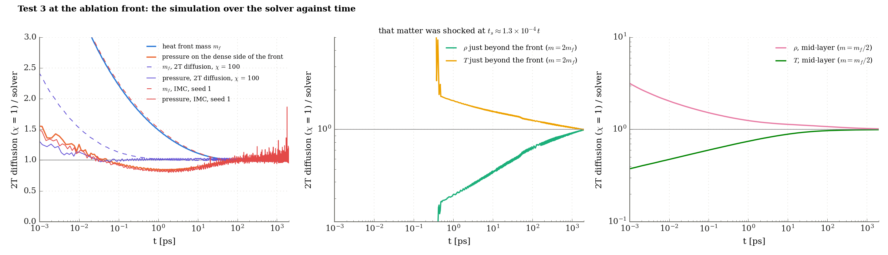

**The entropy remembers the drive.** Left: entropy over the solver's against mass, the shocking time on the top axis; the χ = 1 curves at 0.5–2 ns lie on each other, χ = 100 and 1T are within 1–3%. Right: the same against t_s, with the front pressure at that time.

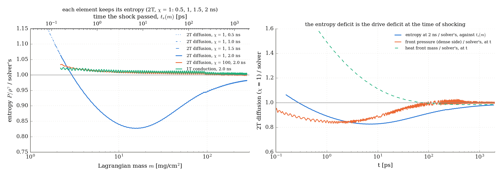

**It is the drive, not heat.** Pure hydro driven at m = 0 by the 2T run's own front pressure reproduces the deficit: entropy 0.85 against 0.83 at 12–20 mg/cm² ([05_shocked_region.md § 2](05_shocked_region.md)). Driven by the solver's pressure, it is on the solver within 0.5%. On the old mesh the same test gave only half the cold-start excess, because the stored pressure series is too sparse in the first 1.5 ps. That is also cause D.

## 4. The cure: make the matter follow the radiation, or skip the period

**Coupling factor χ** (`RadHydroCase.chi`, multiplying the absorption). Cold start, graded mesh, 30 K, entropy over the solver's at 2 ns:

| m [mg/cm²] | 2 | 3 | 5 | 8 | 12 | 20 | 50 | 100 | 200 | shock m | velocity | wall |
|---|---|---|---|---|---|---|---|---|---|---|---|---|
| 2T, χ = 1 | 1.088 | 0.996 | 0.910 | 0.856 | 0.832 | 0.831 | 0.897 | 0.946 | 0.974 | 0.989 | 0.992 | 21 min |
| 2T, χ = 10 | 1.109 | 1.032 | 0.972 | 0.955 | 0.959 | 0.971 | 0.991 | 0.997 | 0.999 | 0.997 | 0.998 | 21 |
| 2T, χ = 100 | 1.041 | 1.023 | 1.015 | 1.011 | 1.006 | 1.004 | 1.010 | 1.001 | 1.001 | 0.998 | 0.999 | 24 |
| 2T, χ = 1000 | 1.051 | 1.040 | 1.026 | 1.017 | 1.015 | 1.009 | 1.012 | 1.001 | 1.002 | 0.999 | 0.999 | 26 |
| **2T, χ = 100, finer surface mesh** | 1.009 | 1.000 | 0.998 | 1.000 | 1.001 | 1.002 | 1.005 | 1.003 | 1.000 | 0.998 | 0.9985 | 37 |
| 1T conduction | 1.023 | 1.017 | 1.013 | 1.010 | 1.011 | 1.007 | 1.013 | 1.003 | 1.005 | 0.999 | 1.0005 | 88 |
| IMC (3 seeds; no χ possible) | 1.044 | 0.965 | 0.882 | 0.825 | 0.798 | 0.789 | 0.855 | 0.917 | 0.963 | 0.983 | 0.987 | 104 |

- The deficit closes with χ. At χ = 100 the surface matter is at 0.94 HeV at 0.1 ps and the front pressure at 1 ps is 1.02. Energy is conserved to 3–6×10⁻¹⁴.
- The 1–3% excess below 5 mg/cm² at χ ≥ 100 is the surface mesh (first cell 4×10⁻⁴ mg/cm²). It disappears with 1×10⁻⁴ and 3% growth, giving **the closest run of all**: density 0.997 (0.979–1.017), entropy within 0.5% from 3 mg/cm² to the shock.
- χ > 1 changes the model, not the numerics. It is a device to reach the solver's χ → ∞ limit, not gold's coupling.
- IMC's material model needs χ ≤ 1, so for IMC the cure is to skip the period: the [analytic start](04_analytic_start.md).

**The χ scan.** Cold start, graded mesh, 30 K: χ = 1, 10, 100, 1000, χ = 100 on the finer surface mesh (dashed), the 1T run, IMC (3 seeds) and the solver, at 2 ns. Numbers: [chi_table.md](../../results/misalignment/test3_on_the_solver/figures/chi_table.md).

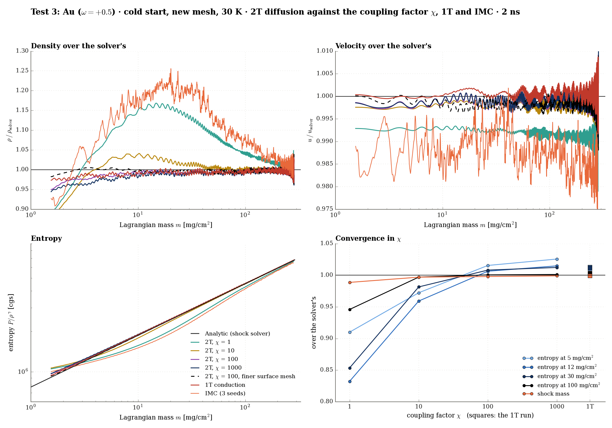

**The closest run: 2T at χ = 100 on the finer surface mesh.** Shocked region, then the whole domain.

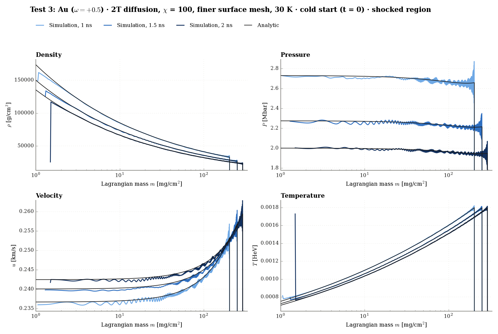

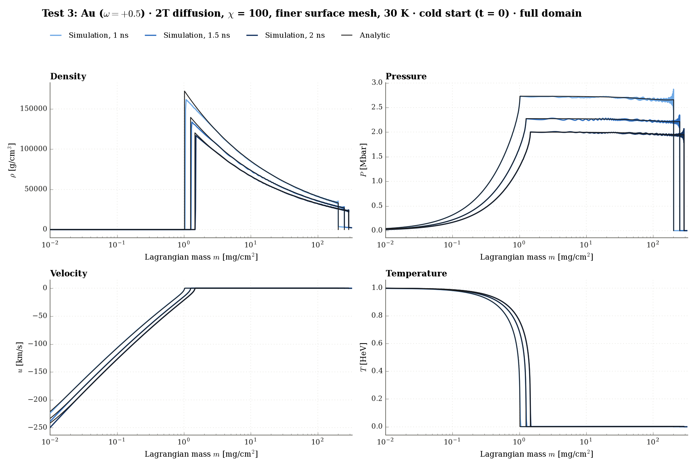

**The solver's own equation: 1T conduction, graded mesh, 30 K.** Shocked region, then the whole domain.

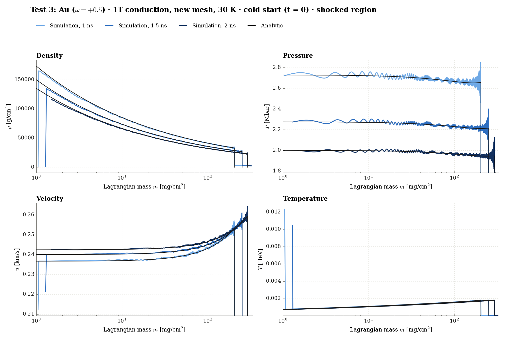

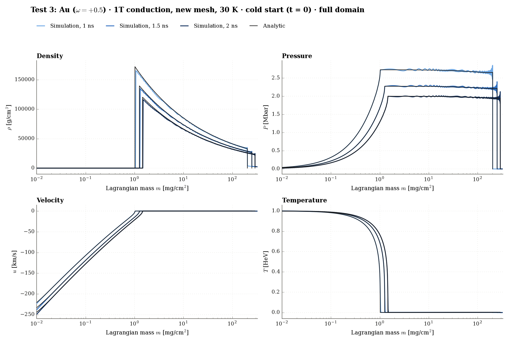

**IMC from the cold start (seed 1)**: the two-temperature deficit, a little deeper than 2T's.

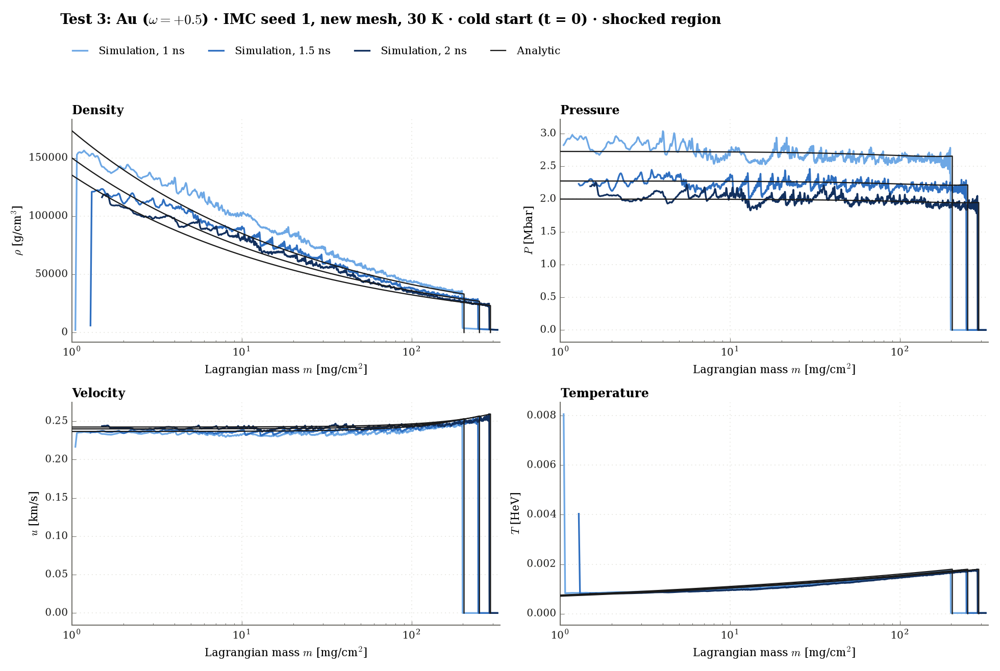

**All cold starts together.** Shocked region at 1, 1.5 and 2 ns: density, pressure and velocity over the solver's, and the entropy against the solver's curve. Grey and orange are the runs before this work (2T and IMC on the old mesh at 300 K); black is the solver.

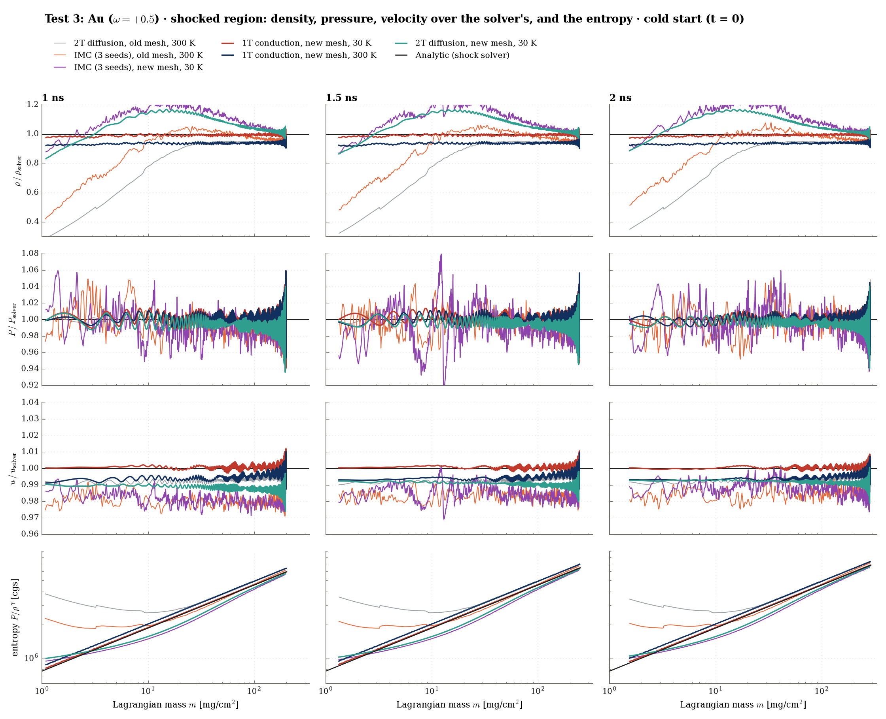

**Entropy at 2 ns** against the solver's, and each element's change between 1 and 2 ns (it does not change: the flow is adiabatic).

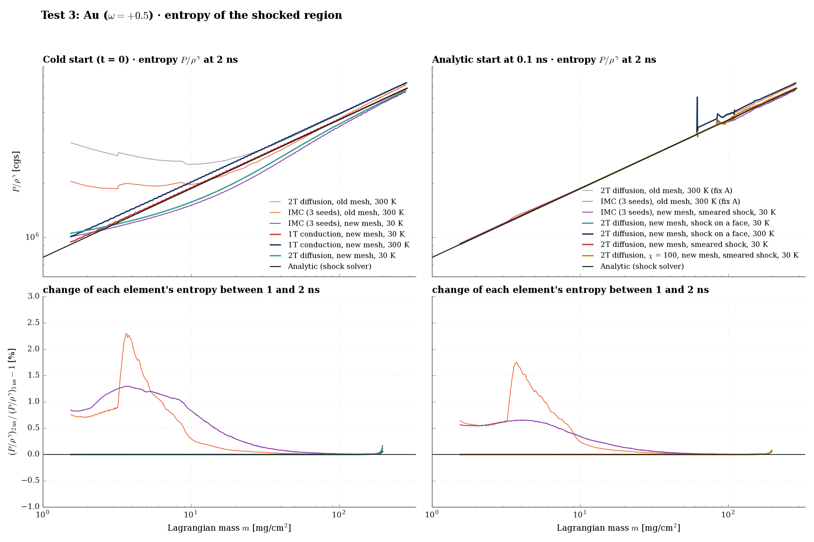

## 5. Does ω matter? No

Hypothesis (15 Nov): a flatter target (ω → 0.05) would equilibrate faster. Test: the same cold start for ω = 0.5, 0.4, 0.3, 0.2, 0.1, 0.05 (IMC 3 seeds and 2T χ = 1, 30 K, to 1 ns, each against its own solver; `test3_omega_scan.py`).

- **At equal shocking time the deficit changes by ≤ 3%**, and in the wrong direction: element shocked at 0.5 ns, 2T, 0.963 at ω = 0.5 against 0.936 at ω = 0.05. IMC is 4–5 points deeper than 2T at every ω. The shock lags a little more at low ω (2T 0.984 → 0.968).
- **Why.** In mass coordinates the heat-wave equations do not contain ρ₀(m). The layer's density is set by p/T, not by the target. The solver's m_f (1.019 mg/cm² at 1 ns), p_f (2.73 Mbar) and 𝒯 are identical for every ω, and so is the measured surface T_m(t) (IMC 0.635–0.646 HeV at 1 ps, 0.987–0.994 at 1 ns, for all ω). ω enters only through the shock. It decides *how much* mass records the early phase (0.1^a of the 1 ns mass with m_s ∝ t^a: 30% at ω = 0.5, 18% at 0.05), not how bad the phase is.
- **Not explained:** the dense-side front pressure in the first 0.1 ns differs with ω (0.88 at 10 ps for ω = 0.5, 1.17–1.23 for ω = 0.05), yet the entropy does not. At low ω the shock is only 15 front masses ahead, so this sampled pressure is probably not what the shock feels. This was not checked.

**Entropy over the solver's for all ω on one axis**, against m/m_shock and against the shocking time; the deficit and the shock mass against ω. (A ratio, because the absolute entropies of different ω differ by four orders of magnitude.)

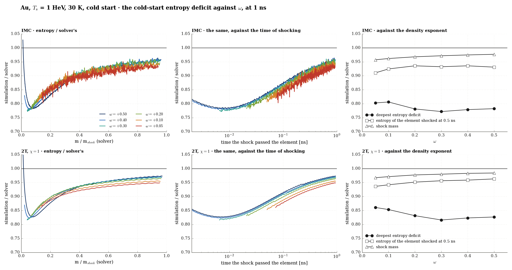

**The ablated layer against time**: front pressure and heat front over the solver's, and the surface matter temperature, the same curve for every ω.

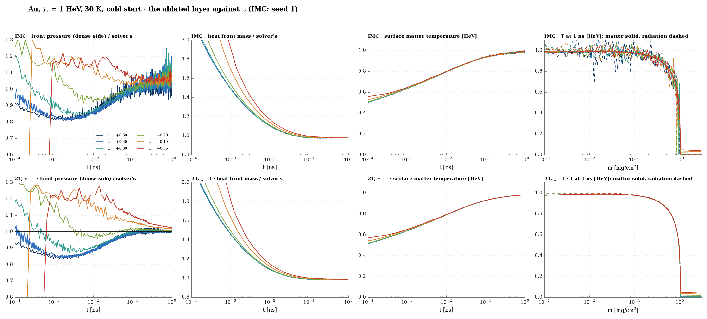

**Per ω**: IMC and 2T entropy against the solver's, one panel each. Tables: [table.md](../../results/misalignment/test3_omega_scan/figures/table.md).

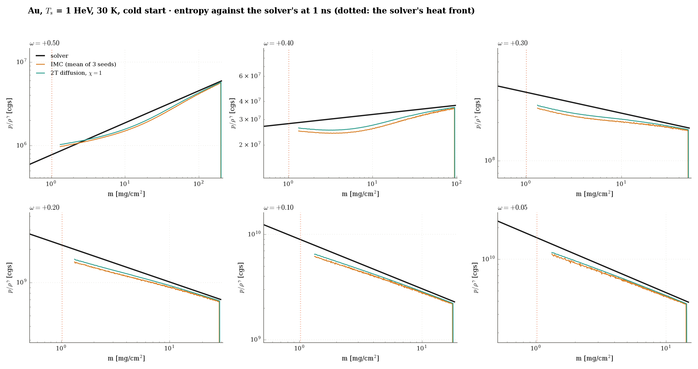

## 6. For the paper

> In the shocked layer the flow is adiabatic: the matter beyond the ablation front is cold and optically thick, and every Lagrangian element keeps the entropy it acquired at the shock. Since m_s ∝ t^0.52, the material shocked during the first 0.1 ns forms ~20% of the shocked mass at 2 ns, and the ablation front always moves into the matter shocked earliest. At these early times the ablated plasma is optically thin (its optical depth grows as t^0.41 and reaches unity at ~10 ps, independently of ω), so each photon has few chances to be absorbed; with gold's matter–radiation coupling the matter lags the radiation (T_m ≈ 0.4–0.7 T_s at the surface in the first 10 ps) and the ablation pressure falls 15% short of the self-similar value. The resulting entropy deficit (up to 17%) is advected with the mass and cannot relax, so the density profile of the shocked region differs from the self-similar one at all later times, although the pressure, the front positions and the surface temperature have converged to it.

The self-similar solution is valid for t ≫ t_*, with t/t_eq(t_*) = 1 on its own profile (t_* ≈ 10 ps for Test 3).

## 7. Open

- The lag between the pressure and the entropy is described, not derived. A linearised PistonShock with a time-dependent drive would give it.
- The 1T run was not repeated on the finer surface mesh, and its energy conservation is not measured (the budget does not record the conduction mode's surface flux).
- The 1T heat front is 0.8% behind the solver's in every run, and the 2T velocity is 0.8% low at 30 K (1T: 1.000). Neither is investigated.
- The transparency is the same for every ω, so it alone does not say why Test 3 shows the imprint more than Test 1. The answer is in the shock's mass distribution (§ 1), not in the layer.
