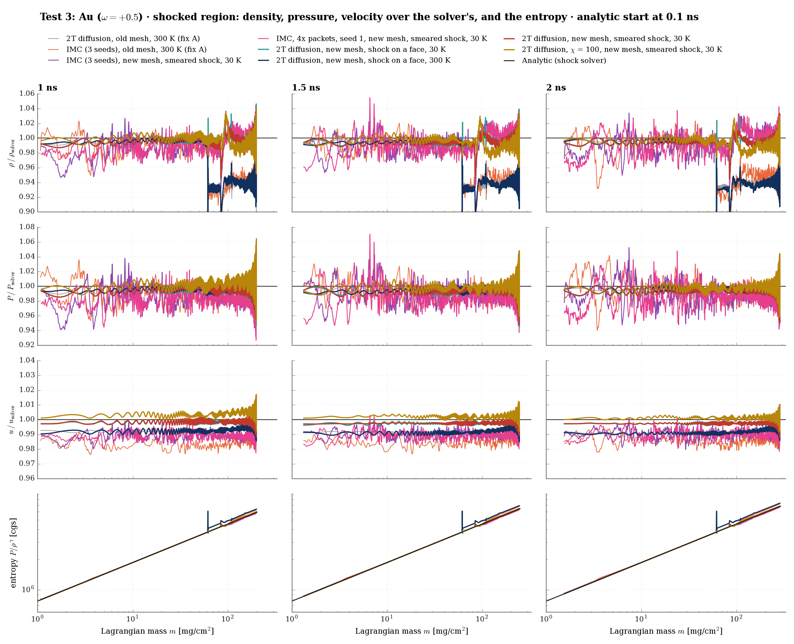
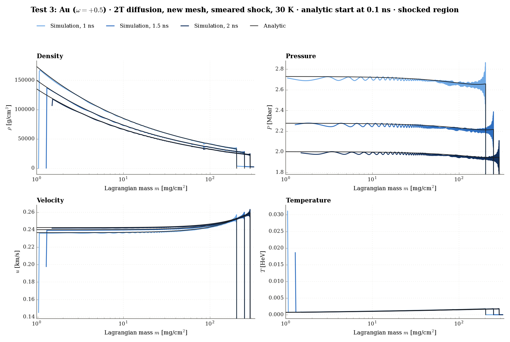
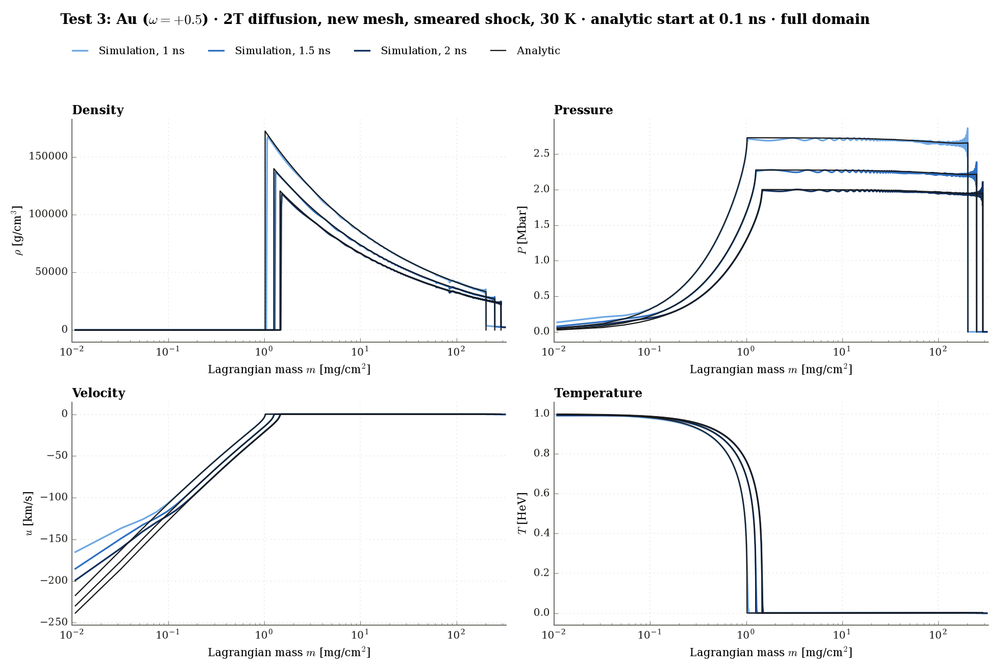
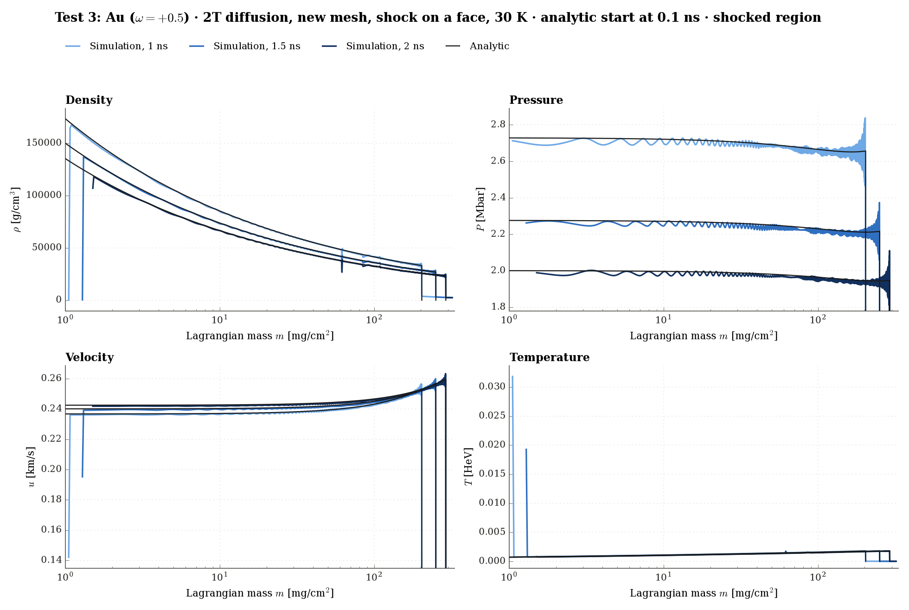
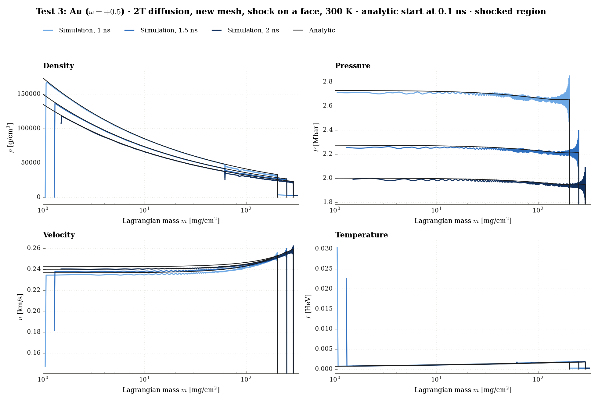
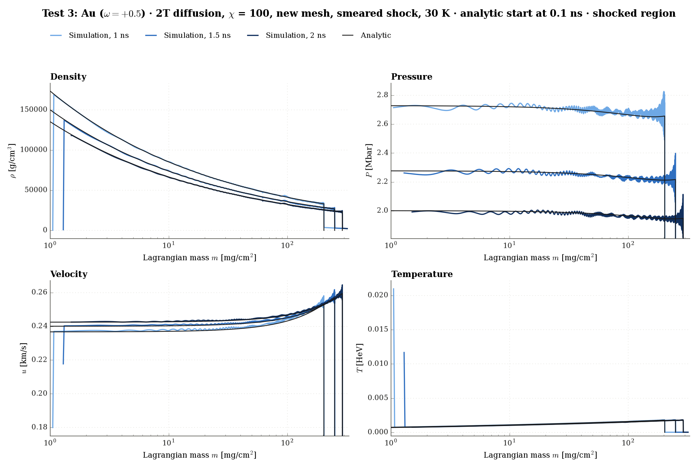
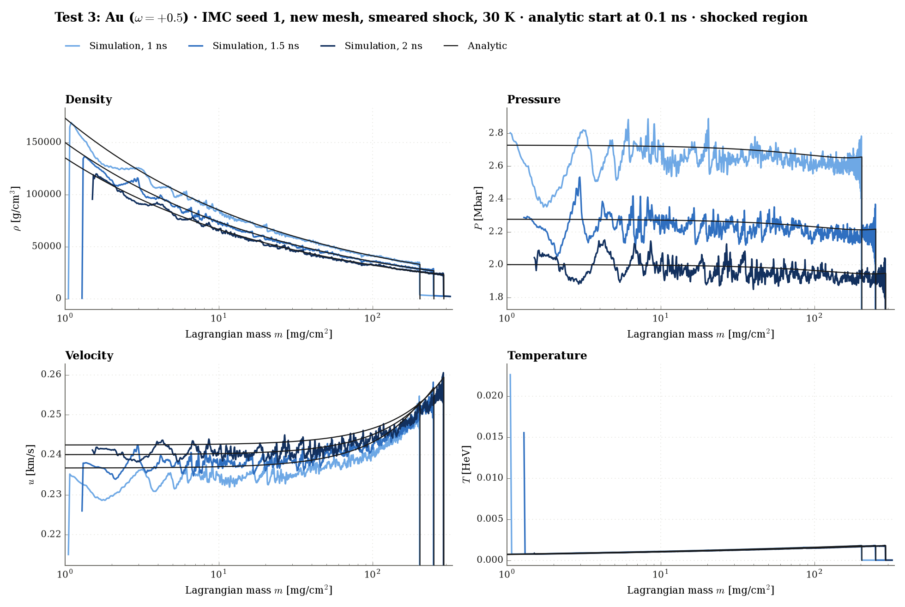

# The analytic start: skipping the non-equilibrium period (Test 3; for IMC the only cure)

Elaborates the "analytic start" cure of the [README](README.md) for gold. For light materials and the rule for choosing t₀, see [01_surface_equilibrium.md § 3](01_surface_equilibrium.md). Why the period has to be skipped at all: [03_startup.md](03_startup.md).

---

## 1. The method

`initial_condition="analytic_ablation"`, `t_sec_start = t₀` (`_seed_ablation_profile` in `src/rad_hydro_sim/simulation/iterator.py`; tests in `tests/test_analytic_ablation_start.py`):

- **The mesh keeps its cell masses.** The nodes behind the solver's shock take the solver's positions and velocities, so each cell has the solver's density. The surface node goes to the solver's boundary. Ahead of the shock the cold target is untouched.
- **Energy.** Each cell gets the solver's specific energy, mass-averaged over the cell (8 points). Node velocities are mass averages over each node's half-cells, which conserves momentum. The surface node gets the velocity that gives its half-cell's kinetic energy. Point values at the nodes would have added 47% to the energy, all in the blow-off. Result: 1.486×10¹⁰ erg/cm² seeded against 1.484×10¹⁰ in a fine quadrature of the solver's profile. The solver's closed-form E(t₀) is 2.6% above its own profile.
- **The seeded shock** (`seed_shock_on_face`, `seed_shock_smeared` → `_start_with_shock_on_face`, `_smear_seeded_shock`): put the shock on a cell face and spread it over the scheme's own shock width (§ 3).
- **Mesh.** The surface cells are equal, 0.0216 mg/cm². The solver's table does not resolve its first ~10⁻³ mg/cm², so the graded cold-start mesh cannot be seeded.

**Why t₀ = 0.1 ns for gold.** The layer then spans 14 surface cells. The solver's t/t_eq is 6.7 (surface 3.5), so the seeded equilibrium holds ([01_surface_equilibrium.md § 2](01_surface_equilibrium.md)). In the cold start, matter shocked once the layer had ≥ 12 cells already carries the solver's entropy. An earlier start is not better: the seeding marks sit where the shock is at t₀ (5.7 mg/cm² at 1 ps), and before ~0.1 ns the 2T front pressure is 2–5% off.

## 2. Fix A (7–10 Nov): old mesh, sharp seed, 300 K

ρ/ρ_solver at 2 ns, fine old mesh (`test3_smooth_analytic`, 1237 cells):

| m [mg/cm²] | 2 | 3 | 5 | 8 | 12 | 20 | 30 | 50 | 70 | 100 | 150 | 200 |
|---|---|---|---|---|---|---|---|---|---|---|---|---|
| diffusion, cold start | 0.40 | 0.49 | 0.59 | 0.70 | 0.82 | 0.90 | 0.94 | 0.95 | 0.94 | 0.94 | 0.94 | 0.94 |
| IMC, cold start | 0.59 | 0.68 | 0.80 | 0.86 | 0.98 | 1.01 | 1.04 | 1.05 | 1.00 | 0.97 | 0.97 | 0.96 |
| diffusion, fix A | 0.99 | 1.00 | 1.00 | 1.00 | 1.00 | 1.00 | 1.00 | 1.00 | 0.94 | 0.93 | 0.94 | 0.94 |
| IMC, fix A (3 seeds) | 1.01 | 0.99 | 0.97 | 0.99 | 1.00 | 1.01 | 1.01 | 0.99 | 0.93 | 0.93 | 0.96 | 0.95 |

- **The start-up band is gone in both codes.** Inside the seeded region (m < 61.6 mg/cm²) the entropy is the solver's within 0.2% in diffusion, and within 0.1–2.2% in IMC (largest at 2–8 mg/cm², rising slowly in time; § 4).
- **The fronts do not move:** heat front −0.8%, shock +0.1%, "ablation pressure" −4.8% (a sampling artifact, [05_shocked_region.md § 3](05_shocked_region.md)). The start changed only what the matter remembers.
- **Left:** beyond 62 mg/cm² the 300 K offset (ρ −6–7%, [05_shocked_region.md § 4](05_shocked_region.md)), and **the seam cell**. The cell that held the solver's shock at t₀ starts half shocked and keeps entropy ×1.58, ρ −31%.
- Cost: diffusion 56 min (energy error 2×10⁻¹⁴); IMC 16.7 h per seed (1.2×10⁻⁹). Figures: `results/phase_c/figures/paper_bath/test3_analytic_start/` and [test3_analytic_start_profiles.png](../../results/phase_c/figures/paper_bath/test3_analytic_start_profiles.png).

## 3. The improved start (14–15 Nov): 30 K, smeared shock, new shocked-region mesh

Over the solver's at 2 ns, 2 mg/cm² to the shock, median (range):

| run | density | entropy | pressure | velocity | shock m | heat front m |
|---|---|---|---|---|---|---|
| 2T, fix A (old mesh, 300 K) | 0.93–1.00 | 1.00–1.09, seam ×1.58 | 0.99–1.00 | 0.991 | 1.000 | 0.992 |
| 2T, shock on a face, 300 K | 0.956 (0.678–1.000) | 1.065 (1.000–1.616) | 0.995 | 0.991 | 1.000 | 0.991 |
| 2T, shock on a face, 30 K | 0.995 (0.708–1.029) | 1.000 (0.963–1.534) | 0.995 | 0.997 | 0.998 | 0.991 |
| **2T, smeared shock, 30 K** | 0.995 (0.945–1.019) | 1.000 (0.985–1.070) | 0.995 | 0.997 | 0.998 | 0.991 |
| **IMC, smeared shock, 30 K (3 seeds)** | 0.997 (0.933–1.034) | 1.001 (0.961–1.068) | 0.987 | 0.990 | 0.994 | 0.988 |
| IMC, same, 4× packets | 0.996 (0.939–1.038) | 1.000 (0.962–1.065) | 0.985 | 0.990 | 0.994 | 0.988 |

- **30 K** removes the plateau beyond 62 mg/cm² and brings the velocity from 0.991 to 0.997.
- **Smearing** removes the seam spike: ×1.53 over 4 cells (sharp, even on a face) becomes ×1.027 over 2 cells.
- **The new mesh changes nothing here.** The old mesh's growth zone (3–10 mg/cm²) lies in seeded matter.

**All analytic starts together.** Shocked region at 1, 1.5 and 2 ns, over the solver's (grey and orange: fix A's runs on the old mesh at 300 K).

**The recommended start: 2T, smeared shock, 30 K.** Shocked region, then the whole domain.

**A sharp shock on a cell face, at 30 K and at 300 K**: the spike at 61–62 mg/cm², and at 300 K also the plateau beyond it.

## 4. What remains

- **Pulse marks (cause G).** The 2T code is not at rest in the seeded one-temperature profile. Its front pressure is 1.14 of the solver's at +2 ps, 1.05 at +5, 0.96 at +10, 0.98 at +20 ps, and 0.995 at 0.2 ns. Each change sends a sound pulse that outruns the shock, and the matter the shock crosses meanwhile keeps a different entropy: +1 to +7% at 84–89 mg/cm², −1 to −4% at 91–109, +1 to +2% at 148–152 (79 of 1514 shocked cells are > 1% off). At **χ = 100** (`seeded_2T_30K_smeared_chi100`) the first pulse is much weaker (1.02 at +2 ps; mark +1.7%), but a dip to 0.945 at +20 ps leaves −1 to −3% at 91–100 and +1 to +3% at 105–260 mg/cm² (504 cells > 1% off). So the marks are partly the two temperatures and partly the seeding itself. For the 2T code at χ = 100 the cold start ([03_startup.md § 4](03_startup.md)) is better. Which pulse makes which mark was not traced; watch it with `--slider seeded_2T_30K_smeared`.

  
- **IMC's velocity is 1% low and its shock 0.6% behind**, as in every IMC run. 4× the packets change neither, so it is not Monte Carlo noise. **Not explained.** IMC (seed 1), smeared shock, 30 K:

  
- **IMC's entropy next to the front rises in time**, and this is noise: +0.65% between 1 and 2 ns at 2–10 mg/cm² with 2000 + 2000 packets, +0.12% with 4×.
- **IMC beyond 100 mg/cm²**: entropy 0.4–2.3% below the solver's (2T: 0.99–1.01).
- IMC's "front pressure 1.04" in `table.md` is the largest of 30 noisy cells, not a 4% excess.

Table of every run: [table.md](../../results/misalignment/test3_on_the_solver/figures/table.md); folder index: [README.md](../../results/misalignment/test3_on_the_solver/figures/README.md).

## 5. Use

- **IMC, and 2T at its own coupling:** seed at 0.1 ns, 30 K, smeared shock (`seeded_IMC_30K_smeared_seed*`, `seeded_2T_30K_smeared`). The result is within 1% outside the pulse marks; IMC is the same within its noise, with velocity −1%.
- **Light materials:** seed where t/t_eq(t₀) ≳ 7, e.g. Al at 2 ns ([01_surface_equilibrium.md § 3](01_surface_equilibrium.md)).
