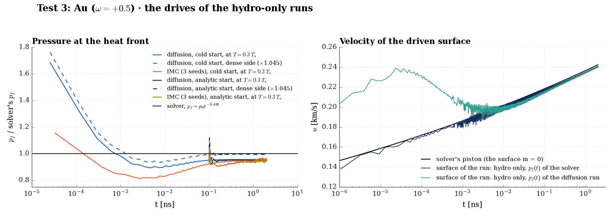
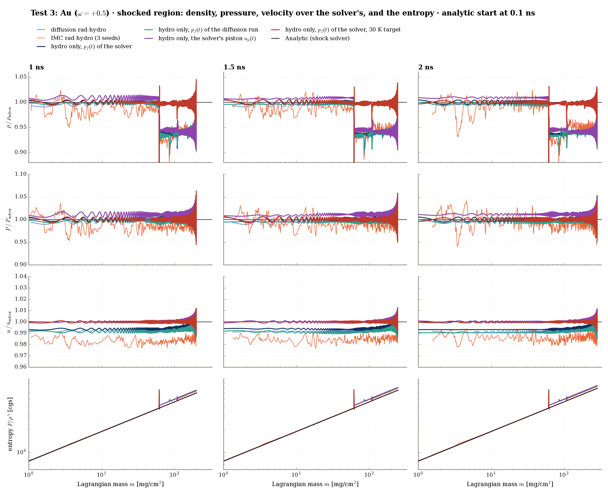
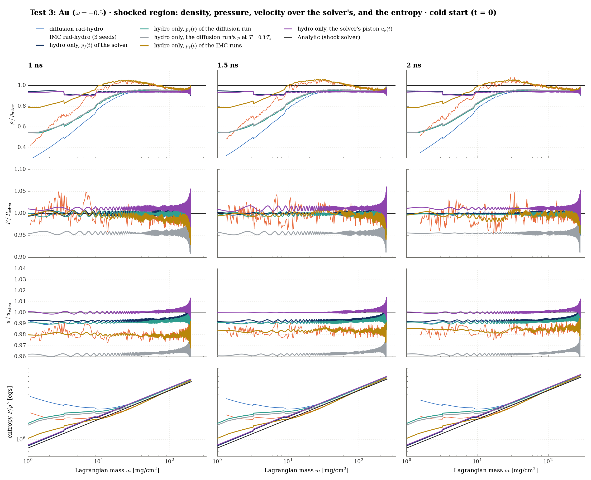
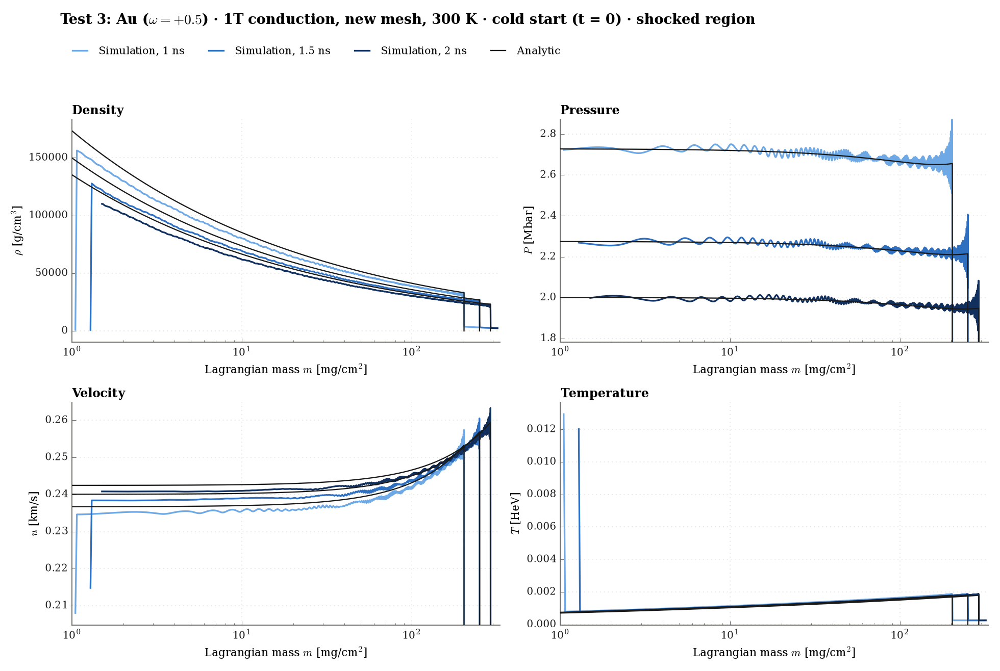

# E–H. The shocked region: hydro-only checks, the target temperature, the mesh, the diagnostics, the flicker

Elaborates causes E–H of the [README](README.md). It also holds the two tests that make the shocked region a pure-hydro problem: §§ 1–2, which [03_startup.md](03_startup.md) relies on.

---

## 1. Hydro only: is the shocked region pure hydro? (10–14 Nov)

The solver assumes no heat flux crosses the ablation front, so beyond it the flow is hydro driven by p_f(t). `test3_hydro_only.py` runs the rad-hydro code's own hydro (same mesh, viscosity, compatible energy update, CFL, target temperature) with no radiation step. m = 0 is driven by one of:

| drive | boundary condition |
|---|---|
| `p_solver` | the solver's p_f = 2.54×10⁸ t^−0.448 (cgs; 2.00 Mbar at 2 ns) |
| `p_diffusion`, `p_imc` | the rad-hydro run's pressure on the dense side of its front (§ 3) |
| `p_diffusion_raw` | the run's stored `p_abl(t)` as it is |
| `piston` | the solver's piston velocity u_p = 0.2424 km/s (t/2 ns)^0.035 |

Each drive is run from the cold start and seeded (`PistonShock` at 0.1 ns). Applying the pressure at m = 0 instead of the moving m_f costs < 0.1% of p_f, because m_f is 0.5% of the shocked mass. Only m > m_f is compared.

**Results at 2 ns, seeded start** (over the solver's; full table [table.md](../../results/misalignment/test3_hydro_only/figures/table.md)):

| m [mg/cm²] | 5 | 20 | 50 | 100 | 200 |
|---|---|---|---|---|---|
| ρ, diffusion rad-hydro | 0.997 | 0.997 | 0.995 | 0.933 | 0.936 |
| ρ, hydro only, p_f of that run | 0.994 | 0.999 | 0.994 | 0.938 | 0.943 |
| ρ, hydro only, p_solver | 0.997 | 1.002 | 0.998 | 0.938 | 0.944 |
| ρ, hydro only, p_solver, **30 K** | 1.002 | 0.999 | 1.003 | 1.001 | 0.996 |
| u, diffusion rad-hydro / hydro p_solver / hydro p_solver 30 K | 0.990 / 0.993 / 1.001 | 0.992 / 0.993 / 0.999 | 0.992 / 0.993 / 1.000 | 0.993 / 0.994 / 1.000 | 0.995 / 0.995 / 1.000 |

- **Hydro with the run's own front pressure is the rad-hydro run**, within 0.5% in ρ, p, u and 0.6% in entropy, ringing and steps included. Those features are therefore hydro.
- **What still separates it from the solver is hydro too**, and it is the 300 K target (§ 4). At 30 K hydro is on the solver within 0.4% (entropy 0.3%, shock mass 0.998).
- **Piston against pressure:** with the piston velocity, u is right and p is 1.0–1.3% high. With the pressure, p is right and u is 0.7% low. The two are equivalent only for a cold target. The rad-hydro runs match the pressure case: what the radiation delivers is the solver's pressure.
- **Cold start:** hydro has no start-up problem of its own. Driven by the solver's diverging p_f from t = 0, the entropy is flat at the 300 K level (1.08–1.10). Beyond ~30 mg/cm² hydro reproduces the rad-hydro run to 1.5%. Below it, the stored front pressure reproduces about half of the old-mesh excess; the rest lies in the first 1.5 ps, which the stored series does not resolve ([03_startup.md § 3](03_startup.md)).
- **Adiabatic:** each element's entropy changes by < 0.03% between 1 and 2 ns in every run. The ringing does not show in the entropy (it is sound). The faults are entropy jumps at fixed mass. Figure: [entropy.png](../../results/misalignment/test3_hydro_only/figures/entropy.png).

**The drives**: the stored `p_abl(t)`, the dense-side pressure and the solver's p_f.

**Analytic start**: each hydro-only run and the rad-hydro run divided by the solver's shock solution, at 1, 1.5 and 2 ns.

**Cold start**, the same.

Each run's profiles (density, pressure, velocity, temperature at 1, 1.5, 2 ns): `results/misalignment/test3_hydro_only/figures/profiles_<start>_<drive>.png`.

## 2. Rad-hydro against hydro with the same drive: no radiative conduction (17–18 Nov)

`test3_transparency.py --pdrive` makes the same pressure-driven run twice: hydro only, and full 2T rad-hydro (χ = 1, `bc_type="reflective"`: zero radiation flux at m = 0, E_rad = aT⁴ initially). The two take identical time steps.

| start | drive | t [ns] | max \|ρ_rad/ρ_hydro − 1\| | max \|s_rad/s_hydro − 1\| | max T, shocked [eV] | max E_rad/E_m |
|---|---|---|---|---|---|---|
| cold | p_solver | 2.0 | 2.8×10⁻⁹ | 2.2×10⁻⁹ | 0.18 | 1.9×10⁻¹⁴ |
| cold | p_2T | 2.0 | 2.6×10⁻⁹ | 2.4×10⁻⁹ | 0.18 | 1.8×10⁻¹⁴ |
| seeded | p_2T | 2.0 | 3.1×10⁻⁹ | 3.9×10⁻⁹ | 0.18 | 1.9×10⁻¹⁴ |

The shocked gold is at 0.1–0.2 eV and 10⁵–10⁸ g/cm³, and the thinnest cell has τ ~ 10⁵. Radiative conduction there is zero at machine precision, so the solver's assumption holds exactly for this model. Driven by `p_2T`, the hydro twin reproduces the 2T run's entropy deficit (0.85 against 0.83 at 12–20 mg/cm²; [03_startup.md § 3](03_startup.md)). Figure: [pdrive_entropy.png](../../results/misalignment/test3_transparency/figures/pdrive_entropy.png); table: [pdrive_table.md](../../results/misalignment/test3_transparency/figures/pdrive_table.md).

## 3. H: the "ablation pressure −4.5%" is where it is read

`fronts_of_profile` (`verification/imc_vs_diffusion.py`) stores `p_abl` at T = 0.3 T_s. That point is two cells on the hot side of the density jump, where the pressure still rises. Diffusion at 2 ns, in units of p_f: 0.921, 0.949 (the T = 0.3 T_s cell), 0.989, 0.998 (first dense cell), then 0.998 through the plateau. **On the dense side the simulations' pressure is the solver's within 0.6%.** The drives `p_diffusion`/`p_imc` above are `p_abl` × 1.045 / 1.048, the measured dense/hot ratio. With raw `p_abl`, hydro has its plateau 4.5% low and its shock 1.5% behind, which the rad-hydro run does not. Later studies read `p_dense`, the largest pressure in the 30 cells beyond the front. That reading is biased upward by ringing and noise.

## 4. E: the 300 K target

The solver's shock runs into a cold target (infinite Mach number). Gold at 300 K and 2700–25 000 g/cm³ has 0.68–0.69% of the shock pressure, which lowers the compression from (γ+1)/(γ−1) = 9 to 8.49. That is Mach 11.5, and it predicts entropy ×1.076. Measured: ρ −6%, entropy +8%, u −0.7% in every piece of matter the run shocks itself, from the cold start and beyond the seed alike. A **30 K** target (Mach 73) removes it in hydro (§ 1), 1T, 2T and IMC (`T_initial_Kelvin`). The 1T cold start at 300 K, which differs from the 30 K run of [03_startup.md § 4](03_startup.md) by this cause alone (density −6%):

## 5. F: growing cells in the shocked region

A shock crossing cells whose mass grows by a factor g per cell leaves entropy ≈ +0.9 (g − 1). Hydro only, p_solver, 30 K, to 25 ps: 1.040–1.049 (g = 1.05), 1.014–1.022 (1.02), 1.005–1.012 (1.01). This is the +4% bump of the old mesh at 3–10 mg/cm². The new shocked-region mesh grows 0.3% per cell (`log_mass_segments`).

## 6. The flicker: the simulations are not smooth, the solver is

1. **Sound trailing the shock, both codes.** About ±3% in density over the 50 cells behind the shock (0.1–0.4% deeper in), at isentropic ratios (δρ/ρ = δp/γp, entropy flat), with a wavelength of 3.6–3.8 cells. The captured shock changes shape once per cell and emits a wave each time. It belongs to the artificial-viscosity hydro and does not shift the profiles. On coarse shocked cells (default mesh, 1–6 mg/cm²) the ringing reaches ±10% in pressure, which is why the density there wanders by ±8%.
2. **Monte Carlo noise, IMC only.** It matters where radiation still heats shocked matter (Test 4). In Test 3 the shocked layer is cold, and IMC's extra jitter there is sound from the noisy hot layer.
3. **Steps frozen at fixed mass, both codes.** A density dip with a matching temperature peak, with the pressure smooth across it. In the cold start they sit where the cell mass starts and stops growing. From the seed they sit at the seam and at 85 and 110 mg/cm², which the shock crossed at 0.19 and 0.31 ns: pressure waves from the first ~20 ps after seeding catching up with the shock ([04_analytic_start.md § 4](04_analytic_start.md)).

## 7. Open

- IMC's entropy next to the front rises 0.5–2.3% between 1 and 2 ns on the old mesh, with a jump where the cell mass starts to grow. With the new mesh and 4× packets it is noise ([04_analytic_start.md § 4](04_analytic_start.md)).
- The transparency study's pressure-driven runs use equal surface cells, not the graded mesh of the run whose pressure drives them. This, together with the `p_dense` sampling, explains the 2–4 point difference between the hydro twin and the 2T run.
