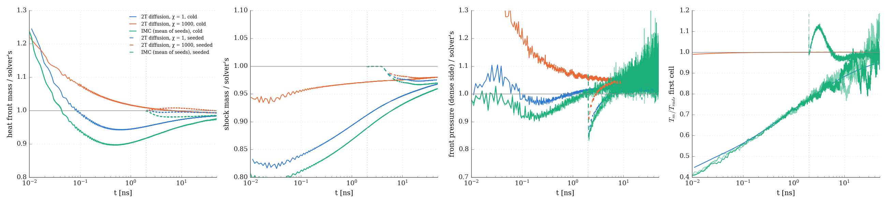
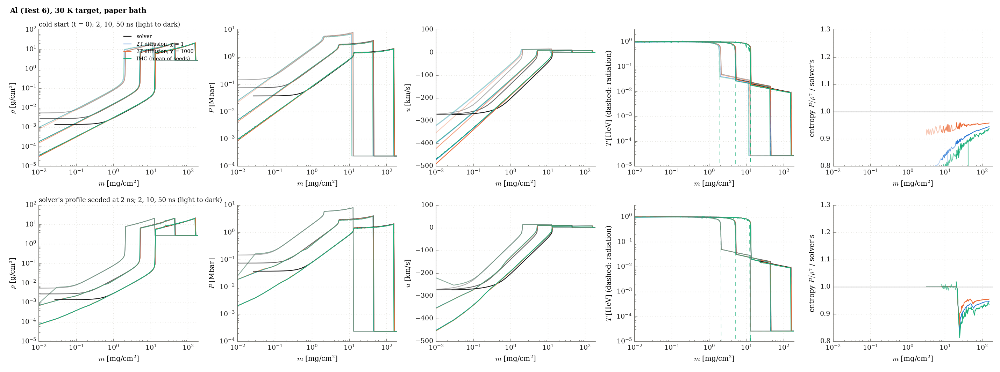

> **Archived 2026-11-20.** Original lab notebook, superseded by the topic docs in `md/misalignment/` (start at its `README.md`). Kept for its full tables; may be deleted once committed.

# Al (Test 6) to 50 ns: which analytic start works, and what remains

2026-11-20. Follows [test3_transparency.md](test3_transparency.md) § 4.6 (the coupling parameter t/t_eq) and § 3 (Be and Al seeded at 0.1 ns, which did not hold). Code: `src/test_misalignment/al_long.py` (runs), `al_long_figures.py` (table, figures, slider data). Results: `results/misalignment/al_long/{runs,figures}`. Interactive slider: `figures/slider/index.html` (serve the folder; it fetches `slider_data.json`), also published as a claude.ai artifact ("Al ablation to 50 ns").

**In short.**

- **Seed Al at 2 ns, not 0.1 ns.** A seeded one-temperature state holds only where the solver's own profile has a large matter–radiation coupling t/t_eq. Gold held at 0.1 ns with 6.7 (surface 3.5). Al reaches that at 2 ns (7.5, surface 6.7); at 0.1 ns it has 0.6.
- **Seeded at 2 ns, the non-equilibrium part is gone.** The 2T run with Al's own coupling (χ = 1) is then on the χ = 1000 run for the heat front (0.994 vs 0.999 of the solver's at 50 ns) and within half a point for the shock (0.975 vs 0.980); matter and radiation are within 1% from 2 ns on. From the cold start the same run is 1.6 and 3.2 points off at 50 ns, with entropy 0.92 of the solver's.
- **What remains is the solver's patching, not equilibrium.** Even at χ = 1000, from either start, the shock is 2.0% behind and the matter shocked after 2 ns has 5% less entropy than the solver's. That is the rigid-front patching of `why_the_solver_differs.md` § 3: in Al the ablated mass is 16% of the shocked mass at 2 ns (8% at 50 ns), and the patched profile carries a 6% pressure step and a 23 km/s velocity jump at the ablation front. No initial condition removes it.
- **IMC follows the diffusion runs, about one point behind.** Seeded at 2 ns: heat front 0.985, shock 0.970, entropy 0.92 at 50 ns (cold start: 0.974, 0.960, 0.90).

---

## 1. Why 2 ns

t/t_eq = t · 4aT³cσ_abs / (ρ c_v), median over the solver's hot plasma (T > T_s/2), minimum (the surface) in parentheses:

| t | 0.1 ns | 0.5 | 1 | **2** | 3 | 10 | 30 | 50 |
|---|---|---|---|---|---|---|---|---|
| Al, solver's profile | 0.6 (0.5) | 2.3 (2.1) | 4.2 (3.7) | **7.5 (6.7)** | 10.5 (9.4) | 29 (26) | 74 (66) | 113 (101) |
| m_f [mg/cm²] | – | 0.93 | 1.39 | 2.07 | 2.61 | 5.24 | 9.88 | 13.3 |
| m_s [mg/cm²] | – | 4.31 | 7.45 | 12.9 | 17.7 | 45.8 | 109 | 163 |

At 2 ns gold's working condition is met (median ≥ 6.7, surface ≥ 3.5) and the layer is 2 mg/cm²: on the seeded mesh 100 cells. The end time 50 ns gives t/t_eq ≈ 113, beyond gold's at 2 ns (79), and 25 times the seeding time (gold: 20).

## 2. The runs

30 K target, paper bath (the bath is the right one once the surface is in equilibrium), domain 190 mg/cm² (1.15 × the solver's shock at 50 ns), all to 50 ns:

| run | start | physics | cells | steps | wall |
|---|---|---|---|---|---|
| `cold_2T`, `seeded_2T` | t = 0 / solver at 2 ns | 2T diffusion, χ = 1 | 2408 / 2320 | 136 k / 108 k | 2 min |
| `cold_chi1000`, `seeded_chi1000` | | 2T diffusion, χ = 1000 | | 136 k / 111 k | 2 min |
| `cold_imc1-3`, `seeded_imc1-3` | | IMC, 5000 + 5000 packets per step, seeds 1–3 | | 141 k / 111 k | 23 / 18 min |

Mesh (`log_mass`): cold start, first cell 10⁻⁴ mg/cm² growing 5% per cell to 0.02 mg/cm², equal to 20 mg/cm² (the whole ablated layer up to 50 ns), then 0.3% growth to 0.2 mg/cm². Seeded: equal 0.02 mg/cm² from the surface (the solver's table does not resolve its first ~10⁻³ m_f), same beyond. The seeded shock sits on a cell face and is smeared over the scheme's shock width (as in Test 3). Energy is conserved to 10⁻¹¹ (diffusion) and 5×10⁻¹² (IMC). IMC is the mean of the three seeds.

## 3. Results





Over the solver's (complete table at 2, 5, 10, 20, 50 ns: `figures/table.md`):

| start | run | t [ns] | heat front | shock | entropy, shocked: median | T_m/T_r, mid-layer |
|---|---|---|---|---|---|---|
| cold | 2T, χ = 1 | 2 | 0.952 | 0.912 | 0.814 | 0.981 |
| | | 10 | 0.973 | 0.947 | 0.879 | 0.995 |
| | | 50 | 0.984 | 0.968 | 0.921 | 0.999 |
| cold | 2T, χ = 1000 | 2 | 1.009 | 0.971 | 0.931 | 1.000 |
| | | 50 | 0.993 | 0.980 | 0.954 | 1.000 |
| cold | IMC | 2 | 0.916 | 0.888 | 0.762 | 0.93 |
| | | 50 | 0.974 | 0.960 | 0.900 | 0.97 (noise) |
| seeded at 2 ns | 2T, χ = 1 | 10 | 0.995 | 0.976 | 1.000 | 0.995 |
| | | 50 | 0.994 | 0.975 | 0.936 | 0.999 |
| seeded at 2 ns | 2T, χ = 1000 | 10 | 1.007 | 0.982 | 1.001 | 1.000 |
| | | 50 | 0.999 | 0.980 | 0.950 | 1.000 |
| seeded at 2 ns | IMC | 10 | 0.981 | 0.971 | 0.992 | ~1 (noise) |
| | | 50 | 0.985 | 0.970 | 0.921 | ~1 (noise) |

(The entropy median is over the shocked matter at that time, 1.5 m_f to 0.97 m_s. For a seeded run at 10 ns that is mostly matter seeded at 2 ns; at 50 ns mostly matter shocked after it.)

- **The cold start carries the early non-equilibrium.** χ = 1: entropy 0.81 at 2 ns in the matter shocked then, shock 9% behind at 2 ns and still 3.2% at 50 ns. IMC is deeper (0.76, 11% behind), as in gold (`test3_on_the_solver.md` § 2.5). χ = 1000 from the same start removes most of it: entropy 0.93–0.95.
- **Seeding at 2 ns does what χ = 1000 does, with Al's own coupling.** The seeded χ = 1 run is in equilibrium from the start (mid-layer T_m/T_r ≥ 0.99), its heat front is within 0.6% of the solver's to 50 ns, and its shock is 0.5 point behind the χ = 1000 run's. The seeded matter keeps the solver's entropy (1.000 at 10 ns). This is the difference to the 0.1 ns seed of `test3_transparency.md` § 3, which relaxed to the cold start's non-equilibrium within ~1 ns.
- **The residual, ~2% in the shock and ~5% in entropy, is the solver's.** It is the same at χ = 1000 from the cold start and from the seed (shock 0.980 both, entropy of the matter shocked after 2 ns 0.95). It does not depend on the coupling, so it is not equilibrium. It matches the size of the patching error: the shock solution is cut at m_f, where its own pressure is 1.059 p_f (m_f/m_s = 16% at 2 ns); the simulated front pushes with a pressure between p_f and that, so the simulated shock is weaker and its matter has less entropy. As m_f/m_s falls (8% at 50 ns) the newly shocked matter approaches the solver: the χ = 1000 run's median entropy rises from 0.93 to 0.95 between 2 and 50 ns.
- **The seed leaves a mark at the seam.** The matter shocked just after 2 ns (20–30 mg/cm² at 50 ns) has entropy down to 0.83–0.85 in all runs: the patched profile, with its pressure step and velocity jump at m_f, is not a state the simulations can hold, and its relaxation sends a weak pulse into the shock. A seed made continuous at m_f (the shock solution continued to m_f with the front's pressure, or a short relaxation in hydro only before switching radiation on) would reduce it.
- **IMC** follows diffusion within about one point on the fronts, from both starts (seeded: heat 0.985 vs 0.994, shock 0.970 vs 0.975 at 50 ns), with entropy 1.5 points lower. The same direction as in gold (IMC shock 0.6% behind from the analytic start, unexplained); here the IMC–diffusion difference of Al (`phase_c_tests3to6_results.md`: 3–5% at 2 ns from a cold start) shrinks to about one point once both start in equilibrium.

## 4. Answer: what analytic seeding works for Al, and why

Seed the solver's profile at **t₀ ≈ 2 ns** (or later). The criterion is the solver's own coupling: t/t_eq on its profile at t₀ ≳ 7 (surface ≳ 3.5), the value at which gold's seed at 0.1 ns held. Then the 2T and IMC runs stay in equilibrium and the start-up error disappears. What it cannot remove is the solver's patching error, ~2% in the shock and ~5% in the entropy of later-shocked matter for Al, falling slowly as m_f/m_s does. For a fair benchmark of IMC against the solver in Al, compare at late times (≥ 20 ns, m_f/m_s ≤ 10%) and quote the χ = 1000 run as the reference for what the solver's model allows.

## 5. Not established

- The patching explanation of the residual is by size and by its independence of χ; a direct test would be hydro only with the pressure applied at the moving front instead of m = 0 (`why_the_solver_differs.md` § 3.2 did this for Test 4).
- The seam mark: a continuous seed was not tried.
- One mesh. The surface cell of the seeded runs carries the seeding's surface-node velocity and runs ~10% hotter than its neighbours (one cell, 0.02 mg/cm²).

## 6. Reproduce

```
uv run python -m test_misalignment.al_long --run cold_2T seeded_2T cold_chi1000 seeded_chi1000   # 2 min each
uv run python -m test_misalignment.al_long --run cold_imc1 cold_imc2 cold_imc3 seeded_imc1 seeded_imc2 seeded_imc3   # 18-23 min each
uv run python -m test_misalignment.al_long_figures
cd results/misalignment/al_long/figures/slider && python -m http.server   # then open http://localhost:8000
```
