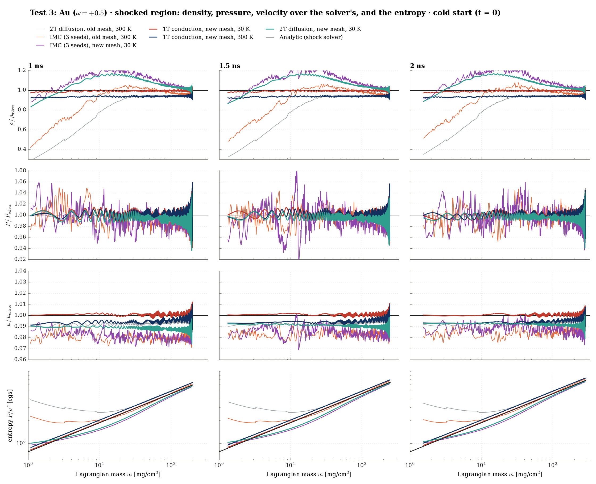
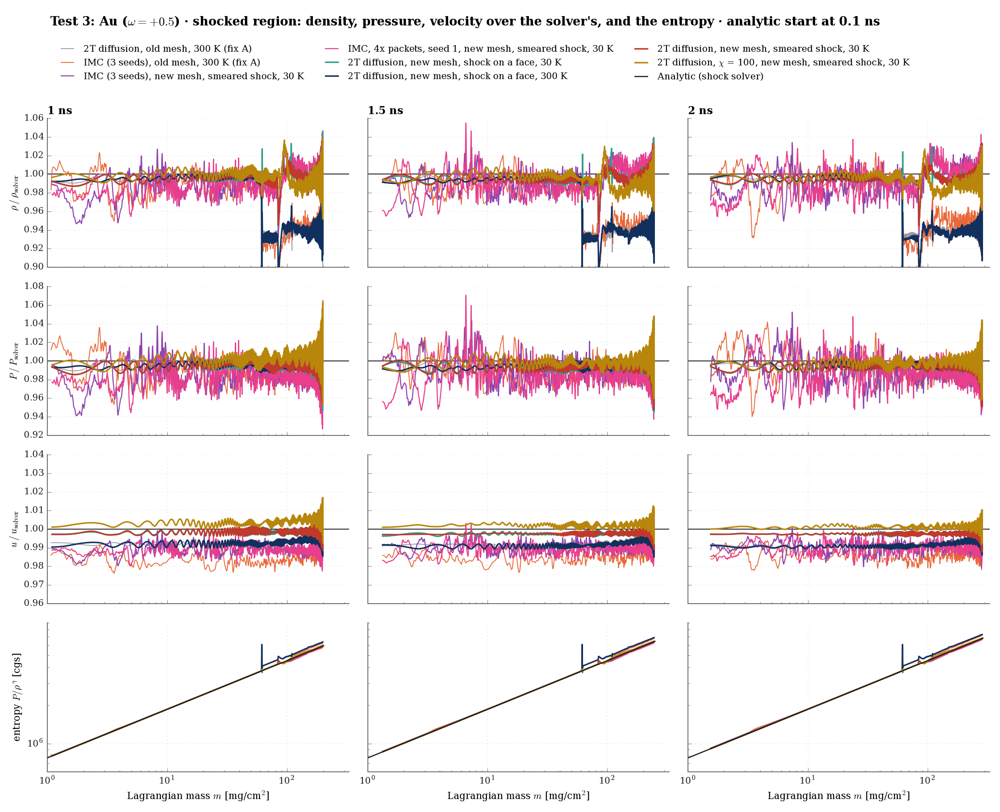
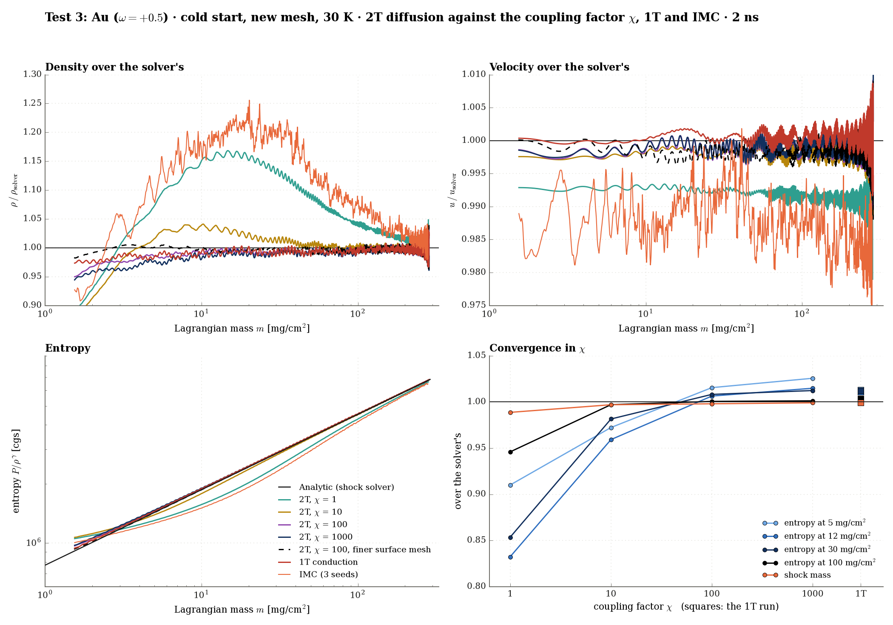

> **Archived 2026-11-20.** Original lab notebook, superseded by the topic docs in `md/misalignment/` (start at its `README.md`). Kept for its full tables; may be deleted once committed.

# Test 3 on the solver: what separates the simulations from the semi-analytic solution, and what removes it

Branch `feat/patching-poc`, 2026-11-14 (χ scan and IMC added the same day; IMC cold start, finer surface mesh, χ = 100 analytic start and 4×-packet IMC on 2026-11-15). Test 3 is gold with ω = +0.5, T_s = 1 HeV, to 2 ns. Follows [test3_fix_A.md](test3_fix_A.md) and [test3_hydro_only.md](test3_hydro_only.md).

**Result.** A cold start from t = 0 can sit on the solver. With the one-temperature conduction mode, a geometric surface mesh and a 30 K target, the shocked region at 2 ns (2 mg/cm² to the shock) has, over the solver's: density 0.994 (median; range 0.973–1.022), entropy p/ρ^γ 1.007 (1.001–1.027), pressure 1.000 (0.978–1.030), velocity 1.0005 (0.996–1.007), shock mass 0.999, heat front mass 0.992. The old cold start had density 0.40–0.95 and entropy 1.07–3.1 there. The two-temperature diffusion code reaches the same result from t = 0 when its matter–radiation coupling is multiplied by χ ≥ 100, at a quarter of the cost (§ 2.3). With its own coupling (χ = 1) it cannot, and IMC has no such factor: for them the analytic start at 0.1 ns stays, now with a smeared seeded shock and a 30 K target. IMC run that way is on the solver within its noise (§ 2.4), and IMC from the cold start shows the χ = 1 deficit (§ 2.5). **The closest run of all** is the 2T code at χ = 100 on a finer surface mesh (§ 2.3): density 0.997 (0.979–1.017), entropy 1.001 (0.997–1.009), velocity 0.9985 of the solver's from 2 mg/cm² to the shock, in 37 min. All figures on one page: [test3_figures.md](test3_figures.md).

Words used here: **1T** is `force_black="conduction"`, one temperature and the surface temperature imposed, which is the solver's own equation. **2T** is the gray diffusion with separate radiation and matter temperatures and the paper bath, the code of all earlier Test 3 runs. **Entropy** is the entropy function p/ρ^γ, γ = 1.25. **Old mesh** is `test3_smooth` (1237 cells).

---

## 1. The causes, one by one

| # | Cause | Its mark | Cure | How it was established |
|---|---|---|---|---|
| 1 | The ablated layer is thinner than a surface cell at the start | cold start: entropy ×1.3–5 at 0.5–20 mg/cm² (old mesh) | surface mesh with geometrically growing cells | two such meshes give the same answer (§ 3.1) |
| 2 | Matter and radiation are out of equilibrium for the first ~0.1 ns (2T, IMC) | cold start: shock up to 17% too weak at 1–5 ps, entropy ×0.83 at 12–20 mg/cm² | 1T mode; or χ ≥ 100 in the 2T code; or an analytic start at 0.1 ns | measured temperatures (§ 3.2); the 1T run has no such mark; the mark shrinks with χ (§ 2.3) |
| 3 | A shock crossing cells of growing mass | entropy +0.9 × (growth − 1): +4.5% at 5% growth | 0.3% growth in the shocked region | hydro-only runs at 5%, 2%, 1% (§ 3.3) |
| 4 | The 300 K target: the shock has Mach 11.5, the solver's is infinite | density −6%, entropy +8%, velocity −0.7% in matter the run shocks | 30 K target (Mach 73) | 30 K and 300 K runs, 1T and 2T (§ 2) |
| 5 | The seeded shock is a sharp jump | analytic start: entropy ×1.53 in 4 cells where the shock was seeded | seed the shock over the scheme's own shock width | sharp and smeared runs (§ 2.2) |
| 6 | The 2T code is not at rest in the seeded 1T profile | analytic start: entropy +1 to +7% at 84–89 mg/cm², −1 to −4% at 91–109, +1 to +2% at 148–152 | χ = 100 makes the largest mark 4 times smaller but leaves +1 to +3% beyond 105 mg/cm² (§ 2.6); a cold start has none | front-pressure series of the seeded run (§ 3.4) |

Placing the seeded shock on a cell face (`seed_shock_on_face`) alone does not cure 5: the spike stays (×1.53, was ×1.58).

## 2. The runs at 2 ns

`src/test_misalignment/test3_on_the_solver.py`. Complete table: `results/misalignment/test3_on_the_solver/figures/table.md`.

**The new mesh** (`mesh="log_mass"`, 1760 cells). Surface: the cell mass grows 5% per cell from 4×10⁻⁴ mg/cm² to the old surface cell, 0.0216 mg/cm², which it keeps to 1.5 mg/cm² (the heat front at 2 ns is at 1.46). Beyond: 0.3% per cell up to 0.3 mg/cm². The seeded runs keep equal 0.0216 mg/cm² surface cells (1698 cells): the layer spans 14 of them at 0.1 ns, and the solver's own table does not resolve the first ~10⁻³ mg/cm² it would have to seed.

### 2.1 Cold start (t = 0)

Over the solver's, 2 mg/cm² to the shock, median and range:

| run | density | entropy | pressure | velocity | shock mass | heat front mass |
|---|---|---|---|---|---|---|
| 2T, old mesh, 300 K (before) | 0.40–0.95 | 1.07–3.14 | 1.00 | 0.992 | 1.000 | 0.990 |
| IMC, old mesh, 300 K (before, 3 seeds) | 0.59–1.05 | 0.96–1.92 | 0.97–1.03 | 0.98–0.99 | 0.989 | 0.984 |
| **1T, new mesh, 30 K** | 0.994 (0.973–1.022) | 1.007 (1.001–1.027) | 1.000 (0.978–1.030) | 1.0005 (0.996–1.007) | 0.999 | 0.992 |
| 1T, new mesh, 300 K | 0.938 (0.924–0.961) | 1.084 (1.077–1.102) | 1.001 (0.978–1.028) | 0.994 (0.992–1.003) | 1.001 | 0.992 |
| 2T, new mesh, 30 K | 1.051 (0.929–1.168) | 0.936 (0.827–1.086) | 0.996 (0.966–1.012) | 0.992 (0.985–0.995) | 0.989 | 0.986 |

- **1T at 30 K is on the solver.** The entropy excess is 2–3% at 1.6–3 mg/cm², about 1% at 5–50 mg/cm² and 0.3–0.5% beyond 70 mg/cm². There is no spike and no step. The ranges of density and pressure are the ringing behind the shock.
- **1T at 300 K differs by cause 4 alone**, uniformly: density −6%, entropy +8%, velocity −0.6%.
- **2T on the new mesh shows cause 2 alone.** The large excess of the old mesh is gone (×1.09 at 2 mg/cm², was ×3.1). What is left is a deficit: entropy ×0.83 at 12–20 mg/cm², still ×0.95 at 100 and ×0.97 at 200 mg/cm²; the shock is 1.1% behind.
- **Cost.** 1T: 4.4 million steps, 88 min (30 K); 3.9 million, 82 min (300 K). 2T: 1.7 million steps, 21 min. The thin surface cells are dense until they are ablated and set the time step, so the step grows only in proportion to the elapsed time.



### 2.2 Analytic start at 0.1 ns (2T)

| run | density | entropy | pressure | velocity | shock mass | heat front mass |
|---|---|---|---|---|---|---|
| old mesh, 300 K (fix A) | 0.93–1.00 | 1.00–1.09, seam ×1.58 | 0.99–1.00 | 0.991 | 1.000 | 0.992 |
| new mesh, shock on a face, 300 K | 0.956 (0.678–1.000) | 1.065 (1.000–1.616) | 0.995 | 0.991 | 1.000 | 0.991 |
| new mesh, shock on a face, 30 K | 0.995 (0.708–1.029) | 1.000 (0.963–1.534) | 0.995 | 0.997 | 0.998 | 0.991 |
| **new mesh, smeared shock, 30 K** | 0.995 (0.945–1.019) | 1.000 (0.985–1.070) | 0.995 (0.973–1.022) | 0.997 (0.992–1.003) | 0.998 | 0.991 |

- **30 K removes the plateau beyond 62 mg/cm²** (density 0.93 → 0.99–1.00, entropy 1.08 → 1.00) and brings the velocity from 0.991 to 0.997.
- **The smeared shock removes the spike.** Sharp: entropy ×1.53 and density −29% over 4 cells at 61–62 mg/cm². Smeared: ×1.027 and −2% in 2 cells.
- **The pulse marks (cause 6) remain**, identical in the sharp and smeared runs: 79 of 1514 shocked cells are more than 1% off in entropy.
- **The mesh changes nothing here.** The 300 K run on the new mesh repeats the old one: the old mesh's 5% growth zone (3–10 mg/cm²) lies in seeded matter.
- **An earlier start is not better.** The seeding marks sit where the shock is at the start time (5.7 mg/cm² at 1 ps), and before ~0.1 ns the 2T code's front pressure is more than 2–5% from the solver's (§ 3.2).



### 2.3 The 2T code against the coupling factor χ

Cold start, new mesh, 30 K, the preset's coupling multiplied by χ (`RadHydroCase.chi`; the preset has χ = 1). Entropy over the solver's at 2 ns:

| m [mg/cm²] | 2 | 3 | 5 | 8 | 12 | 20 | 30 | 50 | 100 | 200 | shock mass | velocity | steps | wall [min] |
|---|---|---|---|---|---|---|---|---|---|---|---|---|---|---|
| 2T, χ = 1 | 1.088 | 0.996 | 0.910 | 0.856 | 0.832 | 0.831 | 0.853 | 0.897 | 0.946 | 0.974 | 0.989 | 0.992 | 1.65 M | 21 |
| 2T, χ = 10 | 1.109 | 1.032 | 0.972 | 0.955 | 0.959 | 0.971 | 0.982 | 0.991 | 0.997 | 0.999 | 0.997 | 0.998 | 1.78 M | 21 |
| 2T, χ = 100 | 1.041 | 1.023 | 1.015 | 1.011 | 1.006 | 1.004 | 1.008 | 1.010 | 1.001 | 1.001 | 0.998 | 0.999 | 2.04 M | 24 |
| 2T, χ = 1000 | 1.051 | 1.040 | 1.026 | 1.017 | 1.015 | 1.009 | 1.012 | 1.012 | 1.001 | 1.002 | 0.999 | 0.999 | 2.20 M | 26 |
| **2T, χ = 100, finer surface mesh** | 1.009 | 1.000 | 0.998 | 1.000 | 1.001 | 1.002 | 1.002 | 1.005 | 1.003 | 1.000 | 0.998 | 0.9985 | 3.26 M | 37 |
| 1T conduction | 1.023 | 1.017 | 1.013 | 1.010 | 1.011 | 1.007 | 1.012 | 1.013 | 1.003 | 1.005 | 0.999 | 1.0005 | 4.37 M | 88 |

- **The deficit closes with χ**: at 12 mg/cm², 0.832 → 0.959 → 1.006 → 1.015, against 1.011 in the 1T run. χ = 100 and χ = 1000 are within 0.5% of the 1T run beyond 12 mg/cm².
- **Below 5 mg/cm² the χ runs are 1–3% above the 1T run**, χ = 1000 more than χ = 100. That matter was shocked in the first ~0.8 ps.
- **That excess, and the ~1% further out, is the surface mesh.** With the first cell at 1×10⁻⁴ mg/cm² (was 4×10⁻⁴) and 3% growth (was 5%), 1847 cells, the χ = 100 run has entropy within 0.5% of the solver's from 3 mg/cm² to the shock (1.009 at 2 mg/cm², 1.021 at 1.6), density 0.997 (0.979–1.017), pressure 0.998 (0.974–1.022), velocity 0.9985 (0.993–1.004), shock mass 0.998, heat front mass 0.991, energy error 9×10⁻¹⁴.
- **The surface follows.** Matter temperature at the surface at 0.1 ps: 0.51 HeV (χ = 1), 0.76 (10), 0.94 (100), 0.99 (1000). Front pressure over the solver's at 1 ps: 0.86, 0.96, 1.02, 1.03.
- **Energy** is conserved to 3–6×10⁻¹⁴ in all four, which the 1T mode cannot show (§ 5).
- **Cost**: 21–26 min against 88 min for the 1T mode.



### 2.4 IMC from the recommended analytic start

`seeded_IMC_30K_smeared_seed1` … `_seed3`: IMC (2000 emission and 2000 bath packets per step, census capped at 20 000), solver's profile at 0.1 ns, smeared shock, 30 K, new shocked-region mesh, to 2 ns. 1.39 million steps, 81–84 min each, energy error 1.2×10⁻⁹. `seeded_IMC_30K_smeared_x4_seed1`: the same with 4 times the packets (8000 + 8000, census 80 000), 239 min. Over the solver's at 2 ns, 2 mg/cm² to the shock:

| | density | entropy | pressure | velocity | shock mass | heat front mass |
|---|---|---|---|---|---|---|
| IMC, old mesh, 300 K, sharp seam (fix A, 3 seeds) | 0.93–1.01 | 1.00–1.07 | 0.98–1.02 | 0.983–0.991 | 0.995 | 0.989 |
| IMC, new mesh, 30 K, smeared shock (3 seeds) | 0.997 (0.933–1.034) | 1.001 (0.961–1.068) | 0.987 (0.948–1.053) | 0.990 (0.980–1.001) | 0.994 | 0.988 |
| IMC, same, 4× packets (1 seed) | 0.996 (0.939–1.038) | 1.000 (0.962–1.065) | 0.985 (0.948–1.048) | 0.990 (0.980–1.002) | 0.994 | 0.988 |
| 2T, same start | 0.995 (0.945–1.019) | 1.000 (0.985–1.070) | 0.995 (0.973–1.022) | 0.997 (0.992–1.003) | 0.998 | 0.991 |

- **IMC behaves like the 2T run.** The 300 K plateau beyond 62 mg/cm² is gone (entropy 1.006 at 70 mg/cm², was 1.07), and the seeded shock leaves ×1.027 in entropy, the same as in the 2T run.
- **Beyond 100 mg/cm² IMC's entropy is 0.4–2.3% below the solver's** (0.977 at 100 and 200 mg/cm², 0.996 at 150); the 2T run has 0.99–1.01 there.
- **IMC's velocity stays 1% low** (0.990; 2T 0.997) and its shock 0.6% behind, as in every earlier IMC run. **Four times the packets change neither** (0.990, 0.994): these offsets are not Monte Carlo noise. Not explained.
- **IMC's entropy next to the front rises in time, and that is Monte Carlo noise**: +0.65% between 1 and 2 ns at 2–10 mg/cm² (seed 1), +0.13% at 10–60; with 4 times the packets +0.12% and +0.03%, and the excess at 2–5 mg/cm² at 2 ns falls from 1.2–1.4% to 0.2–0.4%. On the old mesh the rise was 0.5–2.3% with a jump where the cell mass started to grow; that jump is gone with the growth zone.
- The front pressure in `table.md` reads 1.04 for IMC: it is the largest pressure among 30 noisy cells, not a 4% excess.

### 2.5 IMC from the cold start

`cold_IMC_30K_seed1` … `_seed3`: IMC from t = 0 on the graded mesh at 30 K (1.74 million steps, 104 min each, energy error 1.1×10⁻⁹). IMC's material model needs χ ≤ 1, so there is no χ family. Entropy over the solver's at 2 ns:

| m [mg/cm²] | 2 | 3 | 5 | 8 | 12 | 20 | 30 | 50 | 100 | 200 | shock mass | velocity |
|---|---|---|---|---|---|---|---|---|---|---|---|---|
| IMC (3 seeds) | 1.044 | 0.965 | 0.882 | 0.825 | 0.798 | 0.789 | 0.809 | 0.855 | 0.917 | 0.963 | 0.983 | 0.987 |
| 2T, χ = 1 | 1.088 | 0.996 | 0.910 | 0.856 | 0.832 | 0.831 | 0.853 | 0.897 | 0.946 | 0.974 | 0.989 | 0.992 |

- **IMC has the two-temperature deficit, a little deeper than the 2T code's** (0.79 against 0.83 at 20 mg/cm²), with the density up to 26% above the solver's and the shock 1.7% behind. The three seeds agree within 0.5% in entropy up to 100 mg/cm².
- **Its start looks like the 2T code's**: matter at the surface at 0.50 HeV at 0.1 ps and 0.75 at 5 ps (2T: 0.51, 0.74); heat front mass 2.24 of the solver's at 0.1 ps (2T: 2.19).
- For IMC the cold start cannot be brought onto the solver; the analytic start (§ 2.4) is the way.

### 2.6 The analytic start at χ = 100

`seeded_2T_30K_smeared_chi100`: the 2T analytic start of § 2.2 with χ = 100 (16 min, energy error 3×10⁻¹⁴).

- **The seeding's first pulse is much weaker**: the front pressure is 1.02 of the solver's 2 ps after the start (χ = 1: 1.14), and the mark at 84–89 mg/cm² falls from +7% to +1.7% in entropy.
- **It does not vanish**: the pressure still dips to 0.945 at +20 ps, leaving −1 to −3% at 91–100 mg/cm², and the matter shocked after that has +1 to +3% (105–260 mg/cm²), where the χ = 1 run is within 1%. 504 of 1516 shocked cells are more than 1% off, against 79.
- Velocity 1.001 and shock mass 1.001 of the solver's (χ = 1: 0.997, 0.998).
- So the pulse marks are partly the two temperatures and partly the seeding itself. For the 2T code at χ = 100 the cold start (§ 2.3) is the better choice.

## 3. The evidence for each cause

The runs of this section were short exploratory runs (to 20–50 ps; the entropy of matter is fixed once the shock has passed, so a short run shows the whole record up to its shock). Their data are not in the repository; the settings are given so they can be repeated.

### 3.1 Cause 1: the mesh at the start

2T, 30 K, at 50 ps, entropy over the solver's:

| m [mg/cm²] | 0.5 | 1 | 2 | 3 | 5 | 8 | 12 | 20 | 30 |
|---|---|---|---|---|---|---|---|---|---|
| old mesh (300 K, at 20 ps) | 8.08 | 4.98 | 3.14 | 2.46 | 1.93 | 1.55 | 1.28 | 1.14 | – |
| first cell 4×10⁻⁴ mg/cm², 5% growth | 1.56 | 1.29 | 1.09 | 1.00 | 0.91 | 0.86 | 0.83 | 0.83 | 0.85 |
| first cell 1×10⁻⁴ mg/cm², 3% growth | 1.51 | 1.24 | 1.06 | 0.98 | 0.90 | 0.85 | 0.83 | 0.83 | 0.85 |

The two graded meshes agree within 4% at 0.5–2 mg/cm² and within 2% beyond 3 mg/cm², with 30–70 and 70–140 cells across the ablated layer after 0.25 ps (old mesh: 3–7). The excess of the old mesh is therefore a mesh error, and what the graded meshes share is not.

### 3.2 Cause 2: two temperatures

Graded mesh, 2T, 30 K. Temperatures in the ablated layer [HeV]:

| t | radiation, surface | radiation, mid-layer | matter, surface | matter, mid-layer |
|---|---|---|---|---|
| 0.07 ps | 1.46 | 1.35 | 0.44 | 0.49 |
| 1.4 ps | 1.14 | 1.09 | 0.57 | 0.69 |
| 5 ps | 1.06 | 1.03 | 0.65 | 0.80 |

At 0.5–2 ns (the old runs) the radiation temperature is within 0.2–1.2% of the matter's through the layer, and 9–14% above it in the cells at the front.

Over the solver's, same run:

| t [ps] | 0.09 | 0.5 | 1.5 | 4.7 | 11 | 21 | 50 |
|---|---|---|---|---|---|---|---|
| pressure on the dense side of the front | 0.96 | 0.86 | 0.85 | 0.86 | 0.88 | 0.93 | 0.98 |
| heat front mass | 2.26 | 1.66 | 1.40 | 1.20 | 1.11 | 1.06 | 1.01 |

In the 1T run the heat front mass is within 1.3% of the solver's from 0.03 ps on and the shock mass within 1% from 0.25 ps on. Its front pressure reads 1.00–1.07 of the solver's; that reading is the largest pressure in the 30 cells beyond the front, so the ringing biases it upward (`startup.png`).

**Why equilibrium is not established although gold is opaque.** The mean free path depends inversely on the density. With the test's opacity law, 1/κ = g T^α ρ^(−λ) (α = 1.5, λ = 0.2), it is

  ℓ = 1/(κρ) = g T^α ρ^(−(1+λ)) ≈ 1.4×10⁻⁴ cm × T_HeV^1.5 × ρ^(−1.2)  (ρ in g/cm³).

The heat wave does not run in dense gold. It runs in the ablated layer, which has expanded to 0.04–6 g/cm³ at 5 ps (0.2–20 g/cm³ at 1.4 ps; the cells at the front itself are denser), against ~10⁶ g/cm³ in the shocked matter next to it. There the mean free path is long, and each absorption takes ℓ/c ≈ 5 fs at 1 g/cm³ and 1 HeV. The matter also holds ~10³ times the energy of the radiation field (3×10¹³ against 1×10¹⁰ erg/cm³ at 1 g/cm³, 1 HeV), so the radiation must be absorbed and replaced ~10³ times before the matter has caught up: roughly 5 ps. Both factors depend on the density, ℓ as ρ^(−1.2) and the matter's energy per volume as ρ^(1−μ) = ρ^0.86, so the equilibration time goes as ρ^(−0.34): it grows as the layer expands, about 3 times longer at 0.04 g/cm³ than at 1 g/cm³. These are estimates; they are consistent with the measured temperatures above. A self-similar wave changes on the timescale of its own age, so for t ≲ 10 times this time the matter is behind the radiation. The solver assumes one temperature, so for t ≲ 0.1 ns it does not describe the 2T model, and no mesh changes that. Multiplying the coupling by χ shortens the time by χ (§ 2.3).

### 3.3 Cause 3: growing cells in the shocked region

Hydro only, solver's pressure at the surface, 30 K, to 25 ps; equal 0.0216 mg/cm² cells to 1 mg/cm², then growth g per cell up to 0.3 mg/cm². Entropy over the solver's in the growth zone: 1.040–1.049 (g = 1.05), 1.014–1.022 (1.02), 1.005–1.012 (1.01); 1.002–1.008 in the equal 0.3 mg/cm² cells after it. The old mesh's zone at 3–10 mg/cm² is the +4% bump of the earlier figures.

### 3.4 Cause 6: the seeded state in the 2T code

Pressure on the dense side of the front over the solver's, 2T seeded at 0.1 ns, 30 K: 1.14 at +2 ps, 1.05 at +5 ps, 0.96 at +10 ps, 0.98 at +20 ps, 0.97 at +50 ps, 0.995 at 0.2 ns. Each change sends a sound pulse through the shocked layer; sound outruns the shock, and the matter the shock crosses while a pulse reaches it keeps a different entropy. In the slider (`--slider seeded_2T_30K_smeared`), a pressure hump of ~10% is near 10 mg/cm² at 0.109 ns and moves toward the shock. Which pulse makes which mark was not traced.

## 4. What to use

- **Diffusion against the solver:** a cold start at 30 K with the 2T code at χ = 100 on the finer surface mesh (`cold_2T_30K_chi100_fine`: 37 min, energy conservation checked). Within 2% in density, 1% in entropy and 0.7% in velocity from 2 mg/cm² to the shock, with no analytic start. The 1T mode (`cold_1T_30K`, 88 min) and χ = 100 on the first graded mesh (`cold_2T_30K_chi100`, 24 min) are within 3%.
- **The 2T code with its own coupling, and IMC:** an analytic start at 0.1 ns with a 30 K target and the smeared shock (`seeded_2T_30K_smeared`, `seeded_IMC_30K_smeared_seed*`). 2T: within 1% outside the pulse marks. IMC: the same within its noise (±4–6% in density and pressure per cell with 2 seeds), velocity 1% low.
- **Reading the ablation pressure:** on the dense side of the front (`test3_hydro_only.md` § 2).

## 5. What is not established

- **IMC's offsets from the solver are unexplained**: velocity 1% low and shock 0.6% behind from the analytic start, unchanged by 4 times the packets.
- **A χ > 1 changes the model**, not the numerics: it is a device to reach the solver's one-temperature limit, not gold's coupling.
- **Energy conservation of the 1T runs is not measured.** The energy budget does not record the conduction mode's surface flux. The 2T runs conserve energy to 6×10⁻¹⁴ (χ = 1 to 1000), IMC to 1.2×10⁻⁹ (also with 4 times the packets).
- **The 1T run itself was not repeated on the finer surface mesh.** The χ = 100 run was (§ 2.3), and its excess went away, so the 1T run's (1% at 5–50 mg/cm², 2–3% below 3 mg/cm²) is very probably the same mesh remnant.
- **The 1T heat front is 0.8% behind** the solver's at 0.5–2 ns, as in every earlier run; not investigated.
- **The 2T velocity is 0.3% low (seeded) and 0.8% low (cold) at 30 K**, where 1T has 1.000. Not explained.
- **Tests.** `tests/test_analytic_ablation_start.py` passes (3 tests) with the changed `iterator.py`, `radiation_step.py` and `simulation_config.py`. The rest of the test suite was not run, and the new options have no tests of their own.

## 6. Code changes

- `simulation/iterator.py`: `mesh="log_mass"` (`_log_mass_nodes`); `seed_shock_on_face` (`_start_with_shock_on_face`); `seed_shock_smeared` (`_smear_seeded_shock`).
- `simulation/radiation_step.py`: the conduction mode in `full_rad_hydro` starts each step from the matter energy after the hydro step. Before, it carried the temperature in `E_rad` and would have ignored compression and shock heating; it was only used without hydro.
- `hydro_sim/problems/simulation_config.py`: `log_mass_first`, `log_mass_segments`, `seed_shock_on_face`, `seed_shock_smeared`.
- `verification/test3_on_the_solver.py`, `test3_on_the_solver_figures.py`: the runs (also the χ scan and IMC), figures, tables and slider.

## 7. Reproduce

```
uv run python -m test_misalignment.test3_on_the_solver --run-all --jobs 4      # 18 runs: 16-105 min each (IMC with 4x packets: 4 h)
uv run python -m test_misalignment.test3_on_the_solver --figures --table
uv run python -m test_misalignment.test3_on_the_solver --slider cold_1T_30K
```

Run data: `results/misalignment/test3_on_the_solver/runs/` (untracked). Figures: `results/misalignment/test3_on_the_solver/figures/` (index: its `README.md`).

**The slider** shows density, pressure, velocity, temperature and entropy over the whole domain against the solver, 220 frames from 0.01 ns (0.1 ns for the seeded runs) to 2 ns, on fixed axes. Zoom with the toolbar; the zoom is kept while sliding. Keys: `f` fits the y ranges to the mass window in view, `x` and `y` switch log / linear, left / right arrows step one frame.
