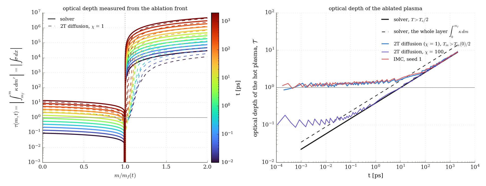
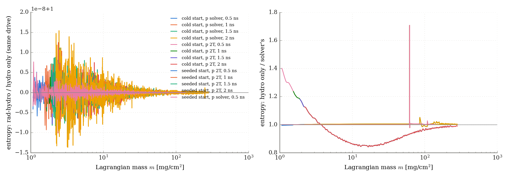
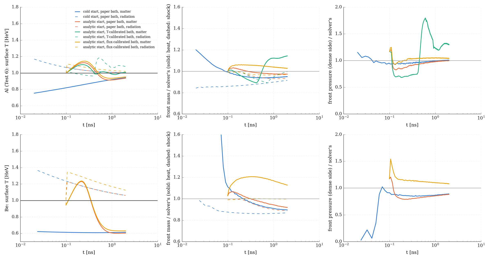
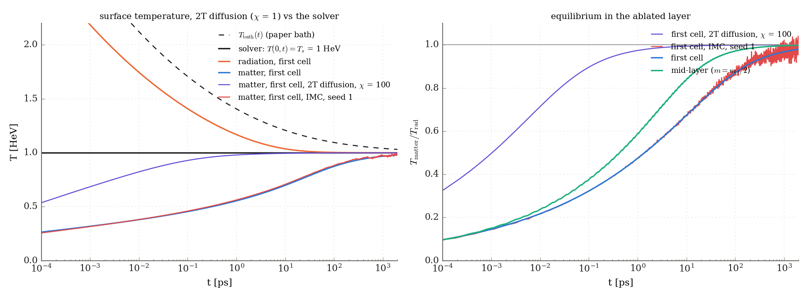
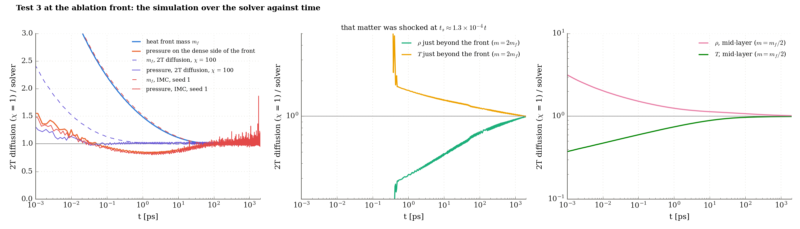
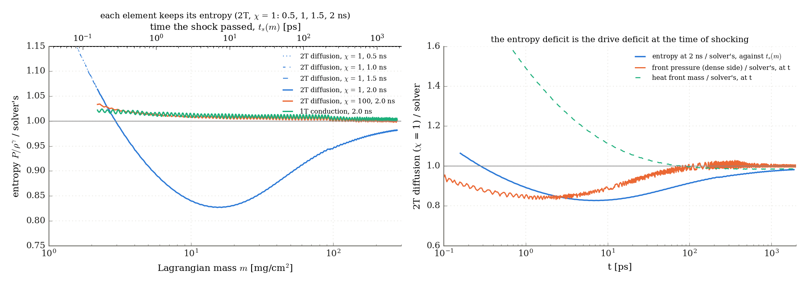

> **Archived 2026-11-20.** Original lab notebook, superseded by the topic docs in `md/misalignment/` (start at its `README.md`). Kept for its full tables; may be deleted once committed.

# Test 3 at short times: transparency, non-equilibrium, and why they persist

Branch `feat/patching-poc`, 2026-11-17; the overnight runs of 2026-11-18 added the χ = 100 and IMC dense reruns, the p_2T pairs to 2 ns, Be's flux-calibrated bath and the 2500-cell checks. Test 3 is gold with ω = +0.5, T_s = 1 HeV, τ = 0, to 2 ns. Follows [test3_on_the_solver.md](test3_on_the_solver.md) (the χ scan, the 1T mode, the analytic start), [test3_hydro_only.md](test3_hydro_only.md) and [test3_omega_scan.md](test3_omega_scan.md). The simulation is the 2T gray diffusion with the preset's coupling (χ = 1), the graded surface mesh and a 30 K target (`cold_2T_30K`), unless stated otherwise.

Four tasks:

1. The optical depth τ(m, t) = |∫_{m_f}^{m} κ dm'| = |∫ σ dx| near the ablation front, at several times (§ 1).
2. Rad-hydro, not only hydro-only, driven at m = 0 by the front pressure p_f(t) of the solver and of the simulation: is there radiative conduction in the shocked region? (§ 2)
3. Be and Al started from the solver at 0.1 ns, with the paper bath and with T_bath(t) calibrated so that the matter's surface temperature sits on T_s: does the start bring them to equilibrium? (§ 3)
4. Why a transparent, out-of-equilibrium start spoils the shocked region at all later times: the entropy argument, and the front quantities against time (§ 4).

**In short.**

- **The ablated plasma is optically thin at the start.** In the solver its optical depth (matter hotter than T_s/2) grows as 𝒯 ≈ (t / 10 ps)^0.41: 0.06 at 0.01 ps, 0.39 at 1 ps, 1.0 at 10 ps, 2.6 at 0.1 ns, 8.8 at 2 ns. Beyond the front the shocked gold is opaque (τ > 10³ within 10% of m_f at every time), and cold (~0.1 eV).
- **Transparency is the condition, not the cause.** The 2T code with χ = 100 has the same thin plasma (𝒯 = 0.14 at 0.01 ps, 0.98 at 10 ps, on the solver's curve), yet its matter sits at 0.93 HeV at 0.1 ps and its front pressure is within 1–3% of the solver's from 0.1 ps on, and its shocked region is on the solver within 1% (`test3_on_the_solver.md` § 2.3). What a thin layer does is leave each photon only ~𝒯 chances to be absorbed, so the matter can only follow the radiation if the coupling is fast. With gold's coupling (χ = 1) it is not, in diffusion and in IMC alike (IMC: front pressure 0.82 of the solver's at 1–3 ps, against 0.85 in diffusion).
- **This does not depend on ω.** The solver's heat wave, written in mass, is the same for ω = 0, +0.5 and −0.5: 𝒯 agrees to three digits at every time. What ω changes is the shock, not the transparency.
- **No radiative conduction in the shocked region.** Driven by the same p_f(t) at m = 0, rad-hydro and hydro-only are identical to 4×10⁻⁹ in density and entropy, to 2 ns. The shocked gold is at 0.1–0.2 eV, its radiation energy 10⁻¹⁴ of the matter's. And hydro-only driven by the 2T run's own front pressure reproduces that run's entropy deficit (0.85 against 0.83 at 12–20 mg/cm²): the deficit is the drive of the first ~0.1 ns, not heat.
- **Be and Al are not rescued by the analytic start.** Both relax within ~1 ns to the same out-of-equilibrium surface as the cold start (Be: matter 0.60 HeV under 1.06 HeV radiation at 2 ns from either start). Be's own solver plasma is optically thin up to 2 ns (𝒯 = 0.3–0.7), so for Be the solver's LTE assumption is never met. In Al the T-calibrated bath does put the matter's surface on T_s (within 2% from 0.4 ns), but it overdrives: heat front +14%, front pressure +30% at 2 ns.
- **The entropy argument.** In the shocked region each Lagrangian element is isentropic (to 10⁻⁵ between 0.5 and 2 ns), so it keeps for ever the entropy its shock gave it. The front pressure of the 2T run is 14–16% low at 0.3–5 ps and recovers by ~0.1 ns; the matter shocked between 0.3 ps and 0.25 ns (3–100 mg/cm², a third of the shocked mass at 2 ns) keeps an entropy 0.83–0.95 of the solver's, hence a density 1.04–1.16 times the solver's, at 2 ns. Nothing in the shocked region can remove it.

Code: `src/test_misalignment/test3_transparency.py` (runs), `test3_transparency_figures.py` (figures, tables), `light_analytic_start.py` and `light_analytic_start_figures.py` (§ 3). The `reflective` radiation boundary is new in `simulation/radiation_step.py` (`calculate_abcd`). Figures: `results/misalignment/test3_transparency/figures/`.

---

## 1. The optical depth at the ablation front

The opacity is the test's Rosseland law, as in the code: σ = κρ = ρ^(1+λ) / (g T^α), α = 1.5, λ = 0.2, with T the matter temperature. In mass, τ(m, t) = |∫_{m_f}^{m} κ dm'| with κ = ρ^λ / (g T^α), integrated on each side of the front separately (κ jumps by ~10⁵ across it). For the simulation, a dense rerun of `cold_2T_30K` stores all profiles every 1000 steps, 1656 frames from 5×10⁻⁶ ps to 2 ns (`dense_cold_2T_30K`, 22 min).



**Left: τ(m) measured from the front** (solid: solver; dashed: simulation), m in units of m_f(t).

- **Toward the surface (m < m_f)** the solver's τ is the optical depth of the ablated plasma between m and the front. Its total is 0.08 at 0.01 ps, 0.20 at 0.1 ps, 0.53 at 1 ps, 1.4 at 10 ps, 3.5 at 0.1 ns and 12 at 2 ns. Most of it sits in the last few percent of the layer, where the temperature falls toward the front (κ ∝ T^(−1.5)).
- **Into the shocked matter (m > m_f)** τ exceeds 10³ within 10% of m_f at every time, and is 3×10⁴–5×10⁶ at 2 m_f. The shocked gold is at ~1×10³ K (0.1 eV) and 10⁵–10⁸ g/cm³. Radiation does not enter it; the front is a sharp opaque wall.
- **The simulation's layer is opaque earlier than the solver's.** At 0.01–10 ps its matter is at 0.4–0.7 HeV instead of 1 HeV, so its opacity is 1.7–4.3 times larger, and its 𝒯 stays at 1.3–1.6 while the solver's rises from 0.06 to 1 (table below). The two converge from ~0.1 ns (2.7 against 2.6; 9.2 against 8.8 at 2 ns). Opaque here does not mean in equilibrium: the matter is opaque because it is cold, and it is cold because it cannot absorb fast enough (§ 4.2).

**Right: 𝒯(t)**, the optical depth of the plasma hotter than half the surface temperature (T_s for the solver, the first cell's matter temperature for the simulation, the definition of `../phase_c/phase_c_tests3to6_results.md`), and the solver's whole layer.

| t | 0.01 ps | 0.1 ps | 1 ps | 3 ps | 10 ps | 30 ps | 100 ps | 300 ps | 1 ns | 2 ns |
|---|---|---|---|---|---|---|---|---|---|---|
| 𝒯, solver | 0.058 | 0.15 | 0.39 | 0.61 | 0.99 | 1.56 | 2.56 | 4.03 | 6.61 | 8.79 |
| 𝒯, 2T diffusion (χ = 1) | 1.31 | 1.27 | 1.48 | 1.46 | 1.62 | 2.17 | 2.73 | 4.29 | 6.60 | 9.18 |
| 𝒯, IMC (χ = 1, seed 1) | 1.16 | 1.32 | 1.57 | 1.57 | 1.74 | 1.96 | 2.88 | 4.49 | 6.77 | 8.90 |
| 𝒯, 2T diffusion, χ = 100 | 0.14 | 0.21 | 0.44 | 0.62 | 0.98 | 1.56 | 2.47 | 4.05 | 6.87 | 9.02 |

- **The solver's 𝒯 grows as t^0.41.** T_s is constant, so κ ∝ ρ^λ, and 𝒯 ∝ m_f (m_f / x_layer)^λ ∝ t^((1+λ) a_m − λ a_x), with m_f ∝ t^(a_m), a_m = 33/64, and the layer's thickness x_layer ∝ t^(a_x), a_x ≈ 1 (an isothermal rarefaction at constant speed). The ablated plasma is optically thin (𝒯 < 1) for t < 10 ps and of order unity until ~0.1 ns.
- **With χ = 100 the simulation's plasma is as thin as the solver's** (it is as hot), from ~0.1 ps on; the dense IMC rerun (`dense_cold_IMC_30K_seed1`, 103 min) has the χ = 1 diffusion run's 𝒯 within 10%.
- **Equal for every ω.** The same integral for the solvers of Test 1 (ω = 0) and Test 4 (ω = −0.5): 0.200, 0.515, 1.33, 3.43, 8.84, 11.8 (whole layer, at 0.1 ps, 1 ps, 10 ps, 0.1 ns, 1 ns, 2 ns) for all three ω. In mass coordinates the subsonic heat wave does not see the initial density profile: ω enters the solution only through the shock (`PistonShock`). This agrees with `test3_omega_scan.md`: the two-temperature entropy deficit, at equal shocking time, changes by at most 3% between ω = 0.5 and 0.05.
- **What a thin layer means.** A photon crosses the plasma with ~𝒯 absorptions. With 𝒯 < 1 the radiation streams through instead of diffusing, the matter does not absorb the bath's energy in place, and with the matter's heat capacity ~10³ times the radiation's (`test3_on_the_solver.md` § 3.2) it lags far behind: at the surface the matter is at 0.38 HeV at 0.01 ps, 0.55 at 1 ps, 0.70 at 10 ps, 0.87 at 0.1 ns (§ 4.2). The solver's one-temperature, diffusive description holds only where 𝒯 ≫ 1, here after ~0.1 ns.

## 2. Rad-hydro driven by p_f(t): is there radiative conduction in the shocked region?

`test3_transparency.py --pdrive`. The left boundary m = 0 is driven by a pressure, as in `test3_hydro_only.md`, and the same run is made twice: **hydro only**, and **rad-hydro**, the full 2T diffusion step (χ = 1, `rad_energy_per_mass`, compatible energy), with a zero radiation flux through m = 0 (new `bc_type="reflective"`) and the radiation starting in equilibrium with the matter, E_rad = aT⁴. Any difference between the twins is radiation moving energy inside the shocked matter. Both twins take the same time steps (the rad-hydro rule, `dt_ramp_max` and CFL), 30 K target.

| drive | p(t) at m = 0 |
|---|---|
| `p_solver` | the solver's p_f(t) = 2.54×10⁸ t^(−0.448) (cgs) |
| `p_2T` | the 2T rad-hydro run's pressure on the dense side of its front (`p_dense` of `cold_2T_30K`, or of `seeded_2T_30K_smeared` for the seeded start), running median over 9 stored points |

Starts: the cold target at t = 0, and the PistonShock profile seeded at 0.1 ns (`test3_hydro_only.seed_piston_shock`). The mesh is the seeded runs' mesh of `test3_on_the_solver.py` (equal 0.0216 mg/cm² cells to 1.5 mg/cm², then 0.3% growth): a driven surface cell is never ablated, and on the graded mesh its 10⁻¹⁵ cm would set the time step for the whole run. Cold start with p_solver: to 2 ns (7.8 million steps; 45 min hydro, 87 min rad-hydro). Cold and seeded with p_2T: to 2 ns too (2.9 and 5.4 million steps, 14–55 min; run overnight 2026-11-18). Seeded with p_solver: to 0.5 ns. Table: `results/misalignment/test3_transparency/figures/pdrive_table.md`.

**Result: the twins are the same to 4×10⁻⁹,** at every snapshot, to 2 ns. Over the shocked matter (1.5 m_f to 0.97 m_s of the solver):

| start | drive | t [ns] | max \|ρ_rad/ρ_hydro − 1\| | max \|s_rad/s_hydro − 1\| | max T in shocked matter [eV] | max E_rad / E_matter |
|---|---|---|---|---|---|---|
| cold | p_solver | 0.5 | 1.2×10⁻⁹ | 1.3×10⁻⁹ | 0.18 | 1.0×10⁻¹⁴ |
| cold | p_solver | 2.0 | 2.8×10⁻⁹ | 2.2×10⁻⁹ | 0.18 | 1.9×10⁻¹⁴ |
| cold | p_2T | 0.5 | 1.1×10⁻⁹ | 1.0×10⁻⁹ | 0.18 | 1.0×10⁻¹⁴ |
| cold | p_2T | 2.0 | 2.6×10⁻⁹ | 2.4×10⁻⁹ | 0.18 | 1.8×10⁻¹⁴ |
| seeded | p_2T | 0.5 | 1.3×10⁻⁹ | 1.1×10⁻⁹ | 0.20 | 1.4×10⁻¹⁴ |
| seeded | p_2T | 2.0 | 3.1×10⁻⁹ | 3.9×10⁻⁹ | 0.18 | 1.9×10⁻¹⁴ |
| seeded | p_solver | 0.5 | 1.2×10⁻⁹ | 0.9×10⁻⁹ | 0.20 | 1.4×10⁻¹⁴ |

- **Why nothing happens.** The shocked gold is at 0.1–0.2 eV (1000–2300 K) and 10⁵–10⁸ g/cm³. The radiation energy there is 10⁻¹⁴ of the matter's, and the thinnest cell has an optical depth of ~10⁵: the radiative diffusion time across one cell exceeds the run by many orders. Radiative conduction in the shocked region is zero at the code's precision, at every time and from either start; the solver's assumption holds exactly for this model.
- **The drive alone gives the 2T run's entropy deficit.** Entropy over the solver's at 2 ns (at 0.5 ns the same to 0.002, as each element keeps its entropy):

| m [mg/cm²] | 2 | 3 | 5 | 8 | 12 | 20 | 30 | 50 | 100 | 200 |
|---|---|---|---|---|---|---|---|---|---|---|
| 2T rad-hydro run (`cold_2T_30K`) | 1.088 | 0.996 | 0.910 | 0.856 | 0.832 | 0.831 | 0.853 | 0.897 | 0.946 | 0.974 |
| hydro only, p_f of the 2T run | 1.163 | 1.047 | 0.946 | 0.881 | 0.850 | 0.853 | 0.874 | 0.917 | 0.960 | 0.982 |
| hydro only, p_f of the solver | 1.001 | 1.003 | 1.004 | 1.004 | 1.005 | 1.005 | 1.005 | 1.005 | 1.002 | 1.002 |

  Driven by the 2T run's own front pressure, pure hydro reproduces the deficit, its depth (0.85 against 0.83) and its extent, within 2–4 points (the rest: the mesh, and `p_dense` read on stored frames as the largest pressure beyond the front). Driven by the solver's pressure from t = 0, it is on the solver within 0.5%. So the deficit is not heat in the shocked region: it is the front pressure of the first ~0.1 ns, written into the entropy (§ 4).
- From the analytic start with the 2T run's pressure, the entropy is the solver's (median 1.000) apart from the seeding marks (`test3_on_the_solver.md` cause 6).




## 3. Be and Al from the solver at 0.1 ns

`light_analytic_start.py`. Al is Test 6 (Rosen's Al: α = 3.1, β = 1.2, λ = 0.3685, μ = 0, r = 0.3, ρ₀ = 2.78). **Be is new**: Shussman's `Be.m` (α = 4.893, β = 1.0902, λ = 0.6726, μ = 0.0701, f = 8.8053×10¹³ erg/g at 1 HeV, g = 1/402.81 g/cm² at 1 HeV, r = 0.5529), ρ₀ = 1.85 g/cm³, ω = 0, T_s = 1 HeV, τ = 0, 300 K, preset `beryllium_const_temperature`, domain 1.15 × the solver's shocked mass at 2 ns (20.3 mg/cm²). Both on 1000 cells; each run takes ~1 min. The analytic start seeds the solver's profile at 0.1 ns with the shock on a face, smeared (as for Test 3).

The T-calibrated bath for the analytic start is a new table (`aluminum_const_temperature_analytic.txt`, `beryllium_const_temperature_analytic.txt`), iterated from that start with the loop of `../phase_c/bath_calibration.md` § 1.1 and the matter temperature of the first cell as the target. With the grid from 0.2 ns (the default) the loop chases the seeding's transient (the matter overshoots to 1.1 HeV at 0.2 ns, below) and clips c at 0.7; the Al table used here starts the grid at 0.4 ns (c is held at its 0.4 ns value before): it reaches 1.9% after 6 iterations. The flux-calibrated run uses the existing cold-start table.



At 2 ns, over the solver's (complete table, also at 0.2, 0.5 and 1 ns: `light_table.md`; 𝒯 as in § 1, solver's value in parentheses):

| | run | T_matter(0) [HeV] | T_rad(0) [HeV] | T_m/T_r, mid-layer | heat front | shock | front pressure | 𝒯 |
|---|---|---|---|---|---|---|---|---|
| Al | cold start, paper bath | 0.943 | 1.004 | 0.981 | 0.950 | 0.916 | 1.007 | 2.22 (2.18) |
| | analytic start, paper bath | 0.937 | 1.004 | 0.981 | 0.973 | 0.934 | 1.002 | 2.21 |
| | analytic start, T-calibrated bath | 1.008 | 1.077 | 0.985 | 1.144 | 0.997 | 1.296 | 2.30 |
| | analytic start, flux-calibrated bath | 0.952 | 1.018 | 0.983 | 1.028 | 0.969 | 1.041 | 2.34 |
| Be | cold start, paper bath | 0.613 | 1.061 | 0.867 | 0.897 | 0.869 | 0.891 | 1.48 (0.73) |
| | analytic start, paper bath | 0.603 | 1.061 | 0.865 | 0.919 | 0.888 | 0.885 | 1.41 |
| | analytic start, T-calibrated bath | 0.792 | 1.600 | 0.732 | 5.5 | 1.15 | 6.8 | 2.08 |
| | analytic start, flux-calibrated bath (own table) | 0.630 | 1.124 | 0.868 | 1.128 | 0.998 | 1.081 | 2.85 |

- **The analytic start does not establish equilibrium.** It starts in LTE (T_rad = T_m, the solver's profile), but the surface leaves it at once: the matter first overshoots (Al 1.12 HeV, Be 1.23 HeV at ~0.2 ns, heated by radiation at 1.04 and 1.18 HeV while the seeded layer is still dense), then cools as the layer expands, and by ~1 ns it lies on the cold start's curve: Al 0.914 against 0.919 HeV at 1 ns, Be 0.604 against 0.609. The mid-layer ratio T_m/T_r is the same to 0.01 from both starts from 0.5 ns on. The non-equilibrium of Al and Be is the state the 2T equations relax to under this bath, not a memory of the start.
- **The fronts keep some memory of the start.** Al: heat front −2.7% instead of −5.0%, shock −6.6% instead of −8.4%; Be: heat front −8.1% instead of −10.3%, shock −11.2% instead of −13.1%. The front pressure is unchanged (Al 1.00, Be 0.89 from both starts).
- **Be's own solution is transparent.** The solver's plasma in Be has 𝒯 = 0.32 at 0.2 ns, 0.57 at 1 ns and 0.73 at 2 ns: it never becomes opaque in the run. The solver's assumption, a surface in LTE at T_s, therefore never holds in Be. In the simulation the colder matter makes the plasma opaque (𝒯 = 1.4–2.2), and its pressure is 11% short at 2 ns.
- **The T-calibrated bath (Al) gets the surface right and the dynamics wrong.** From the analytic start the matter's surface temperature is 1.00 ± 0.02 HeV from 0.4 ns on, but to get there the radiation must be at 1.07–1.18 HeV, and the heat front runs 14% ahead and the front pressure 30% high at 2 ns. The shock happens to land on the solver's (0.997), because the early bath (c = 0.94 up to 0.4 ns) under-drives. The switch from 0.94 to 1.14 at 0.4–0.5 ns sends a pressure spike of ×1.8 into the target. This is the cold-start result of `../phase_c/bath_calibration.md` (T-calibrated: heat +13.6%, shock +6.0%, pressure +1.6% for Al) from the other start: in a plasma out of LTE, forcing T_matter = T_s overdrives the ablation.
- **Be cannot be T-calibrated.** Even with the bath at its cap (1.5 × the law) the matter at the surface reaches only 0.79 HeV, while the radiation, at 1.6 HeV, burns the heat wave through the domain (heat front ×5 at 2 ns). The loop stopped at 23%.
- **Be with a flux-calibrated bath** (calibrated from the analytic start, `beryllium_const_temperature_flux.txt`, converged to 0.14% in 3 runs, c = 1.06–1.10): the shock is on the solver's (0.998–1.003 from 0.2 to 2 ns), the heat front 13–20% ahead and the front pressure 8–15% high, with the surface matter still at 0.63 HeV. Delivering the solver's energy gets the shock right; nothing gets Be's ablated layer right, since its LTE assumption fails.
- **Mesh.** On 2500 cells (2.5×) the fronts move by ≤ 1.4 points (Al cold: heat 0.946, shock 0.913, pressure 1.000; Be cold: 0.889, 0.866, 0.883; analytic starts likewise), so the conclusions stand. The first cell's matter temperature is not converged (Al 0.94 → 0.92, Be 0.61 → 0.56 HeV at 2 ns: a thinner, more expanded outer cell), and with it the simulation's 𝒯 of the hot plasma (defined relative to that cell), which scatters between 1.5 and 3.8 for Be. Table: `light_table.md`.
- **Best combination for Al: analytic start + flux-calibrated bath**, within 4.1% on every front at 2 ns (heat +2.8%, shock −3.1%, pressure +4.1%), comparable to the cold start with the same bath (fine mesh: +1.4%, −3.5%, −4.1%).

## 4. Why the short times spoil the long times

### 4.1 The argument

1. **The shocked region is adiabatic.** Between the shock and the ablation front the matter is cold (~0.1 eV) and opaque (τ > 10³ within 0.1 m_f of the front, § 1), so no heat reaches it: not from the hot plasma, and not by radiative conduction inside it (§ 2). Its flow is ideal hydro, and for an ideal gas ds/dt = 0 along each Lagrangian element away from the shock. In the 2T run each element's entropy p/ρ^γ changes by less than 2×10⁻⁶ between 0.5 and 2 ns at 2–30 mg/cm², and less than 7×10⁻⁵ at 30–100 mg/cm².
2. **So the entropy is a label on the mass.** An element at m carries for ever the entropy its shock gave it at t_s(m), m_s(t_s) = m. For a strong shock in a cold target, p_s/ρ_s^γ = p_s (γ − 1)^γ / [(γ + 1) ρ₀(m)]^γ: it is set by the shock pressure at t_s, which follows the front pressure p_f over the preceding few t_s.
3. **The shocked region is nearly isobaric in mass**, at the front pressure p_f(t) (subsonic, ringing aside). With the right pressure at late times but an entropy s(m) ≠ s_solver(m), the density is ρ = (p / s)^(1/γ): off by (s / s_solver)^(−1/γ) for the rest of the run. The positions x(m, t) = ∫ dm/ρ and the temperature follow.
4. **Self-similar timing makes the early times matter.** m_s ∝ t^(149/288) = t^0.517, so the matter shocked before t₁ is (t₁ / t)^0.517 of the shocked mass at t. At 2 ns, the matter shocked before 1 ps is 2.0% of it, before 10 ps 6.4% (19 mg/cm²), before 0.1 ns 21% (62 mg/cm²). And the ablation front itself sits in the oldest matter: m_f / m_s ≈ 1/200 at all times (∝ t^(−1/576)), so the matter at the front at time t was shocked at t × (1/200)^(1/0.517) ≈ 3.6×10⁻⁵ t (0.07 ps for t = 2 ns), and the matter at 2 m_f at 1.4×10⁻⁴ t. The front always moves into matter whose density and entropy were set 4–5 decades earlier.
5. **Hence:** any error of the drive while the plasma is transparent and out of equilibrium (t ≲ 0.1 ns, § 1) is written into the entropy of the inner 20% of the shocked mass and stays there. There is no relaxation mechanism: no heat conduction, no mixing between elements, and the late-time drive, even if exact, only fixes the pressure. The shock itself (its mass, its pressure) does recover, because it is fed by the current drive: shock mass 0.989 of the solver's at 2 ns in the χ = 1 run.

What a cure must do follows: get the drive right while 𝒯 ≲ 1, either by forcing equilibrium (χ ≥ 100, or the 1T conduction mode: `test3_on_the_solver.md` § 2.3) or by not simulating that period (the analytic start at 0.1 ns).

### 4.2 The surface temperature against T_bath



| t | 0.01 ps | 0.1 ps | 1 ps | 3 ps | 10 ps | 30 ps | 100 ps | 300 ps | 1 ns | 2 ns |
|---|---|---|---|---|---|---|---|---|---|---|
| T_bath (paper) [HeV] | 2.12 | 1.71 | 1.41 | 1.30 | 1.21 | 1.15 | 1.10 | 1.06 | 1.04 | 1.03 |
| T_rad, first cell [HeV] | 1.75 | 1.41 | 1.17 | 1.09 | 1.04 | 1.01 | 1.00 | 1.00 | 1.00 | 1.00 |
| T_matter, first cell [HeV] | 0.38 | 0.45 | 0.55 | 0.62 | 0.70 | 0.78 | 0.87 | 0.93 | 0.97 | 0.98 |
| T_matter, first cell, IMC [HeV] | 0.38 | 0.46 | 0.56 | 0.63 | 0.71 | 0.79 | 0.88 | 0.94 | 0.97 | 0.98 |
| T_matter, first cell, χ = 100 [HeV] | 0.82 | 0.93 | 0.98 | 0.99 | 0.99 | 1.00 | 1.00 | 1.00 | 1.00 | 1.00 |

- The radiation at the surface follows the solver's T_s = 1 HeV from ~30 ps on: the paper bath is right for the radiation. Before that it is above 1 HeV, because the bath law T_bath ∝ (1 + 1.7 (t/ns)^(−0.35))^(1/4) T_s diverges as t → 0 to carry the solver's singular flux, and a transparent layer does not take it up.
- The matter is far below: 0.38–0.70 HeV in the first 10 ps, and still 13% low at 0.1 ns. IMC is the same within 0.01 HeV: the lag is the model's (gold's coupling), not the diffusion approximation's. With χ = 100 the matter is at 0.93 HeV at 0.1 ps and within 1% of T_s from 3 ps on. In the middle of the layer (m_f/2) it reaches 90% of the radiation's temperature at 21 ps, 95% at 51 ps and 99% at 0.36 ns; the first cell, the most expanded and transparent matter, only at 2 ns (0.98).

### 4.3 The front against time



Simulation / solver (heat front: T = 0.3 T(0); pressure: the largest pressure in the 30 cells beyond it; mid-layer: at m_f/2 of the solver):

| t | 0.01 ps | 0.1 ps | 1 ps | 3 ps | 10 ps | 30 ps | 100 ps | 300 ps | 1 ns | 2 ns |
|---|---|---|---|---|---|---|---|---|---|---|
| heat front mass | 3.47 | 2.23 | 1.49 | 1.27 | 1.11 | 1.03 | 0.996 | 0.986 | 0.985 | 0.986 |
| front pressure | 1.26 | 0.93 | 0.85 | 0.86 | 0.89 | 0.95 | 0.99 | 1.01 | 1.01 | 1.00 |
| ρ, mid-layer | 2.04 | 1.53 | 1.25 | 1.18 | 1.14 | 1.11 | 1.08 | 1.05 | 1.03 | 1.02 |
| T, mid-layer | 0.47 | 0.60 | 0.75 | 0.82 | 0.89 | 0.94 | 0.97 | 0.99 | 0.99 | 0.995 |
| front pressure, IMC | 1.15 | 0.92 | 0.82 | 0.82 | 0.87 | 0.93 | 0.97 | 1.00 | 1.01 | 0.98 |
| front pressure, χ = 100 | 1.12 | 0.99 | 1.02 | 1.03 | 1.03 | 1.01 | 1.01 | 1.00 | 1.00 | 1.00 |
| heat front mass, χ = 100 | 1.52 | 1.13 | 1.02 | 1.00 | 0.995 | 0.993 | 0.994 | 0.992 | 0.990 | 0.990 |

- **The pressure deficit goes with the coupling**: 0.85 (diffusion) and 0.82 (IMC) at 1–3 ps with χ = 1, matching their entropy minima (0.83 and 0.79, `test3_on_the_solver.md` §§ 2.3, 2.5); 1.02–1.03 with χ = 100, matching its entropy (1.00–1.01).
- **The order is: temperature, then mass, then pressure.** The cold, dense matter in the layer (T ×0.6–0.9, ρ ×1.1–1.5 at 0.1–10 ps) does not expand like the solver's. The heat front is ahead in mass at first (×2.2 at 0.1 ps): the radiation, streaming through the thin layer, heats more mass to 0.3 T(0) (with T(0) itself low). The pressure on the dense side, the drive of the shock, is first overdriven (×1.26 at 0.01 ps, by the diverging bath into the first cells) and then 14–16% low from 0.3 to 5 ps, recovering by ~0.1 ns.
- **The middle panel shows the label of § 4.1.** The matter at 2 m_f(t) was shocked at 1.4×10⁻⁴ t; its density is 0.3 of the solver's at 1 ps (shocked in the overdriven first 10⁻⁴ ps) and approaches the solver's only as the front reaches matter shocked after the start-up.

### 4.4 The entropy remembers the drive



Left: entropy over the solver's, against mass, with the time each element was shocked on the top axis. The four χ = 1 curves (0.5, 1, 1.5, 2 ns) lie on each other: each element keeps its entropy. χ = 100 and the 1T mode, which are in equilibrium from the start, are within 1–3%. Right: the same entropy at 2 ns against t_s(m), with the front pressure and the heat front mass at time t.

| m [mg/cm²] | 3 | 12 | 20 | 50 | 100 | 200 |
|---|---|---|---|---|---|---|
| shocked at t_s [ps] | 0.29 | 4.2 | 11 | 67 | 255 | 974 |
| entropy / solver's at 2 ns (2T, χ = 1) | 0.996 | 0.832 | 0.831 | 0.897 | 0.946 | 0.974 |
| front pressure / solver's at t_s | 0.89 | 0.84 | 0.89 | 0.99 | 0.99 | 1.00 |

- The entropy minimum (0.83 at 12–20 mg/cm², t_s = 4–11 ps) follows the pressure minimum (0.85 at 1–3 ps) with a lag of a few t_s: the shock at t is driven by the front pressure over the preceding few t (sound needs that long to cross the shocked layer). For a strong shock with γ = 1.25 a pressure deficit of 15% maps onto an entropy deficit of the same size, as measured.
- The tail (0.95 at 100 mg/cm², 0.97 at 200) is the same lag, smaller: the shock recovers its strength more slowly than the pressure behind it.
- With density ρ ∝ s^(−1/γ) at fixed pressure, the entropy 0.83 is a density 1.16 times the solver's: the 2T run's density excess at 12–20 mg/cm² (`test3_on_the_solver.md` § 2.1: up to 1.168).

### 4.5 For the paper

> In the shocked layer the flow is adiabatic: the matter beyond the ablation front is cold and optically thick, and every Lagrangian element keeps the entropy it acquired at the shock. Since m_s ∝ t^0.52, the material shocked during the first 0.1 ns forms ~20% of the shocked mass at 2 ns, and the ablation front always moves into the matter shocked earliest. At these early times the ablated plasma is optically thin (its optical depth grows as t^0.41 and reaches unity at ~10 ps, independently of ω), so each photon has few chances to be absorbed; with gold's matter–radiation coupling the matter lags the radiation (T_m ≈ 0.4–0.7 T_s at the surface in the first 10 ps) and the ablation pressure falls 15% short of the self-similar value. The resulting entropy deficit (up to 17%) is advected with the mass and cannot relax, so the density profile of the shocked region differs from the self-similar one at all later times, although the pressure, the front positions and the surface temperature have converged to it.

## 4.6 The coupling parameter t/t_eq (added 2026-11-18)

How well matter and radiation are coupled is measured by the ratio of the layer's age to the matter's relaxation time toward the radiation temperature (the linearised exchange term of the 2T equations, at fixed E_rad):

  t_eq = ρ c_v / (4 a T³ c σ_abs),  c_v = ∂e/∂T = β f T^(β−1) ρ^(−μ),  σ_abs = χ ρ^(1+λ) / (g T^α).

t/t_eq ≫ 1: the matter follows the radiation (one temperature, the solver's model). t/t_eq ≲ 1: it lags. With L ≈ v t it is t/t_eq ≈ τ_abs (c/v)(u_r/u_m), i.e. τ_abs times a factor O(1) here.

The solver has no such number: it is the χ → ∞ limit by construction. Evaluated **on the solver's own profile**, t/t_eq is a self-consistency test of its assumption: could a two-temperature medium in that state stay in equilibrium? Median over the hot plasma (T > T_s/2), minimum in parentheses (the minimum is at the most expanded matter, the surface):

| Au (Test 3) | 0.01 ps | 0.1 ps | 1 ps | 10 ps | 0.1 ns | 0.3 ns | 1 ns | 2 ns |
|---|---|---|---|---|---|---|---|---|
| solver's profile | 0.003 | 0.023 | 0.15 | 1.0 (0.52) | 6.7 (3.5) | 16 (8.6) | 44 (23) | 79 (41) |
| 2T run, χ = 1 | 0.007 | 0.041 | 0.26 | 1.7 (0.40) | 9.9 (2.0) | 23 (4.0) | 59 (8.6) | 111 (13) |
| 2T run, χ = 100 | 0.79 | 4.9 | 30 | 173 | 983 | 2250 | 5930 | 11000 |

| | 0.1 ns | 0.2 ns | 0.5 ns | 1 ns | 2 ns |
|---|---|---|---|---|---|
| Al, solver's profile | 0.60 | 1.07 | 2.3 | 4.2 | 7.5 (6.7) |
| Al, 2T run (cold, paper bath) | 1.6 | 2.8 | 5.9 | 10.5 | 18.7 (4.1) |
| Be, solver's profile | 0.055 | 0.090 | 0.17 | 0.28 | 0.46 (0.37) |
| Be, 2T run (cold, paper bath) | 0.67 | 0.95 | 1.6 | 2.3 | 3.5 (0.30) |

- **The solver's assumption is self-consistent only where its own t/t_eq ≫ 1**: Au from ~0.1 ns (≈ 7; 1 at 10 ps), Al from ~3 ns (1 at 0.2 ns, 7.5 at 2 ns: Al at 2 ns is where Au is at 0.1 ns), Be not before ~0.1 μs (1 at ~6 ns, extrapolated as t^0.71).
- **This explains § 3.** The analytic start at t₀ can only hold if the solver's t/t_eq at t₀ is large: Au at 0.1 ns has 6.7 and holds; Al at 0.1 ns has 0.6 and Be 0.055, so their seeded equilibrium decays.
- **The runs' value is above the solver's (χ = 1).** Out of equilibrium the matter is colder and denser, so more opaque (κ ∝ T^(−α) ρ^λ) and with less heat capacity (c_v ∝ T^(β−1)): a negative feedback. The 2T run settles into a self-consistent non-equilibrium state with stronger coupling than the solver's state would have, but not strong enough. That state is the model's answer; the solver's one-temperature state, where its own t/t_eq ≲ 1, is outside its range of validity.
- **For the paper**: the self-similar solution is valid for t ≫ t_*, t/t_eq(t_*) = 1 on its own profile. The early-time imprint in Test 3 is the matter shocked before a few t_* (t_* ≈ 10 ps).

## 5. What is not established

- **ω.** The transparency is the same for every ω (§ 1), so it alone does not explain why Test 3 shows the start-up more than Test 1. The difference is in the shocked region (m_s exponent, the mass shocked early, and the log-mass view); `test3_omega_scan.md` found the deficit nearly ω-independent at equal shocking time.
- **The lag between pressure and entropy** (§ 4.4) is described, not derived. A linearised PistonShock with a time-dependent drive would give it.
- **Be** is a new case, not a paper test; its EOS (r = 0.5529 from `Be.m`, not μ/(β−1) = 0.78) and ρ₀ = 1.85 are choices. Its solver is built with the code's `AblationSolver`. The fronts are mesh-converged to ~1 point (1000 vs 2500 cells), the surface cell's temperature is not.
- **Al T-calibration** stopped at 1.9% (not 0.2%); the table starts at 0.4 ns. A calibration that also includes 0.1–0.4 ns would need to treat the seeding transient.
- **Task 2's runs** use the equal 0.0216 mg/cm² surface cells, not the graded mesh of the 2T run whose pressure drives them; that, and the `p_dense` sampling, is the 2–4 point difference in the p_2T comparison. The seeded p_solver pair ran only to 0.5 ns.

## 6. Reproduce

```
uv run python -m test_misalignment.test3_transparency --dense cold_2T_30K                 # 22 min
uv run python -m test_misalignment.test3_transparency --pdrive cold_rad_p_solver cold_hydro_p_solver
uv run python -m test_misalignment.test3_transparency --pdrive seeded_rad_p_2T seeded_hydro_p_2T cold_rad_p_2T cold_hydro_p_2T --t-end 2e-9
uv run python -m test_misalignment.test3_transparency --pdrive seeded_rad_p_solver seeded_hydro_p_solver --t-end 5e-10
uv run python -m test_misalignment.test3_transparency --dense cold_2T_30K_chi100 cold_IMC_30K_seed1   # 26 and 103 min
uv run python -m test_misalignment.test3_transparency_figures
uv run python -m test_misalignment.light_analytic_start --run al_cold_paper al_analytic_paper be_cold_paper be_analytic_paper al_analytic_calibrated_flux
uv run python -m test_misalignment.light_analytic_start --calibrate al_analytic --t-min 0.4
uv run python -m test_misalignment.light_analytic_start --calibrate be_analytic
uv run python -m test_misalignment.light_analytic_start --run be_cold_paper_n2500 be_analytic_paper_n2500 al_cold_paper_n2500 al_analytic_paper_n2500
uv run python -m test_misalignment.light_analytic_start --calibrate-flux be_analytic
uv run python -m test_misalignment.light_analytic_start --run be_analytic_calibrated_flux
uv run python -m test_misalignment.light_analytic_start_figures
```

Run data: `results/misalignment/test3_transparency/runs/`, `results/misalignment/light_analytic_start/runs/` (untracked). The test3 figures read `results/misalignment/test3_on_the_solver/runs/{cold_2T_30K,cold_2T_30K_chi100,cold_1T_30K,seeded_2T_30K_smeared}.npz`.
