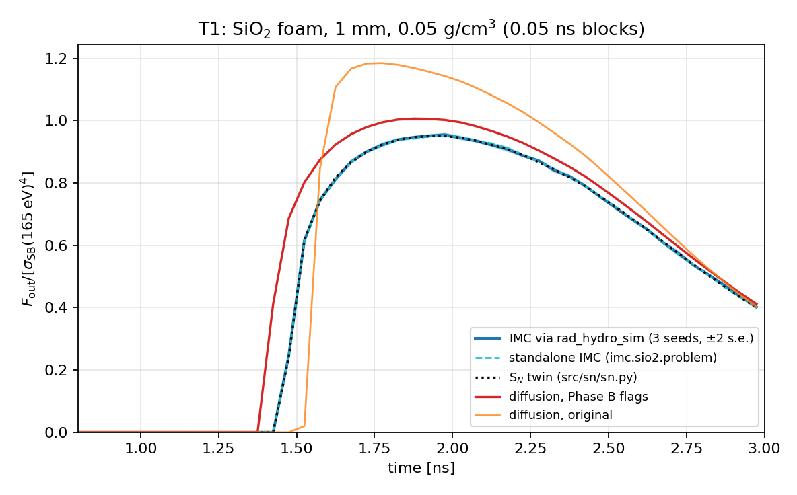
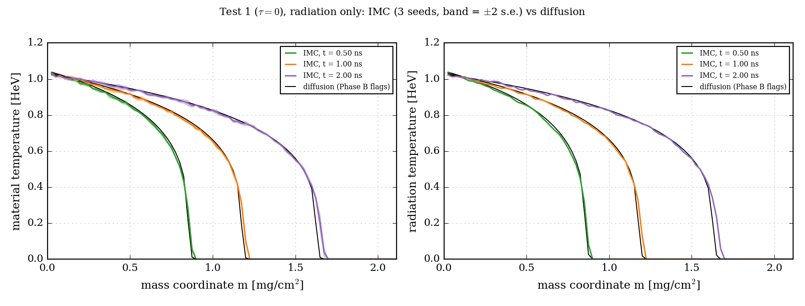
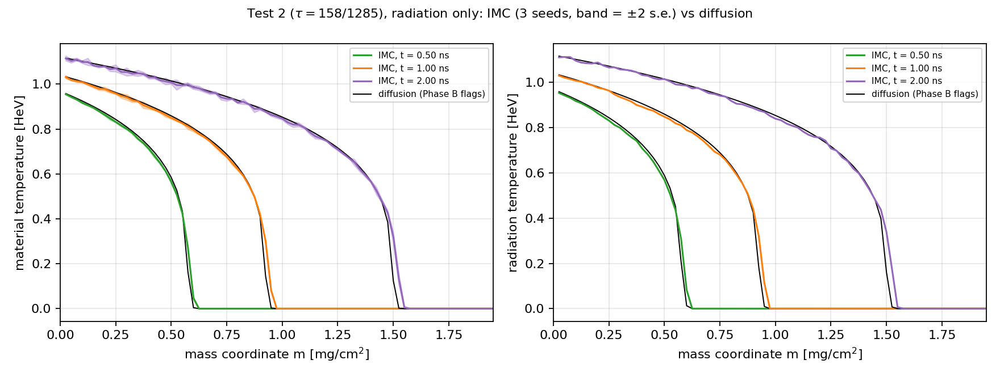
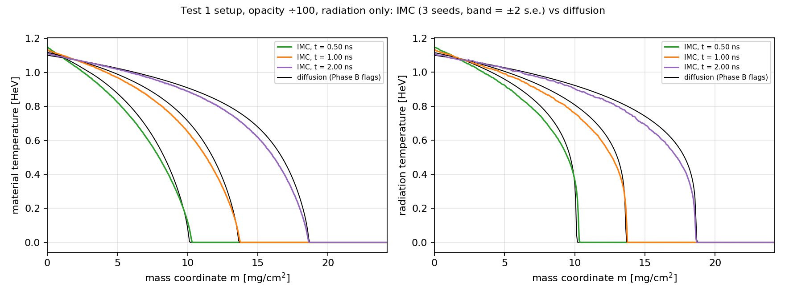

# Phase B results: diffusion vs. IMC on the M4 test ladder

These are the comparisons that close Phase B of `md/plans/full_plan_imc_comparison.md`. The diffusion-code changes are in `md/phase_b/phase_b_diffusion_changes.md`; the IMC coupling is in `md/imc_code/imc_coupling.md`.

**Setup, common to every comparison:**
- Both solvers ran in rad_hydro_sim on the same mesh, with the same dt sequence (`dt_ramp_max`: ramp by ×1.1 to 1 ps for SiO₂, 2 ps for gold) and the same Marshak bath.
- Diffusion used the Phase B flags `material_update="conservative"` and `right_rad_bc="marshak_vacuum"`.
- IMC used 3 seeds, shown as mean ± 2 s.e.
- All runs are radiation-only (static mesh). Hydro coupling is Phase C.

## 1. Summary

| Case | Optical regime | Diffusion vs. transport | Energy error |
|---|---|---|---|
| T1: SiO₂ foam, 1 mm, 0.05 g/cm³ | intermediate | diffusion breaks out 0.05 ns early; peak flux +5% | diffusion 7×10⁻¹⁵, IMC 1×10⁻¹² |
| T3: paper Test 1, radiation-only | thick | heat front within 0.9% (0.2% at 2 ns); T median within 0.5–1.1% | 2×10⁻¹⁵ / 2×10⁻¹² |
| T3: paper Test 2, radiation-only | thick | heat front within 0.9% (0.1% at 2 ns); T median within 0.7–1.3% | 2×10⁻¹⁵ / 1×10⁻¹² |
| T2: Test 1 with opacity ÷100 | thinner | diffusion's front 3.6–4.6% ahead; T median 1.7–5.4% off | 1×10⁻¹⁴ / 3×10⁻¹² |

The pattern is the expected one. Where the medium is optically thick (gold), gray diffusion reproduces transport to about 1%, which supports using it for the manuscript's gold benchmarks. As the optical depth drops, diffusion without a flux limiter propagates too fast. The excess is about 4% in front position at opacity ÷100, and in SiO₂ it shows as an early breakout and a 5% higher peak.

## 2. T1: SiO₂ foam (the opening benchmark)

`PRESET_SIO2_FOAM_RADIATION_ONLY`: 100 cells, tabulated synthetic drive, 3 ns. The plot shows the outgoing flux at the far face, in 0.05 ns blocks.



| Solver | Breakout (flux ≥ 0.01) | Peak |
|---|---|---|
| IMC via rad_hydro_sim | 1.475 ns | 0.955 at 1.975 ns |
| standalone IMC (`imc.problems.sio2`) | 1.475 ns | 0.953 at 1.975 ns |
| S_N twin | 1.475 ns | 0.950 at 1.925 ns |
| diffusion, Phase B flags | 1.425 ns | 1.006 at 1.875 ns |
| diffusion, original | 1.525 ns | 1.184 at 1.775 ns |

- **The three transport solutions coincide.** IMC through rad_hydro_sim vs. standalone gives χ²/dof = 1.39 and a mean difference of +0.09%. IMC vs. S_N differs by +0.04% on average, rms 0.35%. This validates the coupling (`md/imc_code/imc_coupling.md` §5).
- **Diffusion with the Phase B flags** breaks out about 0.05 ns early and peaks 5% high. This is the diffusion approximation itself. The foam is only moderately thick, so the diffusion flux (unlimited) overestimates transport ahead of the front.
- **The original diffusion** is 24% high at the peak. Most of that is its energy leak (14% maximum energy error); see `md/phase_b/phase_b_diffusion_changes.md` §2.2.

## 3. T3: the paper's gold tests, radiation-only

`PRESET_PAPER_TEST1_RADIATION_ONLY` and `PRESET_PAPER_TEST2_RADIATION_ONLY` use the manuscript's material and Marshak bath with the mesh held fixed. The domain is cut to 10⁻² g/cm² with 400 cells (2.5×10⁻⁵ g/cm² per cell), so the heated layer spans 30–65 cells. With the presets' 2.5×10⁻² g/cm² and 100 cells only 3 cells were heated, too coarse to compare.





| | t [ns] | Heat front (T = 0.5 HeV), diffusion → IMC | T in the heated region, median / max difference | IMC s.e. |
|---|---|---|---|---|
| Test 1 | 0.5 | 8.12 → 8.05 ×10⁻⁴ g/cm² (−0.9%) | 1.1% / 5.9% | 0.33% |
| | 1.0 | 1.120 → 1.116 ×10⁻³ (−0.4%) | 0.8% / 2.4% | 0.38% |
| | 2.0 | 1.548 → 1.550 ×10⁻³ (+0.2%) | 0.5% / 4.5% | 0.41% |
| Test 2 | 0.5 | 5.32 → 5.27 ×10⁻⁴ (−0.9%) | 1.3% / 3.6% | 0.26% |
| | 1.0 | 8.744 → 8.741 ×10⁻⁴ (−0.0%) | 0.8% / 2.6% | 0.35% |
| | 2.0 | 1.437 → 1.438 ×10⁻³ (+0.1%) | 0.7% / 10.8% | 0.43% |

How to read these:
- **The material temperatures agree** at the level of about two IMC standard errors over most of the heated layer. The maximum differences are in the one or two cells at the steep front, where a cell is many mean free paths thick.
- **The radiation temperature** (right panels) uses the IMC's track-length estimate; see `md/imc_code/imc_coupling.md` §4 for why not the census.
- **The surface temperature** (first cell) agrees to better than 1% after 0.5 ns. Early on, the diffusion code's Marshak flux uses the cell-center E₀ (`md/phase_b/phase_b_diffusion_changes.md` §5.3), and the bath exceeds the surface temperature most early (T_bath⁴ ∝ 1 + 0.169 t_ns^−0.41).

## 4. T2: thinner gold (opacity ÷100)

The Test 1 setup with g ×100 (opacity ÷100), on the presets' full domain with 400 cells. The bath is that case's own self-similar Marshak bath.



| t [ns] | Heat front, diffusion → IMC | T median / max difference | IMC s.e. |
|---|---|---|---|
| 0.5 | 8.35 → 7.96 ×10⁻³ g/cm² (−4.6%) | 5.4% / 11% | 0.08% |
| 1.0 | 1.180 → 1.133 ×10⁻² (−3.9%) | 3.3% / 14% | 0.09% |
| 2.0 | 1.672 → 1.612 ×10⁻² (−3.6%) | 1.7% / 22% | 0.10% |

The difference is now 20–50 standard errors: a real transport effect. The foot of the front, where T → 0, sits at the same mass in both solvers. The difference is in the shape behind it: diffusion is hotter through the wave, so its T = 0.5 HeV point lies 4% deeper. IMC radiation temperatures in all profile figures use the track-length (step-averaged) estimate. Together with T1 it brackets where gray diffusion stops being adequate for these drives.

## 5. The M3 gate on the full Test 1 (diffusion only)

Full rad-hydro paper Test 1 (`PRESET_FIG_8_CONSTANT_TEMPERATURE_MARSHAK`), N = 200, to 2 ns. The original diffusion vs. all three conservation flags (`conservative`, `rad_energy_per_mass`, `compatible`):

| t [ns] | Heat front (T = 0.5 HeV): original → flags | Paper m_front (for reference) | Surface T [HeV] |
|---|---|---|---|
| 0.5 | 7.790 → 7.790 ×10⁻⁴ g/cm² (+0.01%) | 7.13×10⁻⁴ | 0.9942 → 0.9941 |
| 1.0 | 1.0629 → 1.0628 ×10⁻³ (−0.01%) | 1.019×10⁻³ | 0.9965 → 0.9964 |
| 2.0 | 1.4795 → 1.4796 ×10⁻³ (+0.01%) | 1.457×10⁻³ | 0.9978 → 0.9977 |

**Energy error:** original, 19% maximum (early, while the energies are still small), 0.14% at 2 ns; with the flags, 7×10⁻¹⁴ throughout.

So for the paper's gold Test 1 the conservation fixes change nothing visible: the heat front moves by ≤ 0.02% and the shock position doesn't move. Two reasons: in dense gold the radiation energy is ~3×10⁻⁵ of the material's, and β is tiny, so the u_r-form error is small in absolute terms. The heat front at this coarse N sits 2–9% ahead of the paper's power law. That depends on the front definition (T = 0.5 HeV vs. the paper's ablation front) and on resolution, and it belongs to the Phase C/M10 comparisons with the paper's 1000 cells.

## 6. Reproducing these numbers

All runs, tables and figures come from one module, `src/rad_hydro_sim/verification/imc_vs_diffusion.py`:

```bash
uv run python -m rad_hydro_sim.verification.imc_vs_diffusion                                  # everything
uv run python -m rad_hydro_sim.verification.imc_vs_diffusion --figures-dir md/phase_b/figures  # and refresh this doc's figures
uv run python -m rad_hydro_sim.verification.imc_vs_diffusion --cases test1 --no-runs           # redo one table/figure from the cache
```

What it does:

- **Runs.** Each case is a loop over `simulate_rad_hydro` with the configurations stated above. The diffusion runs use `material_update="conservative", right_rad_bc="marshak_vacuum"`; the IMC runs use `radiation_solver="imc"` with seeds 1, 2, 3. For T1 it also runs the standalone IMC (`imc.problems.sio2.run_one`, seeds 1729, 2718, 3141) and the S_N twin (`sn.run_one`, 16 double-Gauss ordinates, dt = 1 ps).
- **Cache.** Every run is saved as an `.npz` in `results/imc_vs_diffusion/` (not tracked by git) and reused unless `--rerun` is given.
- **Outputs.** It writes the PNGs and `report.md`, which contains the breakout/peak table of §2 and the front/temperature tables of §§3–4.
- **T1 blocks.** The flux blocks are exact energy averages: the cumulative outflow, interpolated at the 0.05 ns block edges, divided by the block width.

The figures and tables in this document were first made with throwaway scratchpad scripts that this module replaces.
