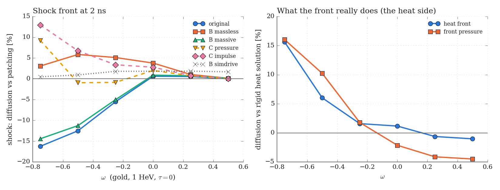
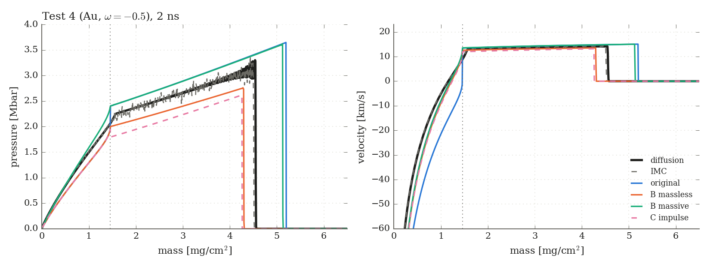

# LEGACY: better patching with a numerical target (fix B), proof of concept

> **Legacy, 2026-11-05.** Fix B is not an analytic model: `MovingFrontShock.run` integrates the
> Lagrangian Euler equations of the target in (m, t), a 1-D hydro simulation, so any curve built
> on it is a hybrid and cannot benchmark IMC and diffusion. It is kept as the record of what it
> established (the massless-front closure, §2 and §5.2–5.3), which the analytic patch builds on.
> The analytic follow-up (also legacy) is [`analytic_patching_impulse.md`](analytic_patching_impulse.md); the current reference is [`../bath_calibration.md`](../bath_calibration.md).
> Code: `src/menahem_new/legacy/moving_front_shock.py` and
> `src/rad_hydro_sim/verification/legacy/patching_fix_b.py`. Figures:
> `md/phase_c/figures/legacy/fix_B/`. Tables: `results/patching_poc/legacy/`.

Follow-up to `../why_the_solver_differs.md` §3.3. Branch `feat/patching-poc`, 2026-11-05.

**In one paragraph.** The rigid-front patching is wrong on the *target* side, and that can now be fixed exactly. A Lagrangian hydro of the target, driven at the moving ablation front m_f(t) (fix B), reproduces the simulated shock to 0.3–1.8% when it is given the simulation's own front history. It does so for every gold case with ω between −0.75 and +0.5. The closure that matters is a **massless front**: the target is pushed by the front pressure, and the matter swept into the ablated layer leaves with its momentum. The original patching turns out to be, to first order, the opposite closure, the **massive front**, in which the ablated layer decelerates with the front. That is why it overshoots the shock by 11–16% for ω ≤ −0.5. With the rigid heat solution as the drive, B‑massless cuts Test 4's shock error from −12.5% to +5.9%, and ω = −0.75's from −16.2% to +3.1%. What is left is on the **heat side**: for ω < 0 the real heat front runs ahead of the rigid self-similar one (+6% in Test 4, +16% at ω = −0.75). That is a third approximation of the solver that the earlier analysis did not separate out. A semi-analytic version of B (C_impulse) gets within 1–2% of B for ω ≥ −0.25 and within 1–4% at ω = −0.5. It falls 9–13% short at ω = −0.75, where the early, supersonic phase of the heat front dominates the history.

---

## 1. What was built

| | Where | What it is |
|---|---|---|
| `MovingFrontShock` | `src/menahem_new/legacy/moving_front_shock.py` | 1-D planar Lagrangian hydro (staggered von Neumann–Richtmyer, ideal gas, q-viscosity) of ρ₀x^(−ω), with its left boundary at the mass m_f(t). Cells are removed as the front sweeps them. ~3000 cells, 2–10 s per case. |
| `PatchedAblationSolver` | same | Fix B: the rigid heat solution (m_f(t), p_f(t)) drives `MovingFrontShock`. The heat layer is then shifted to the front's position **and velocity** (and, for the massive closure, pressure), so x, u and p are continuous at m_f. |
| `MatchedPistonPatch` | `src/menahem_new/ablation_patching.py` | Fix C: PistonShock kept self-similar, with an effective amplitude p_eff(t). `match="pressure"`: p_PS(m_f) = p_f at the cut (quasi-static). `match="impulse"`: the momentum beyond the cut equals what the moving front delivered, ∫(p_f − ṁ_f u_f)dt, marched in time. |
| driver | `src/rad_hydro_sim/verification/legacy/patching_fix_b.py` | Tables against the cached diffusion and IMC runs, the ω-scan runs, the verification (`--verify`) and the figures (`--figures`). |

The ω scan: Test 4 twins (gold, 1 HeV, τ = 0, uniform-mass mesh) at ω = −0.75, −0.25 and +0.25, plus ω = −0.5 at N = 400 as a resolution check against Test 4's N = 1000. Diffusion runs, with one IMC seed at N = 400. ω = +0.25 needs N = 2000 (§5).

```
uv run python -m rad_hydro_sim.verification.legacy.patching_fix_b --cases test1_full test4_full ...
uv run python -m rad_hydro_sim.verification.patching_poc --cases --omega-scan=-0.75 --seeds 1
uv run python -m rad_hydro_sim.verification.patching_poc --cases --omega-scan=0.25 --N 2000
uv run python -m rad_hydro_sim.verification.legacy.patching_fix_b --cases test1_full test4_full --verify
uv run python -m rad_hydro_sim.verification.legacy.patching_fix_b --figures
```

The first `AblationSolver` construction per case takes ~20 min. Solvers are pickled to `results/patching_poc/solver_<label>.pkl`, and every later call takes seconds.

## 2. Theory: what the patch has to get right

The target beyond the front (m > m_f) is a hydro problem with a boundary that moves *through the matter*. As m_f(t) grows, shocked target matter crosses into the ablated layer. The target's momentum balance is

  dΠ_target/dt = p_b − ṁ_f u_f,

where p_b is the pressure the front exerts on the target and u_f the velocity of the matter crossing it. This leaves one open question: what is p_b? It depends on how the ablated layer responds to the front's motion.

- **Massless front:** p_b = p_f, the rigid heat solution's front pressure. Each ablated element keeps the velocity it had when it crossed the front, and is then accelerated only by the layer's own (rigid) pressure gradient.
- **Massive front:** the layer rides on the front, u = u_f(t) + u_heat(m, t). Momentum balance of the layer then gives p_b = p_f − m_f du_f/dt. In the frame of the decelerating front, the layer feels a body force. This is the frame acceleration of the doc's fix C, applied in full.

**Why the original patching is the massive closure, to first order.** In PistonShock, the slab 0 < m < m_f is shocked matter between the piston and the cut, moving at about u_p and decelerating with it. Across it the pressure rises by ≈ m_f|du_p/dt|. That is the 20% jump at the cut in Test 4 (`../why_the_solver_differs.md` §3.1b), and it is exactly the massive closure's extra term. The numbers confirm it: B‑massive lands on the original to within 1–2% in every case (§4). So the original patch was never a "wrong mass" bookkeeping error. It assumes the ablated layer decelerates with the front.

**The ω dependence follows.** For ω < 0 the piston decelerates, u_p ∝ t^((ω+c₃)/(2−ω)), and m_f/m_s ∝ t^(−0.42) at ω = −0.5. The inertial term m_f|a|/p_f is then large: 20% in Test 4, 39% at ω = −0.75 at 2 ns. For ω = 0 it is ~3%. For ω > 0, m_f ≪ m_s and the closures coincide.

**Idea tried and rejected: only the acoustically connected part of the layer pushes.** If the outer, fast-expanding layer could not signal back to the front, the inertia felt by the target would be m_f − m*, with m* the sonic point of the C⁺ characteristics (ρc·t = α·m in the self-similar layer). In the heat solutions of Tests 1, 4, 5 and 6, ρc·t/(α·m) = 1.5–2.8 throughout the layer: there is no sonic point inside it. This idea therefore reduces to the massive closure, and it doesn't explain the simulations.

## 3. Verification of the moving-front hydro

1. **Fixed front (m_f = 0) vs. PistonShock:** shock −0.2 … −0.6%, piston velocity ≤ 0.4%, for ω = −0.5 and 0 and τ = 0 and −0.2.
2. **Moving front driven by PistonShock's own cut pressure, p_b = p_PS(m_f(t), t).** The restriction of PistonShock to m > m_f is a solution with that boundary data, so B must reproduce it. It does, to within −0.08 … −0.20% at all four times, for Tests 1, 3, 4, 5 and 6 (`--verify`).

Check 2 caught two bugs that are now fixed. (a) Before the PistonShock shock reaches the cut, the front pressure is 0 and the cold target has no sound speed, so nothing limited dt and the solver stepped over the onset of the push (Test 4 had been −24%). (b) Starting at 10⁻³ t_end missed ~2% of the impulse (Test 1 had been −1.3%). The start is now 10⁻⁶ t_end, with dt ≤ 0.01 t and the front moving at most half a cell per step.

## 4. Results

Shock front, diffusion vs. each patching (%, + means the simulation is ahead). The heat front, front pressure and the other times are in `results/patching_poc/legacy/<label>_table.md`.

| case | ω | m_f/m_s | t | original | B_massless | B_massive | C_pressure | C_impulse | **B_simdrive** |
|---|---|---|---|---|---|---|---|---|---|
| ω scan, N=400 | −0.75 | 45% | 1 ns | −11.4 | +2.4 | −10.6 | +31.6 | +17.5 | **+0.3** |
| | | | 2 ns | −16.2 | **+3.1** | −14.4 | +9.2 | +12.9 | **+0.5** |
| Test 4, N=1000 | −0.5 | 28% | 1 ns | −14.3 | +4.2 | −12.7 | +1.9 | +8.4 | **+0.9** |
| | | | 2 ns | −12.5 | **+5.9** | −11.3 | −0.9 | +6.7 | **+0.9** |
| ω scan, N=400 | −0.5 | 28% | 2 ns | −12.5 | +5.9 | −11.2 | −0.9 | +6.8 | **+1.3** |
| ω scan, N=400 | −0.25 | 15% | 1 ns | −6.8 | +5.5 | −6.1 | −0.8 | +4.1 | **+1.8** |
| | | | 2 ns | −5.5 | +5.1 | −5.0 | −0.8 | +3.4 | **+1.8** |
| Test 1 | 0 | 7% | 2 ns | +0.6 | +3.8 | +0.9 | +2.0 | +2.8 | (+1.3) |
| Test 2 (τ>0) | 0 | 8% | 2 ns | +2.0 | +2.6 | +2.2 | +2.3 | +2.4 | (+1.1) |
| ω scan, N=2000 | +0.25 | 2.4% | 2 ns | +0.5 | +1.0 | +0.7 | +0.7 | +0.8 | **+1.8** |
| Test 3 | +0.5 | 0.5% | 2 ns | 0.0 | +0.1 | +0.1 | 0.0 | 0.0 | **+1.7** |
| Test 5 (Cu) | 0 | 8% | 2 ns | −4.7 | −1.5 | −4.4 | −3.3 | −2.5 | (+1.9) |
| Test 6 (Al) | 0 | 16% | 2 ns | −7.8 | −2.8 | −7.5 | −5.1 | −3.9 | (+4.4) |

B_simdrive is the diagnostic: the moving-front target driven by the diffusion run's own m_heat(t) and front pressure p_abl(t). Values in parentheses use runs whose stored front series predates the current front definition: their m_heat and p_abl series are 2–6% off the snapshot values. Those diagnostics are approximate, and the bold ones are clean.

IMC agrees with diffusion on the new ω runs to 0.9–1.4% in the shock (−0.75: −1.0%, −0.5: −0.9%, −0.25: −1.4%), as in the old tests.



*Left: shock error against ω for each patching (gold, 1 HeV, τ = 0). Right: the simulated heat front and front pressure against the rigid heat solution's.*



*Test 4 at 2 ns. The original patching jumps in p and u at m_f (dotted). B and C are continuous. The simulated layer velocity sits on the front-shifted heat solution, and the simulated layer pressure follows the rigid heat profile (orange), not p′ + m|a| (green).*

## 5. Conclusions

1. **The target side is solved by fix B.** Driven by the true front history, the moving-front target reproduces the simulated shock to 0.3–1.8% for every clean gold case, from ω = −0.75 to +0.5. With PistonShock's own cut pressure it reproduces PistonShock to 0.2%. Nothing else is needed on the target side.
2. **The massless front is the physically right closure.** Three things show it. (a) The simulated pressure inside the ablated layer follows the rigid heat profile, not p′ + m|a| (Test 4 profiles). (b) The simulated layer velocity is the rigid one shifted by u_f, which the massless model also produces. (c) B‑massive is no better than the original, which it reproduces to within 1–2%.
3. **The original patching = the massive closure.** Its error scales with m_f|du_f/dt|/p_f: −12.5% in Test 4 and −16% at ω = −0.75, while it is right for ω ≥ 0 where that term is small. This replaces the "mass bookkeeping" explanation of `../why_the_solver_differs.md` §3.1–3.2 with a dynamical one: the ablated layer does not decelerate with the front.
4. **What remains is a heat-side approximation not identified before.** With the rigid heat solution as the drive, B‑massless still leaves +3 … +6% for ω < 0. B_simdrive removes it, so it comes entirely from m_f(t) and p_f(t). The simulated heat front runs ahead of the rigid one by +16% (ω = −0.75), +6% (−0.5), +1.6% (−0.25), +1.2% (0), and −0.6 … −1% (ω > 0). The errors are larger early on: +19% at 0.5 ns in Test 4. The likely cause is the heat solution's front condition ṽ(ξ_f) = 0, a front against an infinitely dense wall. For ω < 0 the target near x = 0 is light (ρ₀x^(−ω) → 0), so the shocked matter ahead of the front is far from a dense wall: in Test 4 it is ~4 g/cm³ at 2 ns, and lighter at earlier times. This is a hypothesis. It is not tested here.
5. **Fix C, semi-analytic.**
   - *C_pressure* (quasi-static, p_PS(m_f) = p_f) happens to land within 1% for ω = −0.25 and −0.5 at late times. It is wrong by +32% at ω = −0.75 and early times, because it applies today's m_f/m_s to the whole history. It is a coincidence, not a theory.
   - *C_impulse* (momentum beyond the cut = momentum delivered by the massless front, marched in time) is the consistent semi-analytic version of B‑massless. It tracks B within 1–2% for ω = −0.25 … +0.5 (0.2–0.6 s per case). At ω = −0.5 it is 1–4% short of B (0.8% at 2 ns, 3.9% at 1 ns), and at ω = −0.75 9–13% short. There, most of the history is the early phase with m_f > m_s, when the heat front is ahead of any shock it could drive and a piston-at-0 profile cannot represent the target.
6. **The older tests are not broken.** For Tests 1, 2, 3 and ω = +0.25, all patchings agree with each other and the simulation to ≤ 4%. B‑massless is 3% worse than the original in Test 1 (+3.8% vs. +0.6%), and the clean diagnostic isn't available for that run. For Cu and Al, B‑massless improves the shock from −4.7/−7.8% to −1.5/−2.8%. Their LTE issue (§2 of the earlier doc) is separate and still there in the front pressure.

## 6. Recommendation and next steps

- **For the reference curve in the paper:** use **B‑massless** for ω < 0. It is a few seconds of 1-D hydro, continuous in x, u and p, and it removes the 12% Test 4 gap down to +6%, with the remainder attributable to the heat side. Keep the original closed form for ω ≥ 0, where the two agree to ≤ 1%. State the residual as a heat-side approximation, not a patching error.
- **Theory, if wanted (for Menahem):**
  1. Show that the massless closure is right, i.e. that the layer's pressure is unaffected by the front's deceleration to first order. The profiles show it, but there's no derivation yet.
  2. Solve the heat wave with a finite-density inflow at the front (v_target(t) instead of ṽ = 0). It isn't self-similar, but it can be treated as a perturbation in v_target/v_layer, which is the candidate explanation of conclusion 4. A cheap test before any theory: rerun Test 4 with a denser target at the same mass history. If the heat-front excess shrinks, the hypothesis holds.
  3. A better early-time model for C_impulse: an explicit supersonic-to-subsonic transition for the front, instead of the cap used here.
- **Not done (POC scope):** convergence of the ω-scan simulations beyond N = 400/2000; IMC for ω = +0.25 at N = 2000; multiple IMC seeds for the scan; clean front series for Tests 1, 2, 5, 6 (rerunning them, ~1 min each for diffusion, would make B_simdrive clean there too).

## 7. Profile figures with the corrected patching

`--profiles` redraws each case's `<label>_profiles` figure (ρ, p, u, T against mass at 1, 1.5 and 2 ns; diffusion per time, IMC dashed green) with the corrections on top. The black solid curve is B (massless moving front), the black dotted curve is C_impulse, and the gray dashed curve is the original AblationSolver.

```
uv run python -m rad_hydro_sim.verification.legacy.patching_fix_b --cases test1_full test4_full ... --profiles
uv run python -m rad_hydro_sim.verification.legacy.patching_fix_b --omega-scan -0.75 --profiles
uv run python -m rad_hydro_sim.verification.legacy.patching_fix_b --omega-scan 0.25 --N 2000 --profiles
```

| ω (gold) | figure |
|---|---|
| −0.75 | [figures/legacy/fix_B/profiles/omegam075_profiles.png](../figures/legacy/fix_B/profiles/omegam075_profiles.png) |
| −0.5 (Test 4, N = 1000) | [figures/legacy/fix_B/profiles/test4_full_profiles.png](../figures/legacy/fix_B/profiles/test4_full_profiles.png) |
| −0.5 (scan, N = 400) | [figures/legacy/fix_B/profiles/omegam050_profiles.png](../figures/legacy/fix_B/profiles/omegam050_profiles.png) |
| −0.25 | [figures/legacy/fix_B/profiles/omegam025_profiles.png](../figures/legacy/fix_B/profiles/omegam025_profiles.png) |
| 0 (Test 1; Test 2 with τ > 0) | [test1_full](../figures/legacy/fix_B/profiles/test1_full_profiles.png), [test2_full](../figures/legacy/fix_B/profiles/test2_full_profiles.png) |
| +0.25 (N = 2000, no IMC) | [figures/legacy/fix_B/profiles/omegap025_n2000_profiles.png](../figures/legacy/fix_B/profiles/omegap025_n2000_profiles.png) |
| +0.5 (Test 3) | [log mass axis](../figures/legacy/fix_B/profiles/test3_smooth_profiles.png), [linear mass axis](../figures/legacy/fix_B/profiles/test3_smooth_profiles_linear.png) (`--linear`) |
| Cu, Al (ω = 0) | [test5_full](../figures/legacy/fix_B/profiles/test5_full_profiles.png), [test6_full](../figures/legacy/fix_B/profiles/test6_full_profiles.png) |

What they show:
- **ω < 0:** the original patch jumps in every quantity at m_f, and its shock (gray) runs ahead of the simulations. B is continuous and close to diffusion and IMC in ρ, u and T. The visible remainder is in the pressure: the simulations' front pressure is higher and their heat front further out, which is the heat-side residual of §5.4.
- **ω ≥ 0:** the three analytic curves lie on top of each other and on the simulations. In Test 1, B is ~3% behind the simulated shock, while the original lies on it (§5.6).
