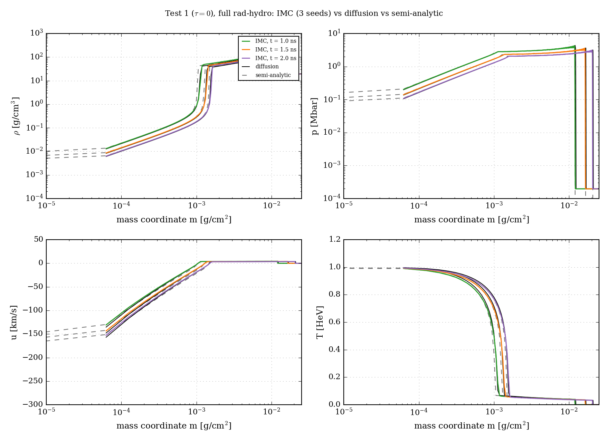
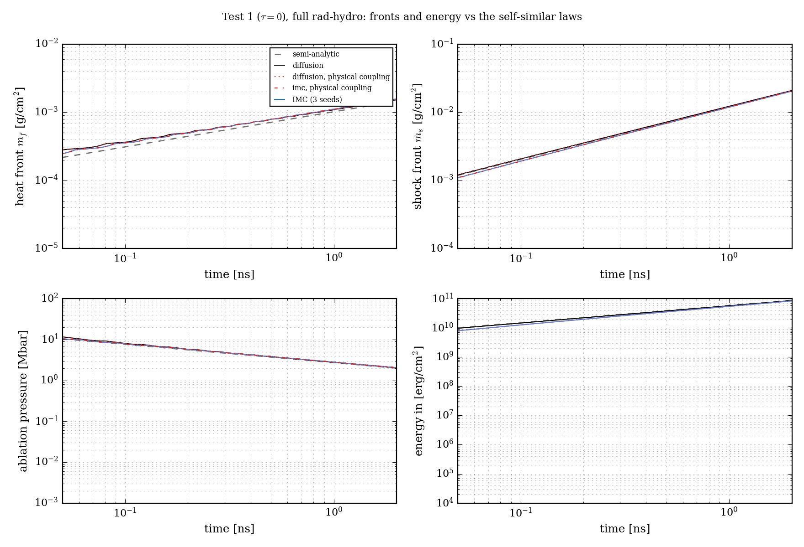
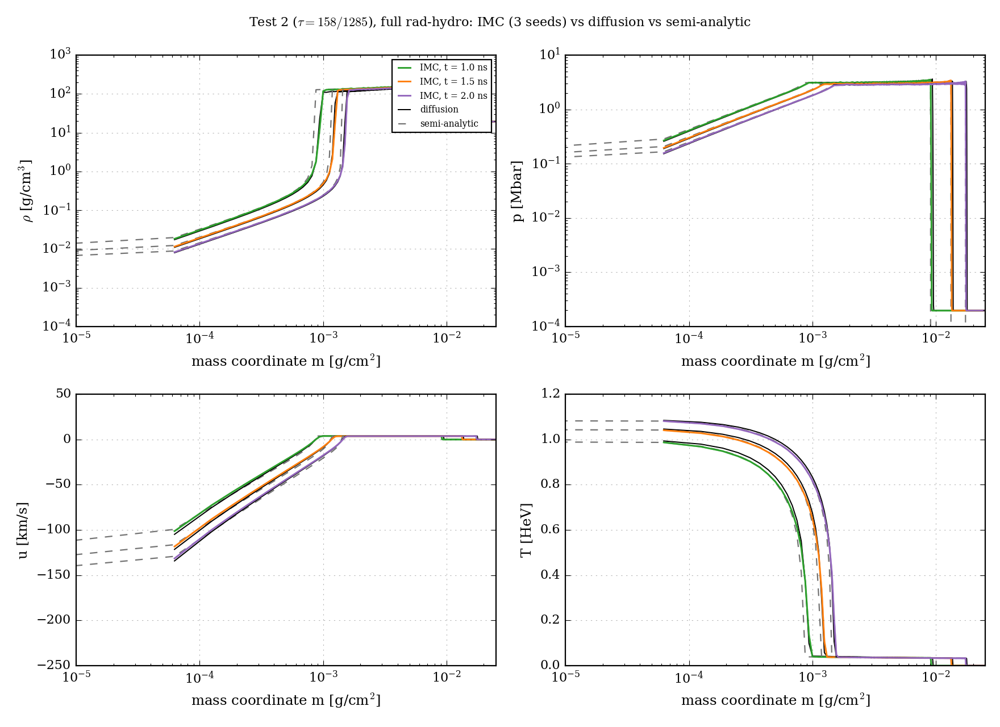
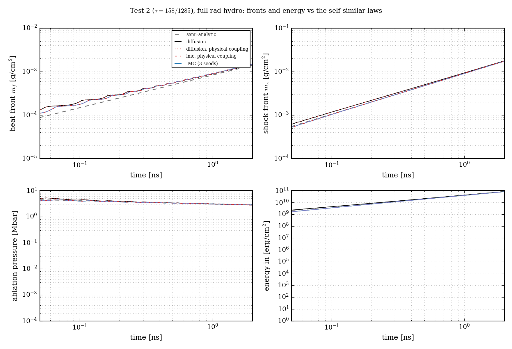

# Phase C results: IMC vs. diffusion vs. the semi-analytic solution, full rad-hydro

These are the comparisons that close Phase C of `md/plans/full_plan_imc_comparison.md` (milestone M5 and its sub-step M5b). The code changes are in `md/phase_c/phase_c_changes.md`; the IMC adapter is in `md/imc_code/imc_coupling.md`.

**Setup, common to every run:**
- The manuscript's Tests 1 and 2 (`PRESET_PAPER_TEST1`, `PRESET_PAPER_TEST2`): gold, Marshak bath, χ = 1, 2.5×10⁻² g/cm², 2 ns. Both solvers ran in rad_hydro_sim on the same Lagrangian mesh (uniform in mass), with the same dt rule (ramp ×1.1 to 2 ps, capped by the hydro CFL) and the same bath.
- Diffusion: the Phase B flags `material_update="conservative"`, `right_rad_bc="marshak_vacuum"`, plus `rad_energy_per_mass=True` and `hydro_energy="compatible"`. These are the conservation flags; IMC needs the per-mass one (`md/phase_c/phase_c_changes.md` §2.1).
- IMC: the same flags, 20 000 emission + 20 000 bath packets per step, seeds 1–3, shown as mean ± s.e.
- Both use the matched coupling (the manuscript's equations, no radiation pressure) unless stated.
- The reference is Menahem's semi-analytic `AblationSolver` (the subsonic heat wave patched to the piston shock).
- Fronts are read off the density (`md/phase_c/phase_c_changes.md` §3.5). The heat (ablation) front is where ρ climbs back to ρ₀; the shock is where the compression falls through half its peak; the ablation pressure is p at the heat front.

## 1. Summary

| | Test 1 (τ = 0) | Test 2 (τ = 158/1285) |
|---|---|---|
| IMC vs. diffusion, heat front | +0.8% … +3.0% | +0.8% … +3.9% |
| IMC vs. diffusion, shock front | −2.0% … −3.0% | −2.0% … −3.3% |
| IMC vs. diffusion, ablation pressure | +0.2% … +1.4% | −2.3% … +1.8% |
| IMC vs. diffusion, energy in at 2 ns | −3.2% | −2.9% |
| both vs. semi-analytic, heat front | diffusion +5…8%, IMC +7…9% | diffusion +4…7%, IMC +6…9% |
| both vs. semi-analytic, shock, pressure | within 3% | within 3.4% |
| energy error (max over the run) | diffusion 7×10⁻¹⁴, IMC 1×10⁻¹¹ | 7×10⁻¹⁴ / 8×10⁻¹² |
| physical coupling (P_rad) vs. matched | ≤ 0.1% on all three | ≤ 0.1% on the fronts |
| A9: max v/c, max Σ τ v/c | 6×10⁻⁴, 1.3×10⁻² | 5×10⁻⁴, 6×10⁻³ |

(Ranges over t = 1, 1.5, 2 ns, N = 400 cells.)

**Transport and diffusion agree on the paper's gold tests to 1–4% in every hydrodynamic quantity, and both agree with the semi-analytic solution.** The remaining offsets from the analytic solution at N = 400 are mostly spatial resolution: one cell is 6.25×10⁻⁵ g/cm², 4% of the heat front's mass at 2 ns, and the analytic front is a discontinuity (§4). At the paper's N = 1000 (§5) the heat fronts of IMC and diffusion agree to ≤ 0.9% and lie within 0.8–2.6% of the analytic m_f(t). What remains is a ~2% transport effect at the ablation surface: IMC delivers ~2% less energy, and its shock trails by 1.5–2%. The paper's gold tests are deep in the diffusion regime, so this is the expected outcome. It supports the manuscript's use of gray diffusion, and through it the semi-analytic solution, for gold.

## 2. Test 1





| quantity | t [ns] | semi-analytic | diffusion | IMC (mean ± s.e.) | IMC vs. diffusion |
|---|---|---|---|---|---|
| heat front [g/cm²] | 1.0 | 1.019×10⁻³ | 1.097×10⁻³ (+7.7%) | 1.112×10⁻³ ± 3×10⁻⁸ (+9.2%) | +1.4% |
| | 1.5 | 1.256×10⁻³ | 1.323×10⁻³ (+5.3%) | 1.363×10⁻³ ± 3×10⁻⁷ (+8.6%) | +3.0% |
| | 2.0 | 1.457×10⁻³ | 1.538×10⁻³ (+5.6%) | 1.565×10⁻³ ± 1×10⁻⁷ (+7.4%) | +1.7% |
| shock front [g/cm²] | 1.0 | 1.214×10⁻² | 1.226×10⁻² (+1.0%) | 1.189×10⁻² (−2.0%) | −3.0% |
| | 1.5 | 1.662×10⁻² | 1.675×10⁻² (+0.8%) | 1.635×10⁻² (−1.7%) | −2.4% |
| | 2.0 | 2.078×10⁻² | 2.091×10⁻² (+0.6%) | 2.049×10⁻² (−1.4%) | −2.0% |
| ablation pressure [Mbar] | 1.0 | 2.729 | 2.806 (+2.8%) | 2.811 ± 0.011 (+3.0%) | +0.2% |
| | 1.5 | 2.276 | 2.302 (+1.1%) | 2.335 ± 0.006 (+2.6%) | +1.4% |
| | 2.0 | 2.001 | 2.039 (+1.9%) | 2.049 ± 0.006 (+2.4%) | +0.5% |
| energy in [erg/cm²] | 2.0 | 8.893×10¹⁰ | 8.718×10¹⁰ (−2.0%) | 8.438×10¹⁰ ± 1×10⁷ (−5.1%) | −3.2% |

The profiles of ρ, p, u and T at 1, 1.5 and 2 ns lie on top of each other through the ablated layer, the plateau and the shock. The visible differences are the position of the steep density rise at the ablation front, about one cell, and the outermost ablated cell: the semi-analytic solution continues to m → 0, while the simulations' first cell holds 6.25×10⁻⁵ g/cm².

## 3. Test 2





| quantity | t [ns] | semi-analytic | diffusion | IMC (mean ± s.e.) | IMC vs. diffusion |
|---|---|---|---|---|---|
| heat front [g/cm²] | 1.0 | 8.343×10⁻⁴ | 8.944×10⁻⁴ (+7.2%) | 9.101×10⁻⁴ ± 7×10⁻⁸ (+9.1%) | +1.8% |
| | 1.5 | 1.131×10⁻³ | 1.174×10⁻³ (+3.8%) | 1.220×10⁻³ ± 2×10⁻⁷ (+7.8%) | +3.9% |
| | 2.0 | 1.404×10⁻³ | 1.469×10⁻³ (+4.7%) | 1.481×10⁻³ ± 3×10⁻⁷ (+5.5%) | +0.8% |
| shock front [g/cm²] | 1.0 | 9.080×10⁻³ | 9.385×10⁻³ (+3.4%) | 9.074×10⁻³ (−0.1%) | −3.3% |
| | 1.5 | 1.328×10⁻² | 1.361×10⁻² (+2.5%) | 1.327×10⁻² (−0.1%) | −2.5% |
| | 2.0 | 1.739×10⁻² | 1.774×10⁻² (+2.0%) | 1.739×10⁻² (−0.0%) | −2.0% |
| ablation pressure [Mbar] | 1.0 | 3.083 | 3.074 (−0.3%) | 3.12 ± 0.015 (+1.2%) | +1.5% |
| | 1.5 | 2.931 | 2.880 (−1.7%) | 2.931 ± 0.025 (+0.0%) | +1.8% |
| | 2.0 | 2.828 | 2.846 (+0.6%) | 2.781 ± 0.006 (−1.7%) | −2.3% |
| energy in [erg/cm²] | 2.0 | 8.402×10¹⁰ | 8.326×10¹⁰ (−0.9%) | 8.087×10¹⁰ ± 8×10⁶ (−3.7%) | −2.9% |

## 4. How to read the differences

- **The IMC standard errors are tiny, but the differences are not noise; they are discretization.** Each front sits in one cell at a time: the front series in the figures are staircases with one step per cell, and the steps are 4% of the front's mass at N = 400. A ±1-cell difference between two solvers is therefore ~±4%, and that is the size of the differences above. The same holds against the semi-analytic solution, whose fronts are exact.
- **The ablation pressure is p at the heat front,** which sits where the pressure has a kink (the end of the ablated profile, the start of the plateau). It jitters by ±2% as the front moves within a cell. That is why a single-seed comparison, such as physical vs. matched in Test 2 (+2.4%), can differ by more than its s.e. suggests.
- **IMC takes in 3% less energy than diffusion.** The bath is the same, so the difference is the energy re-emitted back through the surface. Diffusion's Marshak flux uses the cell-center E₀ of a first cell that, at N = 400, holds 6.25×10⁻⁵ g/cm² of hot, low-density plasma (`md/phase_b/phase_b_diffusion_changes.md` §5.3). IMC treats the surface exactly. The difference shrinks with resolution: at N = 100 IMC took in 0.7% less and its heat front was 20–23% deeper than diffusion's; at N = 400 the front difference is 1–4%. §5 continues the resolution study at the paper's N = 1000.
- **Energy is conserved to round-off** in all 12 runs, in both solvers. The IMC's 10⁻¹¹ is the per-step ledger accumulated over ~10⁴ steps.

## 5. Resolution: N = 1000, the paper's mesh

One diffusion and one IMC run (seed 1) per test at the manuscript's 1000 cells (2.5×10⁻⁵ g/cm² per cell, ~58 cells across the ablated layer at 2 ns):

| | t [ns] | heat front: diffusion / IMC vs. analytic | IMC vs. diffusion | shock: diffusion / IMC vs. analytic | ablation p: IMC vs. diffusion |
|---|---|---|---|---|---|
| Test 1 | 1.0 | +2.6% / +2.2% | −0.4% | −1.7% / −3.7% | +0.7% |
| | 1.5 | +1.9% / +1.5% | −0.4% | −1.5% / −3.2% | −0.5% |
| | 2.0 | +1.7% / +1.4% | −0.3% | −1.4% / −2.9% | +0.8% |
| Test 2 | 1.0 | +1.9% / +1.0% | −0.9% | +0.1% / −2.1% | −0.5% |
| | 1.5 | +1.2% / +0.8% | −0.3% | −0.0% / −1.7% | +1.2% |
| | 2.0 | +0.9% / +0.8% | −0.1% | −0.1% / −1.5% | −0.0% |

| | energy in at 2 ns: diffusion / IMC vs. analytic | IMC vs. diffusion | max energy error (diffusion / IMC) |
|---|---|---|---|
| Test 1 | −2.7% / −4.9% | −2.3% | 1×10⁻¹³ / 3×10⁻¹¹ |
| Test 2 | −1.5% / −3.5% | −2.1% | 1×10⁻¹³ / 2×10⁻¹¹ |

What refinement shows:
- **The heat-front offsets of §§2–3 were resolution.** From N = 400 to 1000, IMC vs. diffusion goes from +0.8…+3.9% to −0.1…−0.9%, and both solvers converge onto the analytic m_f(t) (from +4…9% to +0.8…2.6%). The ablation pressure agrees to ≤ 1.2%.
- **Two small differences survive refinement; they are transport effects.**
  - IMC takes in ~2.2% less energy than diffusion. The extra re-emission through the hot, low-density surface layer is exactly where diffusion with a cell-center Marshak condition is least accurate.
  - With slightly less energy and momentum delivered, the IMC shock trails diffusion's by 1.5–2%.
  - Both differences are of the size expected from the optical-depth check of the manuscript (§"Gray diffusion setup"): the ablated layer is thick overall, but its outermost cells are not.
- **The diffusion shock converges onto the analytic one** (Test 2: ≤ 0.1%), so the semi-analytic patching is confirmed independently of the transport question.

**Verdict for the paper (M5 gate):** on the manuscript's gold Tests 1 and 2, IMC transport, gray diffusion and the semi-analytic solution agree.
- Heat front: within 1% (IMC vs. diffusion) and 3% (vs. analytic).
- Ablation pressure: within 2%.
- Shock front: within 2–4%.
- Energy delivered: within 2–5%.

The residual differences are understood: resolution and the near-surface transport layer.

## 6. M5b: radiation pressure

`rad_coupling="physical"` adds P_rad = E_rad/3 to the momentum equation and charges its p dV work to the radiation (`md/phase_c/phase_c_changes.md` §2.4). On both tests and in both solvers, it moves the heat and shock fronts by ≤ 0.1% and the ablation pressure by ≤ 0.1% (diffusion; IMC within its single-seed jitter, §4), with energy still conserved to 10⁻¹³ / 10⁻¹¹. In the IMC runs, less than 0.05% of the work had to be rerouted to the matter at N = 400. The small effect was expected: P_rad/p = aT⁴/(3p) is at most 1.6×10⁻³ (T = 1 HeV, p = 2.8 Mbar) and less toward the front. **The manuscript's no-radiation-pressure assumption costs ≤ 0.1% on Tests 1–2,** which confirms the advisor's expectation (A7).

## 7. Reproducing these numbers

```bash
uv run python -m rad_hydro_sim.verification.imc_vs_diffusion --cases test1_full test2_full \
    --figures-dir md/phase_c/figures                                   # N = 400, seeds 1-3, ~5 min per IMC run
uv run python -m rad_hydro_sim.verification.imc_vs_diffusion --cases test1_full test2_full \
    --seeds 1 --hydro-n 1000 --no-physical --out results/imc_vs_diffusion_n1000      # Sec. 5
```

The seeds can run in parallel processes; they share the cache:

```bash
M="uv run python -m rad_hydro_sim.verification.imc_vs_diffusion"
$M --cases test1_full --seeds 1 &                                # diffusion, physical runs, IMC seed 1
$M --cases test1_full --seeds 2 --imc-only --no-physical &
$M --cases test1_full --seeds 3 --imc-only --no-physical &
wait; $M --cases test1_full --no-runs --figures-dir md/phase_c/figures
```

Cost on this machine at N = 400 (8 processes in parallel on 12 cores): diffusion 35–40 s (10 000–11 500 steps); IMC 240–300 s per seed.
