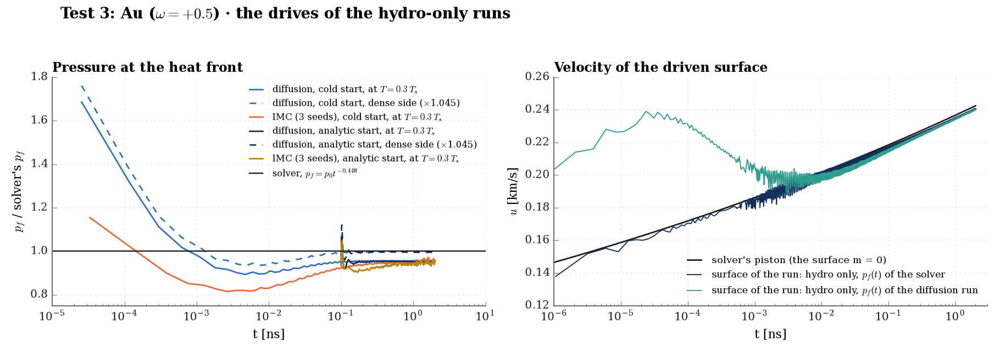
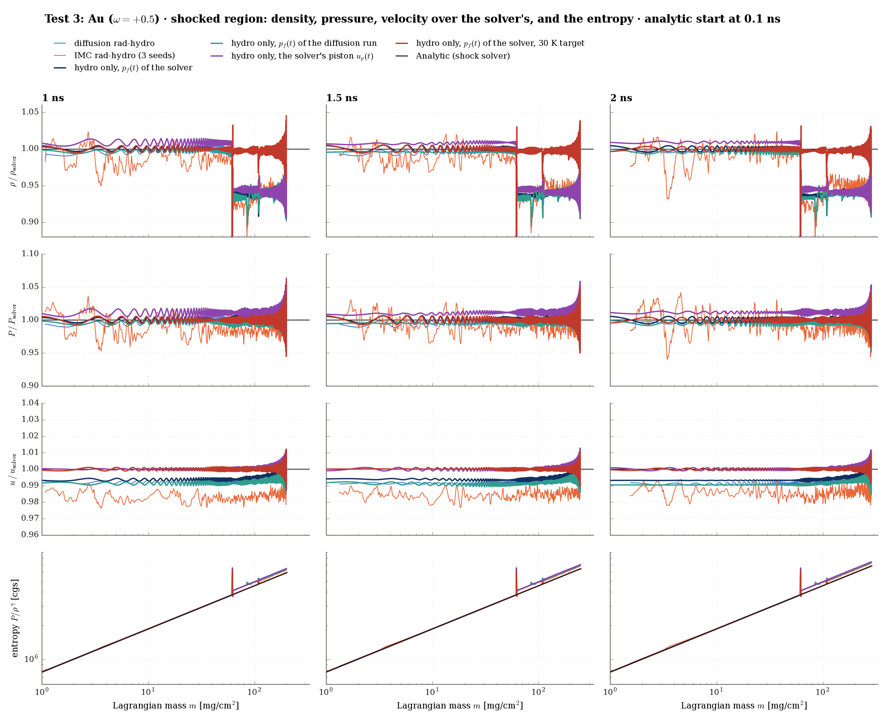
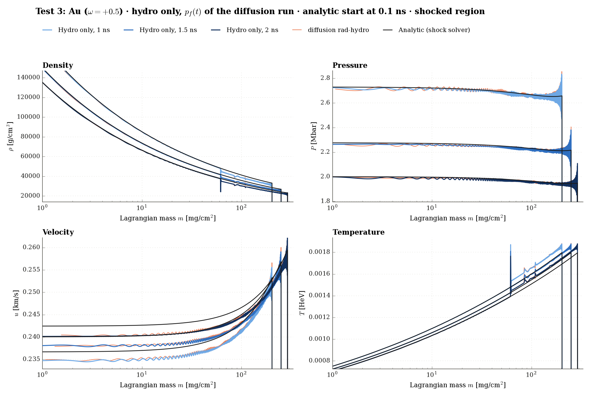
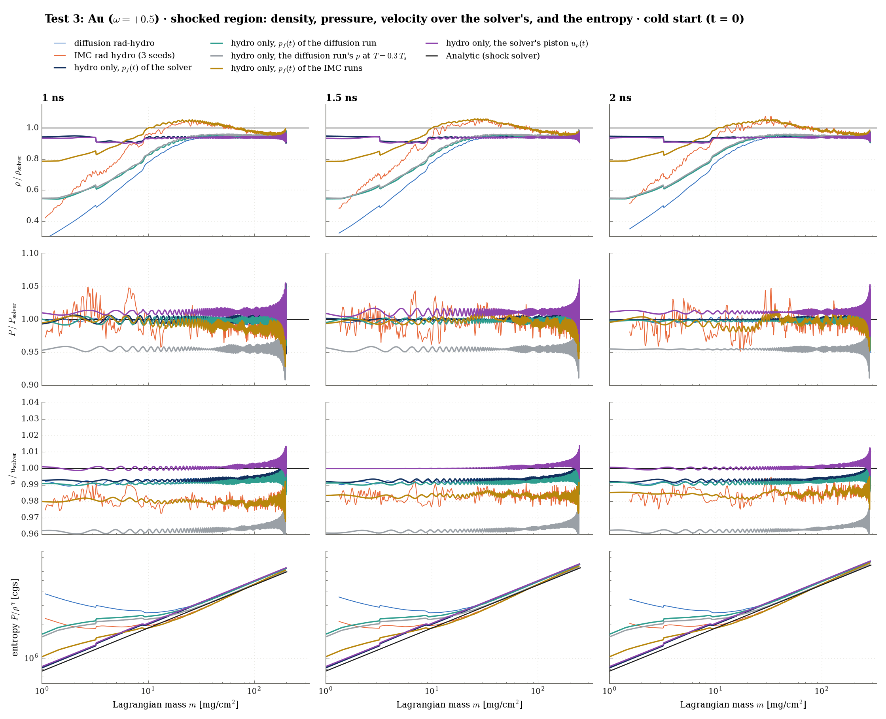
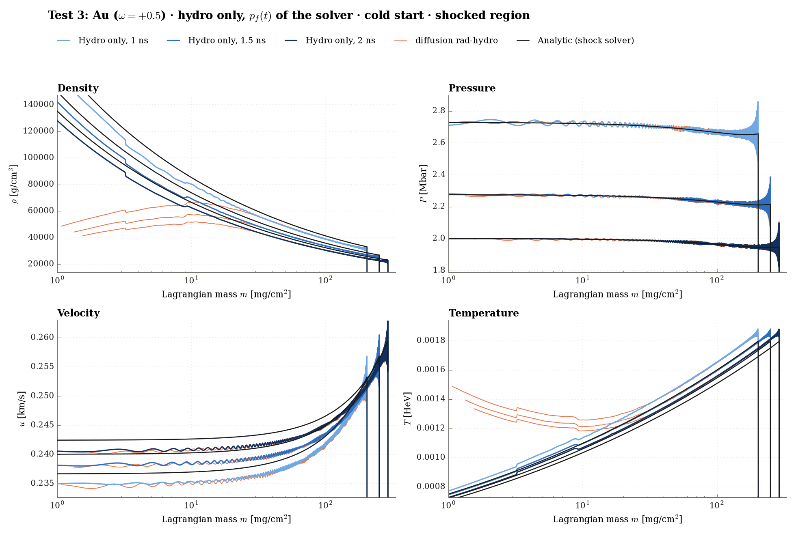
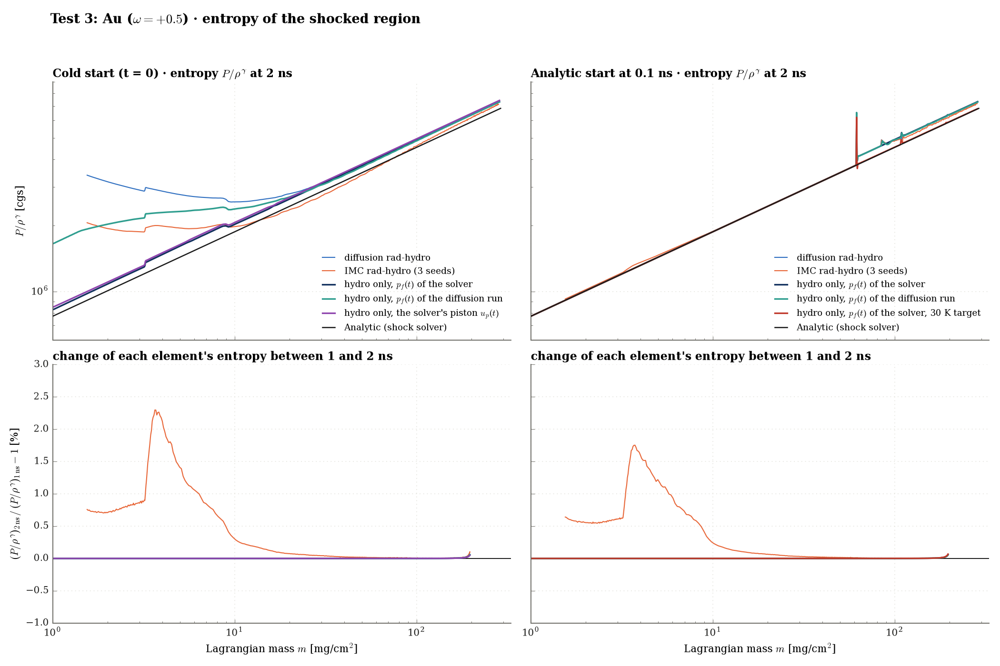

# Test 3: the shocked region as a hydro-only problem

Branch `feat/patching-poc`, 2026-11-10. Test 3 is gold with ω = +0.5 under the paper bath, on its fine mesh (1237 cells). Follows [test3_fix_A.md](test3_fix_A.md). Continued in [test3_on_the_solver.md](test3_on_the_solver.md), which settles § 4's open question: the rest of the cold start's imprint is the mesh at the start and the two temperatures.

**The question.** The semi-analytic solution assumes that no heat flux crosses the ablation front. The matter beyond it is then pure hydro, driven by the pressure at the front, p_f(t) = p₀ t^(−0.448), and the solver's shock part (`PistonShock`) is exactly that: a pressure applied at m = 0. If the assumption holds, a hydro-only run with the front's pressure (or with the piston's velocity) as its boundary condition must reproduce the shocked region of the rad-hydro runs. If it does not, heat reaches the shocked matter.

**The answer.** The assumption holds.

- From the analytic start, the hydro-only run driven by the diffusion run's front pressure reproduces the diffusion rad-hydro run's shocked region within 0.5% in density, pressure, velocity and entropy, including its ringing and its isolated steps.
- Everything that still separates the simulations from the solver there (density −6%, velocity −0.8%, entropy +8% in the matter the run shocks itself) is reproduced by hydro alone with the solver's own pressure. It is the 300 K target: with a 30 K target the hydro-only run is on the solver within 0.4% in all four quantities.
- The stored "ablation pressure" is 4.5% below the pressure the shocked matter feels, because it is sampled on the hot side of the density jump. On the dense side the simulations' pressure is within 0.6% of the solver's.
- The cold start's density deficit below ~30 mg/cm² is the one place where the test is not conclusive: hydro alone, driven by the stored front pressure, gives its shape, its extent and about half of its size (§ 4).

---

## 1. The runs

`src/rad_hydro_sim/verification/test3_hydro_only.py`. The hydro is the rad-hydro code's own: the same mesh, artificial viscosity, compatible energy update, CFL and 300 K target (`get_e_star_from_hydro`, `update_nodes_compatible`). There is no radiation step. The left boundary m = 0 is driven by one of:

| drive | boundary condition |
|---|---|
| `p_solver` | the solver's p_f(t) = p₀ t^(−0.448), p₀ = 2.54×10⁸ (cgs, t in s): 2.00 Mbar at 2 ns |
| `p_diffusion`, `p_imc` | the rad-hydro run's pressure on the dense side of the heat front (§ 2), tabulated in time |
| `p_diffusion_raw` | the rad-hydro run's stored `p_abl(t)` as it is |
| `piston` | the surface moves with the solver's piston velocity u_p(t) = 0.2424 km/s × (t / 2 ns)^0.035 |

Each drive runs from the cold target at t = 0 (`cold`, compared with `test3_smooth`) and from the `PistonShock` profile seeded at 0.1 ns (`seeded`, compared with fix A's `test3_smooth_analytic`). The runs take 4–7 million steps (12–19 min each); the energy error of the pressure-driven runs is 6×10⁻¹³ (cold) and 5×10⁻¹⁰ (seeded).

**Where the boundary is.** In the full problem the pressure acts at the ablation front m_f(t), which moves through the matter. Here it acts at the surface m = 0, as in the solver. The matter between, m < m_f(t), is 0.5% of the shocked mass, and the pressure difference across it (its mass times its acceleration) is below 0.1% of p_f. The comparison uses m > m_f only.

## 2. The pressure at the heat front

`drives.png`. The rad-hydro runs store `p_abl(t)`, the pressure where T = 0.3 T_s (`fronts_of_profile`): 316 times (diffusion, cold start) to 707 times (analytic start).



- **`p_abl` is not the pressure that drives the shock.** The point T = 0.3 T_s lies two cells on the hot side of the density jump, where the pressure still rises toward the dense matter. Diffusion, 2 ns, in units of the solver's p_f: 0.921, 0.949 (the T = 0.3 T_s cell), 0.989, 0.998 (the first dense cell), then 0.998 through the shocked plateau.
- **On the dense side the pressure is the solver's.** Averaged over 2–10 heat-front masses it is 0.997–0.999 of the solver's law at 0.5–2 ns from the cold start and 0.994–0.998 from the analytic start (diffusion); IMC scatters by ±2% around the same. The "ablation pressure −4.5 to −4.8%" in the tables of `test3_analytic_start.md` and `bath_calibration.md` is this sampling offset. It is not a deficit in the drive.
- **The drive used here** is `p_abl(t)` times the ratio dense side / `p_abl` measured at the four stored snapshots: 1.045 (diffusion; the same at all four to 0.3%) and 1.048 (IMC). The factor is applied to the whole series. Before the first snapshot (0.5 ns) nothing checks it, and before the first stored time (0.025 ps) the series is continued with the solver's exponent.
- **With `p_abl` as it is** (`p_diffusion_raw`) the hydro-only run has the plateau pressure 4.5% low, the velocity 3.7% low and the shock 1.5% behind. The rad-hydro run has none of these (pressure 0.998, shock 1.000), which confirms that its shocked matter feels the solver's pressure.
- **The start.** From the cold start the front pressure is 1.69× the solver's at 0.025 ps in diffusion and 1.16× in IMC, falls below it by 1 ps, and settles after ~0.1 ns.

## 3. Analytic start: hydro only reproduces the rad-hydro run

`ratio_seeded.png`: each run divided by the solver's shock solution, at 1, 1.5 and 2 ns.



At 2 ns (complete table: `results/phase_c/figures/test3_hydro_only/table.md`):

| | m [mg/cm²] | 5 | 20 | 50 | 100 | 200 |
|---|---|---|---|---|---|---|
| ρ / ρ_solver | diffusion rad-hydro | 0.997 | 0.997 | 0.995 | 0.933 | 0.936 |
| | hydro only, p_f of the diffusion run | 0.994 | 0.999 | 0.994 | 0.938 | 0.943 |
| | hydro only, p_f of the solver | 0.997 | 1.002 | 0.998 | 0.938 | 0.944 |
| | hydro only, p_f of the solver, 30 K target | 1.002 | 0.999 | 1.003 | 1.001 | 0.996 |
| | hydro only, the solver's piston | 1.010 | 1.008 | 1.008 | 0.946 | 0.939 |
| u / u_solver | diffusion rad-hydro | 0.990 | 0.992 | 0.992 | 0.993 | 0.995 |
| | hydro only, p_f of the diffusion run | 0.990 | 0.990 | 0.990 | 0.991 | 0.992 |
| | hydro only, p_f of the solver | 0.993 | 0.993 | 0.993 | 0.994 | 0.995 |
| | hydro only, p_f of the solver, 30 K target | 1.001 | 0.999 | 1.000 | 1.000 | 1.000 |
| | hydro only, the solver's piston | 0.999 | 1.001 | 1.001 | 1.000 | 1.003 |
| p / p_solver | diffusion rad-hydro | 0.996 | 0.997 | 0.995 | 0.997 | 0.993 |
| | hydro only, p_f of the diffusion run | 0.993 | 0.998 | 0.992 | 0.999 | 1.000 |
| | hydro only, the solver's piston | 1.013 | 1.010 | 1.011 | 1.013 | 1.008 |
| entropy / solver's | diffusion rad-hydro | 1.000 | 1.000 | 1.001 | 1.088 | 1.078 |
| | hydro only, p_f of the diffusion run | 1.000 | 1.000 | 1.000 | 1.082 | 1.077 |
| | hydro only, p_f of the solver, 30 K target | 1.000 | 1.000 | 1.000 | 1.002 | 1.003 |

- **Hydro only with the run's own front pressure is the rad-hydro run**, within 0.5% in ρ, p and u and 0.6% in entropy, at every mass and at the three times. The profiles lie on each other (`profiles_seeded_p_diffusion.png`), with the same ringing behind the shock and the same steps at 62, 85 and 110 mg/cm². Those features are therefore hydro: the seam cell and the acoustic adjustment after the seeding, not radiation.
- **The remaining distance to the solver is hydro too.** With the solver's own pressure the hydro-only run has the velocity 0.7% low everywhere and, in the matter shocked after the seeding (m > 62 mg/cm²), the density 6% low and the entropy 8% high. Those are the rad-hydro run's offsets.
- **It is the 300 K target.** The solver's shock runs into matter with no pressure. With the target at 30 K (1/40 of the initial pressure) the same hydro-only run is on the solver: ρ, p and u within 0.4%, entropy within 0.3%, shock mass 0.998.
- **The piston.** With the solver's piston velocity the velocity is the solver's (within 0.3%) and the pressure is 1.0–1.3% above it; with the solver's pressure the pressure is right and the velocity is 0.7% low. The two drives are equivalent only for the solver's cold target: at 300 K the same velocity needs ~1% more pressure. The rad-hydro runs match the pressure-driven case (pressure right, velocity −0.8%): what the radiation delivers to the shocked matter is the solver's pressure, and the velocity follows from the target.
- **IMC** differs from diffusion by its noise (±2–3% in ρ and p), by a velocity 0.5–1 points lower, and by 1–2% more entropy at 2–8 mg/cm², rising slowly in time (1.007 → 1.012 at 2 mg/cm² between 1 and 2 ns). That last one is the only sign of heat entering shocked matter from the analytic start. It is small and next to the front.



## 4. Cold start

`ratio_cold.png`.



Entropy over the solver's at 2 ns:

| m [mg/cm²] | 2 | 3 | 5 | 8 | 12 | 20 | 30 | 50 | 100 | 200 |
|---|---|---|---|---|---|---|---|---|---|---|
| diffusion rad-hydro | 3.14 | 2.46 | 1.93 | 1.55 | 1.29 | 1.14 | 1.09 | 1.07 | 1.07 | 1.08 |
| hydro only, p_f of the diffusion run | 2.01 | 1.83 | 1.61 | 1.40 | 1.21 | 1.10 | 1.07 | 1.06 | 1.07 | 1.08 |
| IMC rad-hydro | 1.92 | 1.59 | 1.36 | 1.17 | 1.01 | 0.97 | 0.96 | 0.98 | 1.02 | 1.05 |
| hydro only, p_f of the IMC runs | 1.30 | 1.23 | 1.16 | 1.07 | 0.98 | 0.94 | 0.94 | 0.97 | 1.01 | 1.04 |
| hydro only, p_f of the solver | 1.07 | 1.07 | 1.12 | 1.12 | 1.08 | 1.08 | 1.08 | 1.08 | 1.08 | 1.08 |
| hydro only, the solver's piston | 1.10 | 1.09 | 1.14 | 1.15 | 1.10 | 1.10 | 1.10 | 1.09 | 1.09 | 1.09 |

- **Hydro has no startup problem of its own.** Driven by the solver's diverging p_f(t) from t = 0, or by its piston, the entropy is flat at the 300 K value (1.08–1.10) from 1 mg/cm² to the shock. The only marks are +4% at 3–10 mg/cm², where the cell mass grows, and the cells next to the driven surface (m < ~0.5 mg/cm², matter that the real problem ablates; with the piston the first cells have up to +25%, the usual wall heating). The density deficit of the rad-hydro runs does not come from the hydro scheme or from the singular drive as such.
- **Beyond ~30 mg/cm², hydro only is the rad-hydro run**: entropy within 1.5%, pressure within 0.3%, velocity within 0.2 points, shock mass 0.999 (diffusion) and 0.989 against 0.989 (IMC). The hydro-only run with the solver's pressure even lies on the diffusion run there, ringing included (`profiles_cold_p_solver.png`).
- **Below ~30 mg/cm², the measured front pressure gives the imprint's shape and about half of its size.** The overdriven early pressure makes the same band, over the same masses, with diffusion above IMC. Of the entropy above the 300 K level, hydro only has 45% at 2 mg/cm², 54% at 3, 63% at 5 and 67% at 8 (diffusion); for IMC it has about a third at 2–5 mg/cm².
- **The missing part cannot be assigned with the stored data.** That matter was shocked in the first 1.5 ps, where the stored series has five points, none before 0.025 ps, and where the factor 1.045 of § 2 is unchecked: the heat front is then one or two cells wide, and the pressure on its dense side may exceed `p_abl` by much more. A drive ~1.5–2× stronger in the first 0.3 ps would close the gap. The alternative is heat deposited directly in the dense cells next to the unresolved front, which would break the hydro-only assumption during the start. Both are effects of the unresolved first picosecond, and fix A removes both.



## 4a. Entropy

`entropy.png`: the entropy p/ρ^γ against mass at 2 ns with the solver's curve, and each element's change between 1 and 2 ns. (The last row of `ratio_cold.png` and `ratio_seeded.png` is this entropy too; the ratios to the solver's are in `table.md`.)



- **The flow is adiabatic.** Each element's entropy changes by less than 0.03% between 1 and 2 ns in the diffusion run and in every hydro-only run. The entropy is not uniform in mass: each element keeps the value its shock gave it, so the solver's curve rises smoothly with m.
- **The ringing does not show.** The oscillations of density and pressure behind the shock leave no trace in the entropy: they are sound.
- **The faults are entropy jumps at fixed mass.** Analytic start: the seam at 62 mg/cm² (×1.7), the marks at 85 and 110 mg/cm², the 300 K plateau (×1.08) beyond. The 30 K run removes the plateau and keeps the marks at 62 and 110.
- **IMC's entropy rises in time next to the front**: 0.5–2.3% between 1 and 2 ns at 2–10 mg/cm², in both starts, with a jump where the cell mass starts to grow (~3.2 mg/cm²). Not separated into physical heating and Monte Carlo noise.

## 5. Conclusions

1. Once the ablated layer is resolved, the shocked region of Test 3 is hydro-only: no heat flux crosses the ablation front at a level the profiles can show (diffusion: entropy within 0.1% of the solver's over 1.9 ns; IMC: 1–2% next to the front).
2. The solver and the simulations then differ in the shocked region only through the target's temperature: 300 K against the solver's cold limit. It costs 6% in density, 8% in entropy and 0.8% in velocity in the matter the run shocks. A colder target removes it in hydro-only; the rad-hydro runs with a colder target are not run yet.
3. The ablation pressure of the simulations is the solver's within 0.6% when it is read on the dense side of the front. The tables' −4.5 to −4.8% is where `p_abl` is sampled.
4. The flicker of the shocked region (ringing behind the shock, steps at fixed mass) appears in the hydro-only runs unchanged. It belongs to the hydro scheme.
5. Open: how much of the cold start's imprint below ~30 mg/cm² is overdrive and how much is direct heating. A rerun of the first 10 ps that stores the pressure on the dense side of the front at every step would decide it.

## 6. Reproduce

```
uv run python -m rad_hydro_sim.verification.test3_hydro_only --run-all --jobs 4     # 9 runs, 12-19 min each
uv run python -m rad_hydro_sim.verification.test3_hydro_only --figures --table
```

The runs read the rad-hydro runs' `results/imc_vs_diffusion/test3_smooth*_{diffusion,imc1,imc2,imc3}.npz` and the pickled solver. Run data: `results/test3_hydro_only/` (untracked). Figures and table: `results/phase_c/figures/test3_hydro_only/`: `drives.png`, `ratio_cold.png`, `ratio_seeded.png`, `profiles_<start>_<drive>.png` (density, pressure, velocity and temperature at 1, 1.5 and 2 ns for each run), `table.md`.
